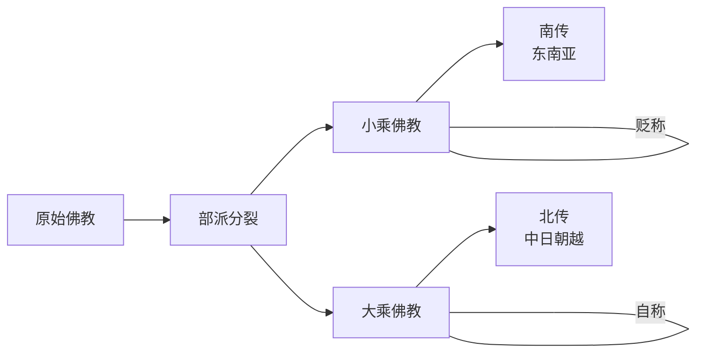

# 大乘佛教与小乘佛教的区别

## 从“渡己”到“渡人”：两条不同的修行道路

佛教在释迦牟尼涅槃后，因对教义理解与实践目标的分歧，逐步分化出两大体系。要理解二者的区别，不妨先问一个问题：**修行，到底是为了自己离开苦海，还是为了让所有人都离开苦海？** 对这个问题的不同回答，正是大乘与小乘的分水岭。

### 核心区别

“乘”（shèng）本义是运载工具，佛教用它比喻能将人从生死此岸渡到涅槃彼岸的“船”。小乘，是初始的、传统的教派，侧重==自我解脱==，犹如只能运载少数人的小船；大乘则认为自己是能把==一切众生==救出苦海运往幸福彼岸的“大船”。

| 维度 | 大乘佛教 | 小乘佛教 |
|------|----------|----------|
| 修行目标 | ==普度众生==，自利利他 | ==自我解脱==，证阿罗汉果 |
| 佛的观念 | 过去、现在、未来及十方世界有无数佛，释迦牟尼只是其一 | 只尊释迦牟尼佛，强调其历史性 |
| 修行者理想 | 菩萨——觉悟有情，不舍众生 | 阿罗汉——断尽烦恼，不受后有 |
| 经典语言 | 梵文系统（后译汉、藏） | 巴利文系统 |
| 传播路径 | ==北传佛教==：中国、日本、朝鲜半岛、越南 | ==南传佛教==：东南亚各国（斯里兰卡、缅甸、泰国等） |
| 教义侧重 | 空性、菩萨道、六度万行 | 四圣谛、八正道、缘起法 |

### “小乘”这个名号从何而来？

>[!IMPORTANT]
> 小乘佛教是原始佛教与部派佛教的延续，并非自称，而是==大乘佛教对其的贬称==。小乘派内部自称为“上座部佛教”（意为长老传承的正统教派）。

大乘兴起后，批评早期部派只讲自我解脱、不讲普度众生，“犹如只能运载少数人的小船”，故称之为“小乘”。这一称谓带有明显的教派立场，现代学术界与宗教对话中更倾向于使用“上座部佛教”这一中性表述。但在《中国文化概论》的考试语境中，==“小乘佛教”仍是标准术语==。

### 佛的数量：一个关键分歧

为什么大乘认为人人都能成佛？因为它主张==佛有无数个==——过去有佛、现在有佛、未来还有佛，十方世界处处有佛。释迦牟尼只是娑婆世界的教主，并非唯一的觉悟者。由此推论：既然佛不只一个，那么==一切众生皆具佛性==，只要按照佛教戒律如法修行，理论上人人皆可解脱成佛。

小乘则严格恪守“一佛出世”的传统观念，认为一个世界在同一个时期内只有一位佛，即释迦牟尼佛。修行者的最高果位是阿罗汉，而非成佛。

>[!TIP]
> 记忆口诀：**“大乘大船渡众生，小乘小船渡自己；大乘北传多菩萨，小乘南传尊一佛。”**

### 常见的坑

>[!WARNING]
> **误以为“小乘”是小学生水平、大乘是进阶版。** 实际上小乘保留了更多原始佛教的面貌，在戒律和禅修方法上极为严谨，并非“低级”的佛教。二者是在教义目标和修行理想上的路径差异，不是简单的高低之分。

>[!CAUTION]
> **混淆传播区域与时间先后。** 小乘在时间上更早，但它流传至今的主要区域是东南亚（南传）；大乘虽晚出，却通过丝绸之路与海路传入中国、朝鲜半岛、日本、越南（北传）。不要因为中国流行大乘就认为大乘更早。

### 一个“算对了”的例子

以考试中的名词解释题“大乘佛教”为例，规范作答应包含三层信息：

> 大乘佛教是从基本教义和理论层面对佛教的划分之一。它认为自己是能把一切众生救出苦海运往幸福彼岸的“大乘”，主张过去、现在、未来及十方世界有无数佛，释迦牟尼佛只是其中之一；只要按照佛教戒律修行，就可以解脱成佛。后流行于中国、日本、朝鲜半岛、越南等地，属北传佛教。

作答时若只写“大乘主张普度众生”，信息量不足，缺失了佛的观念与传播区域两个得分点。小乘佛教的名词解释同理，需涵盖：==初始与传统==、==只讲自我解脱==、==“小乘”系贬称==、==流行东南亚==、==南传佛教==。

### 一句话总结

大乘与小乘的根本分野，不在戒律松紧或修行难易，而在修行目标的格局：**一个以自渡为足，一个以渡尽众生为期。** 这个格局差异，直接塑造了北传与南传佛教截然不同的精神气质与文化面貌。
