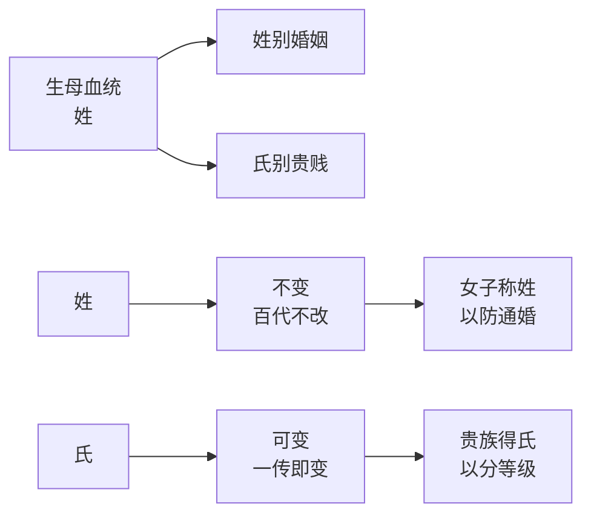

# 姓与氏的区别及合流

## 姓与氏的区别及合流

在阅读先秦典籍时，你可能会遇到一个困惑：为什么同一个人有时被叫“公子小白”，有时又被叫“齐小白”？这背后的核心，正是“姓”与“氏”的分离。

### 姓与氏：两条不同的血脉线索

在母系氏族社会，人们只知其母，不知其父。为了区分不同的母系血统，便产生了“姓”。

> [!IMPORTANT]
> ==姓代表母系血统，氏代表氏族分支；姓是不变的，氏是可变的；姓区别血统，氏区别子孙。==

随着社会发展，子孙繁衍分裂出不同的部落，于是从“姓”中分化出“氏”。进入夏商周，氏除了区分分支，更带上了浓厚的==阶级色彩==——只有贵族才有氏，氏往往由统治者赐封，用以“明贵贱”。

而姓的作用则转向“别婚姻”。周代严格执行“同姓不婚”，女子必须用姓来标明血统。女子未嫁时通常以排行相称（伯/孟仲叔季），如“孟姜”即姜家大女儿。

### 姓氏的合流

为什么今天我们只说“姓氏”而不分家？进入封建大一统社会后，原有的宗法制崩坏，明贵贱的氏和别婚姻的姓功能弱化。到了==秦汉时期==，二者完成合流，混为一谈。司马迁在《史记》中写“姓某氏”，已经完全不区分了。

### 女子称谓：“孟姜女”到底姓什么？

这是一个常见的坑。理解了上面的道理，你就不会说孟姜女姓“孟”了。

*   **未嫁称排行+姓：** 如孟姜、仲姬。
*   **出嫁后的称谓极其灵活，常见几种情况：**
    *   用母国国名+姓：来自褒国的姒姓女子，叫**褒姒**。
    *   用夫国国名+姓：嫁到卫国的姜姓女子，叫**卫姜**。
    *   用夫君谥号+姓：卫庄公之妻姜氏死后叫**庄姜**。

> [!WARNING]
> “孟姜女”不是姓孟名姜女，而是==姜姓长女==的意思。同样，成语“秦晋之好”能世代通婚，是因为**秦为嬴姓，晋为姬姓**，符合“同姓不婚”；而晋、鲁同为姬姓则不可通婚。

### 例子：韩愈为什么自称“昌黎韩愈”

理解姓氏合流后，再看一个延伸概念——**郡望**。

韩愈实际是河阳（今河南孟州）人，却自称“昌黎人”。这并不是他搞错了籍贯，而是反映了封建社会的郡望意识。

> [!NOTE]
> **郡望**：指某一姓氏世居某郡并为世人所仰望，实际代表该姓氏的社会影响力与门第高下。

昌黎（今属河北）是韩姓最有名的郡望，所以韩愈用来抬高门第，时人也尊称他为“韩昌黎”。这就好比王家都爱标榜“太原王”，刘家爱说“彭城刘”。

常见郡望速查表：

| 姓氏 | 郡望 | 示例称呼 |
| :--- | :--- | :--- |
| 韩 | 昌黎 / 南阳 | 韩昌黎 |
| 王 | 太原 | 太原王 |
| 刘 | 彭城 | 彭城刘 |
| 陈 | 颍川 | 颍川陈 |

> [!TIP]
> **记忆线索**：姓是从母亲肚子里带来的“出厂设定”，氏是长大后因封地、官职获得的“社会头衔”。秦汉以后人人平等（相对而言），头衔和出身就不再严格区分了。
