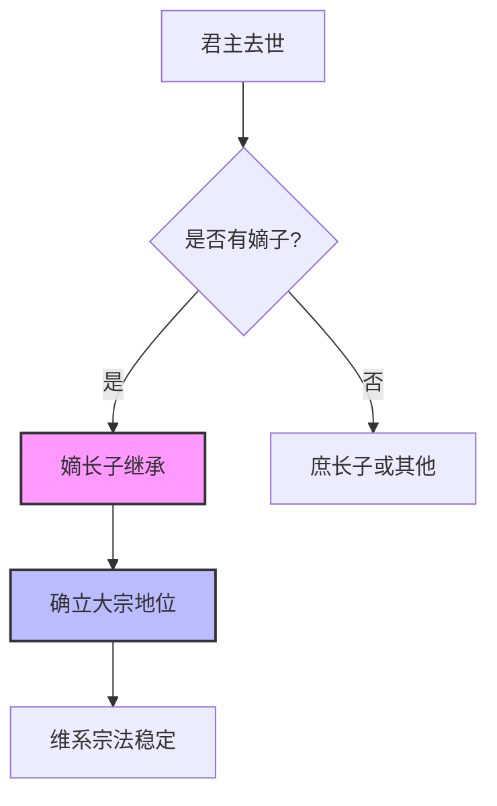

# 嫡长子继承制与宗法制度

## 嫡长子继承制

在君主专制时代，最高权力具有排他性（一人占有），但君主的子嗣往往众多。如何避免诸子争位引发的政治动荡？==嫡长子继承制==便是为解决这一核心矛盾而确立的制度。

> [!IMPORTANT]
> 核心定义：正妻（嫡）所生的第一个儿子（长子）拥有优先继承权。其原则可概括为“立嫡以长不以贤，立子以贵不以长”。

该制度并非孤立存在，而是深深植根于==商末周初形成的宗法制与分封制==之中。它通过血缘关系的亲疏远近，构建了严格的等级秩序，确保了权力交接的稳定性与可预期性。

## 为什么需要它？

想象一下，如果继承标准是“贤能”或“喜爱”，会发生什么？
1. **主观性强**：谁更“贤”？谁更受宠？缺乏客观标准，易引发兄弟阋墙。
2. **政局动荡**：每次权力更迭都可能伴随血腥政变。

嫡长子继承制虽然未必能选出最有能力的统治者，但它提供了一个==清晰、无争议的身份标识==（出生顺序+母亲身份）。这种“程序正义”极大地降低了统治集团内部的摩擦成本，是维护封建社会超稳定结构的关键基石。

## 与相近概念的区别

| 概念 | 核心依据 | 特点 |
| :--- | :--- | :--- |
| **嫡长子继承制** | 血缘+出身（嫡/庶，长/幼） | 严格、客观、重身份 |
| **禅让制** | 德行+能力 | 理想化、非世袭、重贤能 |
| **兄终弟及** | 同辈兄弟间传承 | 商代常见，易致辈分混乱 |

> [!WARNING]
> 常见误区：认为“长子”就是所有儿子里最大的。
> **纠正**：必须是==正妻==所生的长子。若正妻无子，才考虑庶子中的长者。妾室所生的儿子即使年龄最大，也无优先权。

## 典型案例分析

以唐代韩愈为例，虽其实际籍贯为河阳，但他常自称“昌黎人”。这看似与继承制无关，实则同源——都源于对==宗法血缘与门第郡望==的重视。

在宗法体系下，不仅皇位继承讲究嫡庶，士族阶层也通过“郡望”来标榜自己的高贵血统（如“太原王”、“琅琊颜”）。韩愈自称昌黎人，是因为昌黎是韩姓的著名郡望。这种对出身的强调，正是宗法制度在社会心理层面的投射。

> [!TIP]
> 记忆口诀：**嫡出优先，长者优先；身份既定，争端自息。**

理解嫡长子继承制，不仅要看到其在皇室权力交接中的作用，更要理解它作为宗法制的核心，如何影响了中国古代社会的家族结构、伦理观念乃至选官制度（如后来的九品中正制看重门第，亦是宗法精神的延续）。
