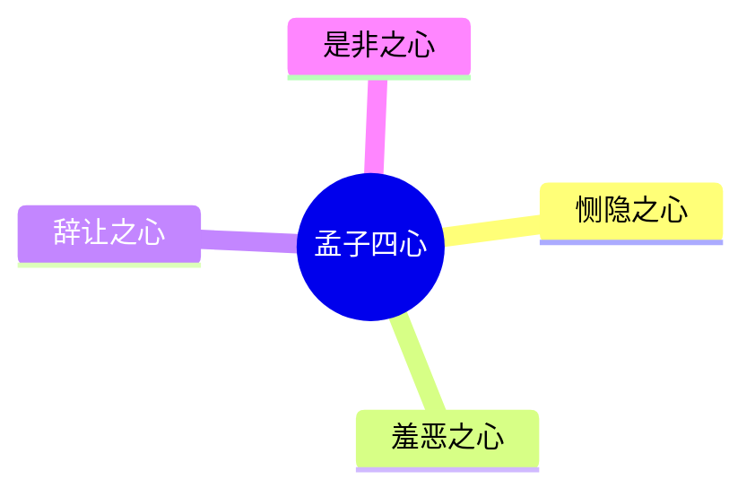

# 孟子思想（性善论、仁政、民贵君轻）

孟子思想是孔子之后儒家学派的重大发展，核心围绕==性善论==、道德修养与“仁义”并举展开。

> [!IMPORTANT]
> 考试常考简答题：“简述孟子的思想及他在孔子‘杀身成仁’基础上提出了什么？”答题必须踩准三个得分点：性善与良知、养浩然之气、舍生取义。

## 性善论与良知良能

人天生就是善良的吗？如果不是，为什么看到小孩快掉进井里会本能地害怕？

孟子认为人性本善，这种善表现为人与生俱来的“四心”，即良知良能：

既然性善，为何世上还有恶人？孟子指出，这是因为人不去培养和扩充自己的“善端”。因此他提出主观精神修养的方法——==养浩然之气==，最终达到“富贵不能淫，贫贱不能移，威武不能屈”的境界。

## 仁政与民贵君轻

孔子的核心是“仁”，孟子将其向外推演为政治主张“仁政”。仁政的哲学基础正是性善论：君王有不忍人之心，才能行不忍人之政。在君民关系上，孟子明确提出“民为贵，社稷次之，君为轻”（民贵君轻），将民众地位置于君主之上。

## 仁义并举与舍生取义

如果“仁”是内心的爱，那遇到利益冲突时该按什么标准行动？

孟子在“仁学”理论中补充了“义”。正如他所言：“仁，人心也；义，人路也。舍其路而弗由，放其心而不知求。”在孔子“杀身成仁”的基础上，他又提出了==舍生取义==，使儒家道德观更加完备。

| 比较维度 | 孔子主张 | 孟子发展 |
| :--- | :--- | :--- |
| **核心概念** | 仁 | 仁 + 义 |
| **最高境界** | 杀身成仁 | 舍生取义 |
| **内在依据** | 克己复礼 | 性善论 / 良知良能 |
| **政治主张** | 德治 | 仁政 / 民贵君轻 |

> [!NOTE]
> 王阳明心学中的“良知”“良能”概念，正是直接溯源至孟子的性善论。王阳明认为万事万物之理都在心中即“知”，内心代表真理的“知”即“良知”，表现于行动即“良能”。

## 常见易错坑

> [!WARNING]
> 不要把孟子的“性善论”和荀子的“性恶论”记混。孟子主张性善，强调向内扩充善端；荀子主张性恶，强调向外用“礼”来规范和化性起伪。

> [!CAUTION]
> 答“舍生取义”时，切忌漏掉前提！必须先写“在孔子‘杀身成仁’的基础上”，再写“孟子提出了舍生取义，使儒家道德观更加完备”，这是课件原文的逻辑链。

## 真题实战解析

**题目**：简述孟子的思想及孟子在孔子“杀身成仁”的基础上，提出了什么。

**满分作答逻辑拆解**：

1. **点明核心**：孟子思想的核心是主张“性善”和“良知”。人有恻隐、羞恶、辞让、是非“四心”，是与生俱来的良知良能。
2. **修养方法**：不善是因为不扩充善端，故需重视主观修养，提出“养浩然之气”，达到“富贵不能淫，贫贱不能移，威武不能屈”的境界。
3. **补充仁义**：在仁学中补充“义”，仁是发自内心之爱，义是为人之道。
4. **扣题结论**：在孔子“杀身成仁”的基础上，提出了==舍生取义==，使儒家道德观更加完备。

> [!TIP]
> 背诵口诀：“**一善二气三仁义**”——一个核心（性善/良知）、一种修养（浩然之气）、一套理论（仁心义路、舍生取义）。
