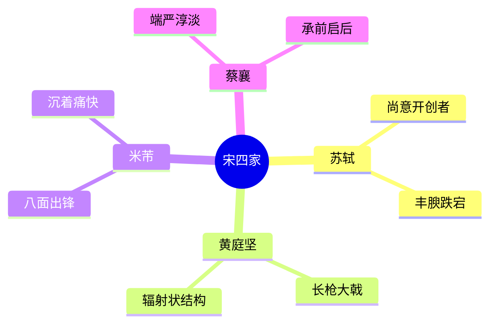

# 宋代书法四大家（苏轼、黄庭坚、米芾、蔡襄）

# 宋代书法四大家（苏轼、黄庭坚、米芾、蔡襄）

## 它是什么与历史定位

“宋四家”指北宋时期四位最具代表性的书法家：**苏轼、黄庭坚、米芾、蔡襄**。他们打破了唐代“尚法”（注重法度严谨）的传统，开创了**==尚意==**书风，即强调个人情感、学识修养的自然流露，追求“我书意造本无法”的艺术境界。

> [!IMPORTANT]
> 核心考点：宋四家的核心特征是**“尚意”**，区别于唐代的“尚法”。

## 为什么需要关注“宋四家”

在《中国文化概论》中，书法不仅是技艺，更是文人精神的载体。理解宋四家，关键在于理解宋代文人**“学问文章之气”**郁郁芊芊发于笔墨之间的审美转向。若只记名字而不解其“意”，便无法应对论述题中关于“宋代文化精神”的提问。

## 怎么做：风格辨析与记忆

如何区分四家风格？请观察以下对比：

| 人物 | 风格关键词 | 笔法特征 | 代表作品 |
| :--- | :--- | :--- | :--- |
| **苏轼** | 丰腴跌宕 | 侧锋多，字形扁方，如“石压蛤蟆” | 《寒食帖》 |
| **黄庭坚** | 长枪大戟 | 中宫收紧，四肢舒展，撇捺夸张 | 《松风阁诗帖》 |
| **米芾** | 八面出锋 | 笔势跳跃，变化丰富，如“风樯阵马” | 《蜀素帖》 |
| **蔡襄** | 端严淳淡 | 楷行兼善，法度严谨，保留唐风 | 《自书谢表并诗》 |

> [!TIP]
> 记忆口诀：**苏肥黄瘦米癫蔡稳**。苏轼字胖（丰腴），黄庭坚字瘦长（辐射），米芾性格癫狂（刷字），蔡襄风格稳健（正统）。

## 常见的坑与易错点

> [!WARNING]
> **蔡京还是蔡襄？**
> 历史上原指“蔡京”，但因蔡京为人奸佞，后世将其剔除，换为德高望重的**蔡襄**。考试中若问“宋四家”原始说法或道德评价，需注意此变迁，但标准答案通常为**蔡襄**。

> [!CAUTION]
> **勿混淆“尚意”与“无法”**
> “尚意”并非真的没有法度，而是不被法度束缚。苏轼言“我书意造本无法”，实则是“出新意于法度之中”。

## 算对了的例子（真题演练）

**题目**：简述苏轼《寒食帖》为何被称为“天下第三行书”，并分析其体现的宋代书法特征。

**解析思路**：
1.  **定位**：《寒食帖》是苏轼被贬黄州时所作，情感悲凉。
2.  **特征对应**：
    *   **尚意**：字迹随情绪波动，前缓后急，涂改自然，不拘泥于工整。
    *   **技法**：用笔丰腴，结体扁斜，体现“石压蛤蟆”之态，却显天真烂漫。
3.  **结论**：它完美诠释了宋代书法**==重神轻形、抒情写意==**的美学追求，故地位极高。

通过此例可见，答题时需将**具体作品**与**时代精神（尚意）**挂钩，方能得分。
