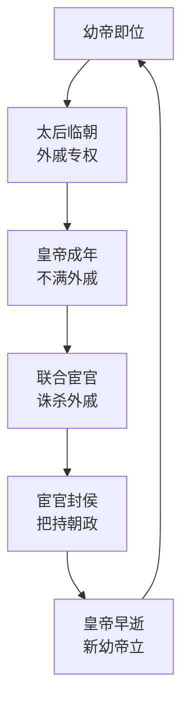

# 宦官专权集中的朝代（东汉、唐、明）

## 宦官专权集中的朝代（东汉、唐、明）

先看一个问题：同样是一群被隔绝在宫墙之内的服务人员，为什么在大多数朝代，宦官不过是皇帝的“家奴”，而偏偏在东汉、唐代和明代，他们能掀起滔天巨浪，甚至决定皇帝的废立？

答案在于：==宦官专权的本质是皇权膨胀的畸形产物==。当皇帝不再信任外朝的官僚系统，转而将权力私相授受给身边最亲近的宦官时，专权的土壤就形成了。以下三个朝代，恰好都具备了某种“权力断裂”的契机。

### 东汉：外戚与宦官的“跷跷板”

东汉中后期的政局有一个死循环：皇帝大多年幼即位，由太后临朝，太后又依赖自己的娘家人——外戚掌权。等到小皇帝长大，环顾四周，满朝文武竟全是外戚党羽，唯一能说上话、信得过的，只剩从小伺候自己的宦官。

于是，皇帝联合宦官发动政变，铲除外戚，宦官因功封侯，权倾朝野。接下来皇帝早逝，新幼帝即位，新的外戚上台又要把宦官打压下去。

这就像一架跷跷板，==皇权在中间，外戚和宦官来回坐，而整个东汉就在这循环中走向崩溃==。

> [!IMPORTANT]
> 东汉宦官专权的核心特征是依赖皇权生存，一旦皇帝死亡，他们便立刻被新的外戚势力清算。他们是皇权的临时替身，而非独立力量。

### 唐代：从“家奴”到“废立皇帝”

唐代的宦官专权走出了完全不同的路子。安史之乱后，皇帝不再信任地方节度使，也猜忌朝中宰相，便让宦官执掌**禁军**（神策军）并担任**枢密使**，从而掌握了中央军权和机要决策权。

这步棋一走出去，局面就彻底失控了。手握刀把子的宦官，不再仅仅是皇权的寄生者，而变成能决定皇位归属的实际主宰。唐代后期，穆宗、文宗、武宗、宣宗等多位皇帝都由宦官拥立，顺我者昌，逆我者亡。

> [!WARNING]
> 东汉宦官靠“宫变辅佐”获取权力，本质仍是皇权的附庸；而唐代宦官靠“军权+机要权”形成独立势力，==可以反过来压制甚至废立皇帝==，这是一个质的飞跃。

### 明代：批红权与厂卫的“站着的阁老”

明代开国皇帝朱元璋定下祖制，严禁宦官干政。怎料明成祖朱棣靠“靖难之役”夺位时宦官有功劳，从此开了口子。到明宣宗以后，皇帝批阅奏章的决策流程被宦官截断了：内阁大学士只能票拟（写个处理意见草稿），最终的批红权（用红笔签署最终执行令）落到了司礼监掌印太监手里。

这就意味着，==司礼监太监在决策环节中实际成了“立皇帝”，而内阁首辅反而成了“坐皇帝”面前跑腿的==。更要命的是，明代宦官还控制着**东厂、西厂**这样的特务机构，对反对的文官集团进行残酷打击。

> [!CAUTION]
> 一个常见误区是把明代宦官当成只会贪污的小丑。实际上，像王振、刘瑾、魏忠贤这批人，都是在行使“代皇帝决策”的权力。他们的本质，是皇帝从正式官僚系统中将决策权剥离，装进了一个私人秘书班子，而这个班子最后反噬了整个官僚系统。

### 一张表看清三个朝代的区别

| 朝代 | 权力来源 | 权力根基 | 与皇权关系 |
| :--- | :--- | :--- | :--- |
| **东汉** | 皇帝对幼年即有情分的“功臣”封赏 | 无独立军权 | 皇权附庸，被清算 |
| **唐代** | 掌握禁军（神策军）、机要权（枢密使） | 独立军事力量 | ==压制皇权，可废立== |
| **明代** | 行使决策的批复权（批红）、特务侦查权（厂卫） | 制度性代行皇权 | ==寄生制度，代替决策== |

> [!TIP]
> 记忆口诀：“**汉凭宫变，唐靠枪杆，明握笔杆**”。东汉是间歇式爆发，唐代是武力硬控，明代则是借助制度堂堂正正地坐在了决策席上。
