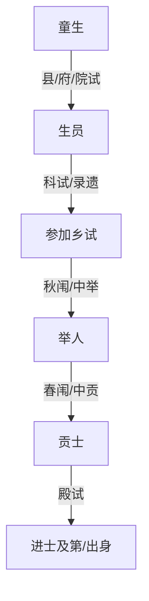

# 封建社会教育政策（尊孔读经、科举取士）

## 封建社会教育政策：尊孔读经与科举取士

在长达两千年的中国封建社会中，教育制度始终服务于一个核心目标：为大一统的专制王朝培养合格的治理人才。这个目标的实现，主要依靠两大支柱——**尊孔读经**的教育内容，与**科举取士**的选拔机制。

### 一、为什么是“尊孔读经”？

要理解封建教育的内容，不妨先想一个问题：一个疆域辽阔、人口众多的帝国，最高统治者最担心什么？

除了外敌入侵，恐怕就是内部的动乱与思想的多元。因此，最高效的统治策略，就是从思想源头入手，让未来可能进入统治阶层的读书人都接受同一套价值观。汉武帝采纳董仲舒“罢黜百家，独尊儒术”的建议，正是这一逻辑的开端。

这套价值观的核心，就是以孔子为代表的儒家学说，其载体便是儒家经典（“五经”：《诗》《书》《礼》《易》《春秋》）。自此，**尊孔读经**成为历代官学教育的核心内容。

> [!IMPORTANT]
> 封建社会的教育政策，表面上是“独尊儒术”，但其统治内核却是“外儒内法”——以儒家的礼教伦理为表，以法家的权术法令为里。儒家提供了“忠孝仁义”的道德外衣，而法家思想则成为后世封建统治者维护集权统治的理论基石。

### 二、教育制度如何落地——以太学为例

确立了“独尊儒术”的国策后，就需要一个官方的教育机构来推行它。

> [!NOTE]
> 汉代太学是中国封建社会最早的官方最高学府。汉武帝下令在京师设立太学，并以精通“五经”的学者担任教官，称为“**五经博士**”。学生们在此研习儒家经典，优秀的毕业生可获得入仕资格。

这标志着，读经开始与做官直接挂钩，形成了初步的学政一体化。

### 三、选拔机制如何定型——以明清科举为例

如果说太学解决了“怎么教”的问题，那么科举制度就解决了“怎么考、怎么选”的问题。至明清时期，科举考试已发展为一套精密而严格的“人才筛选流水线”。

我们先来了解这条流水线上最关键的两个环节：

- **乡试（秋闱）**：每三年在各省省城举行，因在秋季举行而得名。考中者称“举人”，即具备了做官的资格，也是参加更高一级考试的入场券。
- **会试与殿试（春闱）**：乡试后的次年春天，各省举人汇聚京师参加会试，考中者称“贡士”。随后再参加皇帝亲自主持的殿试，最终划出名次。

这套流程看似公平，为许多寒门子弟提供了上升通道。但其**常见的陷阱**也极为明显：

> [!WARNING]
> **思想禁锢**：明清科举考试内容被严格限定在“四书五经”之内，且答题形式必须采用“八股文”。这导致天下读书人皓首穷经，思想日益僵化，只知代圣贤立言，毫无创新精神，这也是近代中国文化落后的重要原因之一。

从汉代的太学五经博士，到明清森严的秋闱春闱，**尊孔读经**的内容与**科举取士**的形式紧密结合，共同构成了封建社会教育的核心。它成功地为帝国培养了大量文化认同感极强的管理者，但也以牺牲思想的创造力为代价，最终在近代化的浪潮中走向终结。
