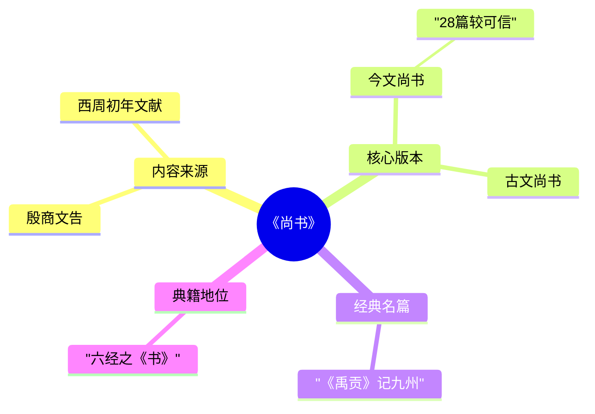

# 《尚书》的体例与价值

《尚书》究竟是一部怎样的书？如果穿越回殷商或西周初年，你想了解当时的国家大事、君王政令，该去哪里查阅档案？答案正是这部典籍。

## 它是什么与为什么需要

> [!IMPORTANT]
> 《尚书》是==我国最早的一部历史文献汇编==，主要收录殷商和西周初年的王室文告、命令以及王公大臣的谈话等。

先秦时期没有现代意义上的“史书”，国家治理依靠口耳相传与简牍记录。为了保存历代先王的治国经验与政治训诫，后人将这些珍贵的官方档案汇编成册，这便是《尚书》（“尚”即“上”，意为上古之书）。它在儒家体系中地位极高，是孔子删订并向弟子讲授的教材之一，属于==“六经”（《诗》《书》《礼》《乐》《易》《春秋》）中的“《书》”==。

## 体例、内容与版本辨析

现存《尚书》共 58 篇，其文词古奥难懂，但其中不乏生动的比喻和描写。在流传过程中，它分化出了两个关键版本：

| 对比维度 | 《今文尚书》 | 《古文尚书》 |
| :--- | :--- | :--- |
| **文字载体** | 汉代通行隶书记录 | 先秦古文字（如蝌蚪文） |
| **篇目数量** | ==28 篇== | 包含多出的篇章 |
| **可信程度** | 比较可信 | 部分被后世疑为伪作 |

> [!TIP]
> 记忆口诀：“今二八，最可信；属六经，称《书》也。”考试若问“六经”指什么，务必答全六部著作，并点明它们又称“六艺”。

## 经典应用：《尚书·禹贡》九州

《尚书》不仅是政治档案，还蕴含丰富的地理知识。其中的《禹贡》篇将天下划分为“九州”，这是中国古代极具代表性的地理区划观念。

> [!NOTE]
> 《尚书·禹贡》记载的九州具体为：==冀、豫、青、徐、荆、扬、兖、雍、梁==。这九个州名常作为填空题或选择题考点出现。

## 常见坑与答题示例

> [!WARNING]
> 极易混淆的坑：不要把《尚书》和《春秋》搞混。《尚书》是“历史文献汇编”（侧重原始档案），而《春秋》是鲁国的“编年体史书”（侧重按年月记事）。

> [!CAUTION]
> 回答“六经”时，千万不要漏掉《乐》（虽然后世失传，但在先秦概念中必须存在），也不要写成后世的“五经”。

下面看一道典型考题的规范作答：

**题目**：简述《尚书》的性质及版本情况。

**正确解答思路**：
1. **定性**：指出它是我国最早的历史文献汇编，内容为殷商和西周初年的王室文告等。
2. **定量与定版**：说明现存 58 篇，分为《今文尚书》和《古文尚书》，强调 28 篇《今文尚书》比较可信。

这样既踩准了“最早”“文献汇编”“今古文之分”“28 篇”这几个得分关键词，又逻辑清晰，不会遗漏要点。
