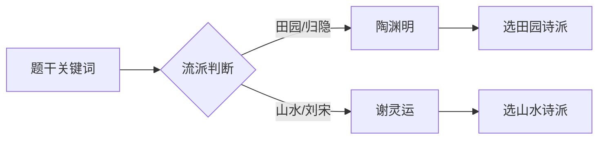

# 山水诗派（谢灵运）

## 山水诗派是什么

> [!IMPORTANT]
> ==谢灵运是“山水诗派”的开创者==，而非陶渊明。

当我们谈论魏晋南北朝诗歌时，常将“田园”与“山水”并提，但二者实则分属不同流派。如果说陶渊明在《归园田居》中构建的是心灵栖居的农耕世界，那么谁第一次将自然山水本身作为独立的审美对象写入诗中？正是南朝刘宋时期的谢灵运（385–433年）。他纵情于会稽、永嘉、庐山等地，通过精细刻画山水风光的艺术魅力，正式开辟了我国诗歌史上的“山水诗派”。

## 为什么需要区分两派

复习时最容易混淆的就是两位奠基人。为何教材特意将二人并列却又严格区分？因为他们的创作动机与审美取向截然不同：

| 比较维度 | 田园诗派（陶渊明） | 山水诗派（谢灵运） |
| :--- | :--- | :--- |
| **核心对象** | 农村生活、躬耕体验 | 自然山川、奇景胜境 |
| **情感寄托** | 归隐之志、人格理想 | 审美愉悦、玄理感悟 |
| **艺术手法** | 质朴自然、白描为主 | 精雕细琢、富丽精工 |
| **代表作品** | 《饮酒》《桃花源诗》 | 《登池上楼》《石门岩上宿》 |

> [!WARNING]
> 切勿因“山水田园诗”这一后世合称，误认为谢灵运也写田园诗，或陶渊明开创了山水诗派。==考试只认“陶-田园”“谢-山水”的对应关系==。

## 如何准确掌握该知识点

面对此类考题，可按以下逻辑链快速定位答案：

以课件原题为例：“了解开辟我国诗歌史上‘田园诗派’‘山水诗派’的诗人陶渊明、谢灵运。”题目虽将二人同列，但参考答案明确拆解为“陶渊明开创田园诗派，谢灵运开创山水诗派”。答题时必须分别对应，不可笼统作答。

> [!TIP]
> 记忆口诀：==“陶田谢山”==——陶渊明种豆南山下（田园），谢灵运登楼观池水（山水）。

## 常见误区与辨析

> [!CAUTION]
> 谢灵运的山水诗≠后世王维式的“诗中有画”。他的诗仍带玄言尾巴，重形似而轻神韵，这是早期山水诗的阶段性特征，勿以后世标准倒推。

此外，需注意时代限定：谢灵运活跃于==南朝刘宋时期==，非东晋亦非唐代。若选项中出现“东晋谢灵运”或“唐代山水诗派开创者”，均为干扰项。其代表作《登池上楼》中“池塘生春草，园柳变鸣禽”一句，正是从玄言向纯山水过渡的典型例证，既写景又暗含时序流转之感，体现了他对山水风光的“非凡感受”。

> [!NOTE]
> 虽然谢灵运被尊为山水诗派鼻祖，但其诗风对后世影响复杂；考试中只需牢固掌握“开创者+朝代+代表作”三要素即可应对绝大多数题目。
