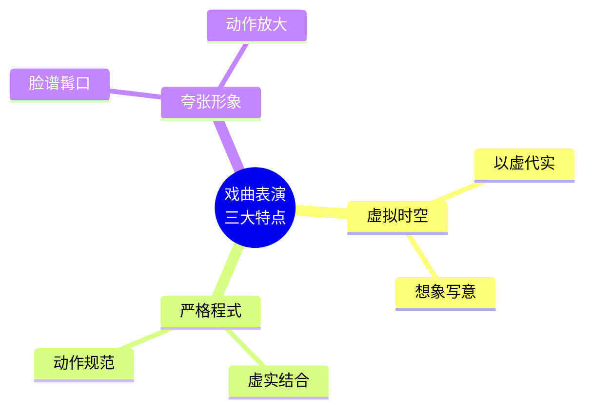

# 中国戏曲表演艺术的特点（虚拟时空、严格程式、夸张形象）

> [!IMPORTANT]
> 中国戏曲表演艺术的三大特点：==虚拟时空、严格程式、夸张形象==。这是论述题高频考点（P342—344），需结合具体剧目举例作答。

## 它是什么与为什么需要

先想一个问题：西方话剧要在舞台上搭出真实的房间、摆上真花真树，但中国古代戏班往往只有一个简陋的台子，怎么演千军万马？怎么演翻山越岭？

答案就是**以虚代实**。戏曲不追求物理上的“像”，而追求艺术上的“意”。这三大特点共同构成了中国戏曲区别于世界其他戏剧体系的根本标志。

## 怎么做：三大特点详解

### 虚拟时空

没有固定的布景环境，时间和空间完全自由灵活，靠演员的“唱”或“念”来交代，靠观众的想象来完成。

*   **转换时空**：不用拉幕换景，剧中人在舞台上走一个圆场就算展开了新环境。例如主帅喊一声“发兵前往”，将士转一圈再喊“人马列开”，十万大兵的长途行军就结束了。
*   **平行时空**：闽剧《拜月亭》中四人逃难失散，在台上边唱边走“O”字形，彼此视而不见、听而不闻，观众却能完全理解。这种高度简练、泼墨写意式的虚拟手法是戏曲最大特点。

### 严格程式

> [!NOTE]
> 虚拟不等于随意。戏曲讲究“虚实结合，虚中有实”，虚拟的表演必须依据生活原型并加以规范，这就是**程式**。

*   **动作规范**：开门关门虽只做动作，但在什么地方关，就必须在什么地方开；上楼迈几步，下楼也必须迈几步。
*   **调度规范**：千军万马的调度，走一个圆场即可，但这“圆场”本身就是一种严格的程式结构。

### 夸张形象

一切艺术都有夸张，但戏曲的夸张集中在**视觉形象**和**表演动作**上。

*   **脸谱**：极度夸张且具规定性。红脸忠义宽厚，黑脸正直严肃，白脸奸诈多疑，丑角滑稽可笑。
*   **髯口**：假胡须分三、满、扎三类，长达一尺，不仅表年龄，更用于“捋髯”“甩髯”“撕髯”等表达情绪的艺术表演。
*   **动作**：舞台上的哭笑不是生活中的号啕大笑，《白蛇传》小青杀许仙也不用真杀。

## 和相近概念的区别

| 比较维度 | 中国戏曲 | 西方话剧 |
| :--- | :--- | :--- |
| **时空处理** | ==虚拟时空==，无固定布景，自由灵活 | 真实再现，依赖实体布景与灯光 |
| **表演依据** | 严格程式，以虚代实，写意为主 | 体验生活，模仿现实，写实为主 |
| **人物造型** | 夸张形象，脸谱化、符号化 | 贴近生活真实面貌 |

> [!TIP]
> 答题记忆口诀：“**虚时严程夸形**”。遇到论述题，务必按照“特点定义 + 课件原例”的结构展开，如答“虚拟时空”必举《打渔杀家》或“走圆场”的例子。

## 常见的坑

> [!WARNING]
> 1. **把“虚拟”等同于“随便”**：虚拟时空必须以“严格程式”为基础，开关门的位置、上下楼的步数绝不能错。
> 2. **认为脸谱颜色可以乱涂**：夸张形象具有“规定性”，各个人物必须按谱式勾画，不能随意发挥。
> 3. **只答干条条不给例子**：作为论述题，若只写“虚拟时空、严格程式、夸张形象”九个字拿不到高分，必须结合《打渔杀家》《拜月亭》或脸谱颜色的具体例子进行论述。
