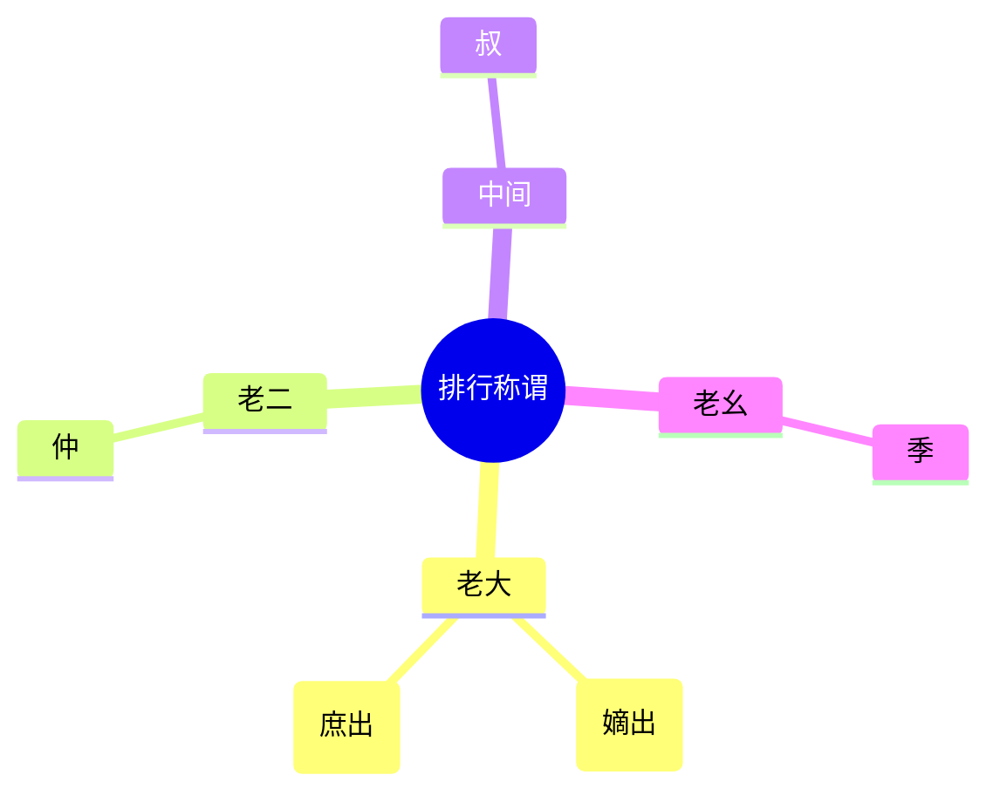

# 排行称谓（伯仲叔季等）

# 排行称谓（伯仲叔季）

在宗法制度下，长幼有序是维护家族稳定的核心。古人如何精准标识兄弟间的长幼顺序？这就引入了==排行称谓==系统。

## 它是什么：嫡庶与长幼的编码

古代男子成年取“字”时，常将排行嵌入其中。基本序列为：**伯（孟）、仲、叔、季**。

- **伯/孟**：老大。嫡长子称“伯”，庶长子称“孟”。
- **仲**：老二。
- **叔**：老三及以后的中间序列。
- **季**：最小的弟弟。

> [!IMPORTANT]
> ==核心区别==：“伯”与“孟”均指老大，但严格区分**嫡庶**。嫡妻所生长子为“伯”，妾室所生长子为“孟”。若不分嫡庶或庶出为主，常统称“孟”。

## 为什么需要：别婚姻与定尊卑

排行不仅用于家庭内部称呼，更承担社会功能：

1.  **同姓不婚**：周代严格实行此制。女子称呼需冠以排行+姓（如孟姜、仲姬），以此标明血统，避免近亲通婚。
2.  **社会定位**：通过“字”中的排行，社交场合可迅速判断对方在家中的地位，决定礼仪规格。

> [!NOTE]
> **女子称谓特例**：
> *   未婚：排行+姓（如**孟姜**=姜家大女儿，非姓孟）。
> *   出嫁：国名+姓（如**齐姜**）或 夫家国名+姓（如**卫姜**）。
> *   死后：谥号+姓（如**庄姜**）。

## 怎么做：从曹操看实战

如何判断古人的排行？直接看其“字”。

**案例解析：曹操**
*   **名**：操
*   **字**：孟德
*   **推导**：“孟”为庶长子或泛指老大。故曹操在兄弟中==排行第一==。

**其他典型例子：**
*   **孔子**：字仲尼 -> “仲”为老二 -> 孔丘排行第二。
*   **刘邦**：字季 -> “季”为最小 -> 刘季即刘小弟（后改名邦）。
*   **欧阳修**：字永叔 -> “叔”为老三或中间序列。

| 人物 | 字 | 排行字根 | 实际排行 | 备注 |
| :--- | :--- | :---: | :---: | :--- |
| 曹操 | 孟德 | 孟 | 老大 | 庶长子或泛指 |
| 孔子 | 仲尼 | 仲 | 老二 | 生于尼山 |
| 孙策 | 伯符 | 伯 | 老大 | 嫡长子 |
| 孙权 | 仲谋 | 仲 | 老二 | 孙策之弟 |

## 常见的坑

> [!WARNING]
> 1.  **误认姓氏**：看到“孟姜女”以为姓孟。实为**姜姓**，排行**孟**（大）。
> 2.  **混淆伯孟**：认为“伯”一定是老大，“孟”是别的。实则二者皆可为老大，关键在**嫡庶**之分。但在后世文学作品中，常混用，“孟”也广泛用于泛指老大（如曹操）。
> 3.  **忽略“季”**：以为只有三个兄弟。若有四子，序列为伯、仲、叔、季；若仅三子，通常为伯、仲、季（叔可省略或泛指中间）。

> [!TIP]
> **记忆口诀**：
> 伯孟老大分嫡庶，仲二叔三季最小。
> 女子称姓别婚姻，孟姜非姜是大姐。
