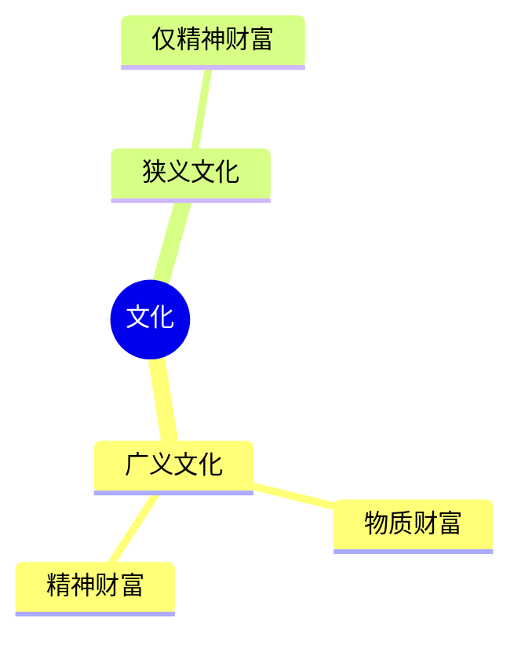

# 文化的定义与广义狭义之分

当你听到“文化”这个词，脑海里浮现的是诗词歌赋，还是高铁手机？如果只想到前者，你就把文化“看小了”。那么，到底什么才算完整的文化？

## 它是什么

在《中国文化概论》中，“文化”的定义有==广义与狭义之分==。马克思主义理论家罗森塔尔·尤金在《哲学小辞典》中给出了标准解释：

> [!IMPORTANT]
> **广义文化**：人类在社会历史实践过程中所创造的==物质财富和精神财富的总和==。

也就是说，广义文化既包括看得见的器物、建筑（物质），也包括看不见的思想、艺术、制度（精神）。

而狭义文化则排除了物质层面：

> [!NOTE]
> **狭义文化**：从比较狭隘的意义来讲，文化就是在历史上一定的物质资料生产方式的基础上发生和发展的==社会精神生活形式的总和==。

用一张图理清两者的包含关系：

## 为什么需要区分

考试中的名词解释或论述题常要求精准界定概念。如果不分广狭义，答题时容易把范围写错：比如题目问“简述文化的定义”，你只答了精神层面，就会丢掉物质财富那部分的分数。此外，材料题（占 30 分）若给出一段关于古代农具或建筑的史料让你分析，你需要意识到这属于==广义文化==的物质财富范畴，才能准确切入。

## 怎么做：背诵与拆解

面对闭卷考试中 5 分一道的名词解释，直接背诵原话最稳妥。可以按三个层次拆解记忆：

1. **主体**：人类。
2. **途径**：在社会历史实践过程中创造。
3. **结果**：物质财富和精神财富的总和（广义） / 社会精神生活形式的总和（狭义）。

> [!TIP]
> 记忆口诀：“**人类实践造两财，广义全包狭义精**”。即人类通过实践创造了两种财富；广义全包（物质+精神），狭义只取精神。

## 相近概念的区别

很多同学容易把“文化”与“文明”混为一谈。

| 对比维度 | 文化 | 文明 |
| :--- | :--- | :--- |
| **产生时间** | 与人类同生，有人类就有文化 | 较晚出现，通常以文字、城市为标志 |
| **价值判断** | 中性词，无高低优劣之分 | 褒义词，指人类社会的进步状态 |
| **对立面** | 自然（非人造的） | 野蛮（未开化的） |

> [!WARNING]
> 判断题常见陷阱：“文化就是文明”。这是错的！原始部落的图腾崇拜是文化，但通常不被视为文明。

## 常见的坑

> [!CAUTION]
> 默写时极易漏掉定语！“==在社会历史实践过程中所创造的==”和“==在历史上一定的物质资料生产方式的基础上发生和发展的==”这两句长定语是踩分点，省略会导致扣分。

## 算对了的例子

**【模拟真题 · 名词解释】**（5 分）
**题目**：请根据马克思主义理论家的观点，解释“文化”的含义。

**满分作答示范**：
马克思主义理论家罗森塔尔·尤金在《哲学小辞典》中指出：文化是人类在社会历史实践过程中所创造的物质财富和精神财富的总和。（3 分）从比较狭隘的意义来讲，文化就是在历史上一定的物质资料生产方式的基础上发生和发展的社会精神生活形式的总和。（2 分）

**得分解析**：先答广义拿大头，再补狭义保满分。注意两处核心定语一字不落，这就是标准答案的写法。
