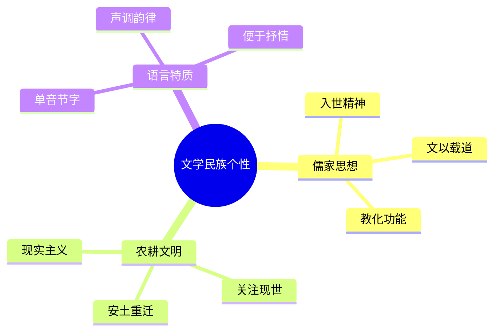

# 中国古代文学创作的民族个性表现

# 中国古代文学创作的民族个性表现

在《中国文化概论》的文学篇章中，理解中国古代文学的“民族个性”是把握其精神内核的关键。这不仅是应对论述题的高频考点，更是理解中国文人精神世界的钥匙。

## 它是什么：三大核心特征

中国古代文学并非孤立存在，而是深深植根于儒家伦理与农耕文明之中。其鲜明的民族个性主要体现在以下三个维度：

> [!IMPORTANT]
> **核心结论**：中国文学的民族个性表现为 ==关注现实人生==、==强调教化功能（文以载道）== 以及 ==强烈的抒情色彩==。

1.  **关注现实和人生**：从《诗经》的“饥者歌其食”到杜甫的“三吏三别”，中国文学自始至终不脱离社会现实，具有伟大的人本主义精神。
2.  **强调教化功能**：主张“文以载道”，文学被视为承载儒家道统、移风易俗的工具，反对空洞无物。
3.  **强烈的抒情色彩**：受含蓄内敛的民族性格影响，文人偏好简洁、回环的语言形式抒发情怀，形成了独特的抒情传统。

## 为什么需要：文化根源解析

为何中国文学会形成这种个性？这与中国的文化土壤密不可分。

*   **儒家主导**：儒家强调社会责任与伦理秩序，使得文学必然承担“经夫妇，成孝敬，厚人伦，美教化”的功能。
*   **思维模式**：不同于西方文学常有的宗教超越性或纯粹形式探索，中国思维更倾向于“天人合一”的现世关怀。

## 怎么做：答题与辨析技巧

在回答相关论述题时，切忌只罗列要点，需结合具体历史背景或作品进行阐释。

| 特征 | 关键词 | 典型代表/表现 |
| :--- | :--- | :--- |
| **现实精神** | 人生、社会、民生 | 《诗经》、杜甫诗歌、白居易新乐府 |
| **教化功能** | 文以载道、道统 | 韩愈古文运动、唐宋八大家散文 |
| **抒情传统** | 含蓄、意境、情景交融 | 唐诗宋词、山水田园诗 |

> [!TIP]
> **记忆口诀**：**一现实，二载道，三抒情**。
> *   **现实**：盯着地面看（关注人生）；
> *   **载道**：背着包袱走（承载道德）；
> *   **抒情**：心里有话不说透（含蓄表达）。

## 常见的坑：概念混淆

> [!WARNING]
> **易错点**：不要将“抒情色彩”等同于“缺乏逻辑”或“只有诗歌”。
> 即使是散文（如《赤壁赋》）甚至小说（如《红楼梦》），也充满了浓郁的抒情意味和诗意境界，这是中国文学区别于西方叙事文学的重要特征。

此外，需注意“文以载道”在不同时期的演变。唐代古文运动是其高峰，但明清时期有时流于僵化，答题时可适当提及这种历史动态，体现深度。

## 算对了的例子：真题演练

**题目**：简述中国古代文学创作的民族个性表现。（P294—295）

**参考解答逻辑**：
1.  **总述**：中国古代文学具有鲜明的民族个性，主要源于儒家文化与农耕文明的影响。
2.  **分述**：
    *   首先，体现为==关注现实和人生的伟大精神==。如《诗经》反映民间疾苦，杜甫诗作记录历史变迁。
    *   其次，自古强调==教化功能==，主张“文以载道”。如韩愈发起古文运动，旨在恢复儒家道统，反对形式主义。
    *   最后，具有==强烈的抒情色彩==。文人多用含蓄、简洁的语言抒发情怀，如唐诗宋词的意境营造，形成了独特的抒情传统。
3.  **总结**：这三者共同构成了中国文学区别于其他民族文学的独特风貌。
