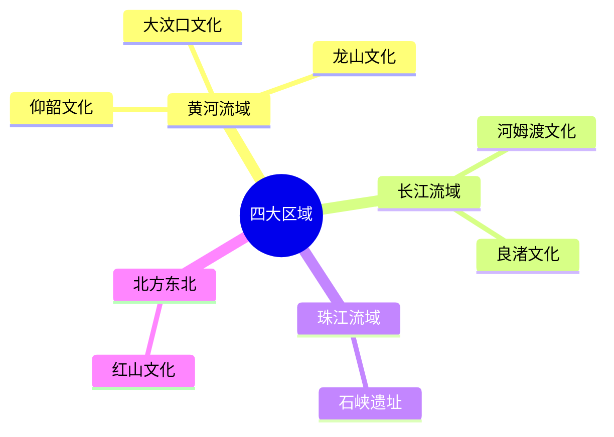

# 中国古代文明起源的四大区域说

过去常有一种说法，认为中国文化是从西向东单向流动的。但事实真的如此吗？如果文明只有一个源头，为什么我们在东北、江南甚至岭南都能挖出几千年前的古城遗址？

> [!IMPORTANT]
> 考古发现证明，中国文明的发祥地不仅仅是黄河流域，而是像“满天星斗、四面火光”一样分布于神州大地。==中国古代文明起源的四大区域说==正是对这一多元格局的系统总结。

## 四大区域与代表文化

根据考古成果，专家将古代文明起源分为四个主要区系：

| 区域 | 代表文化 | 距今时间 | 对应上古集团 |
| :--- | :--- | :--- | :--- |
| **黄河流域** | 仰韶文化、大汶口文化、龙山文化等 | $8000 \sim 4000$ 年 | 华夏集团（炎黄）、东夷集团 |
| **长江流域** | 河姆渡文化、良渚文化、屈家岭文化等 | $7000 \sim 3000$ 年 | 苗蛮集团 |
| **珠江流域** | 石峡遗址 | $4000 \sim 5000$ 年 | — |
| **北方和东北** | 红山文化（牛河梁遗址） | 约 $5000$ 年 | — |

> [!NOTE]
> 课件P41明确指出：**华夏集团**起于陕甘，活动于黄河流域（仰韶、河南龙山文化分布区）；**东夷集团**活动于山东及豫东皖中（大汶口、山东龙山文化分布区）；**苗蛮集团**活动于鄂湘赣一带（河姆渡、良渚文化是其历史表现）。

## 为什么需要这个理论？

提出“四大区域说”，是为了打破旧有的“中原中心论”或“由西向东单线传播论”。它揭示了中国文明的两个核心特质：
1. ==土生土长==：中国文明是在这块土地上独立起源的，而非外域传入。
2. ==多元融合==：四面八方互相渗透，最终形成秦汉以来延续两千余年的大一统多元性文化。

虽然各区域发展不平衡，但黄河流域的中原地区成熟最早，约在 $5000$ 年前已进入文明社会，是起源的==主要区域==。

## 论述题怎么拿满分？

遇到“论述中国古代文明起源其中的四大区域说”这道真题，千万别只列四个名字。完整的答题逻辑应包含“破题—展开—升华”三步：

> [!TIP]
> **答题模板**：
> 1. **总述**：指出旧有“由西向东”观点的局限，引出“满天星斗、四面火光”的多元一体格局。
> 2. **分述**：按黄河、长江、珠江、北方东北四个区域，列举代表性文化及其大致年代（如黄河流域的仰韶、大汶口；长江流域的河姆渡、良渚等），并点出三大集团的对应关系。
> 3. **总结**：强调中国文明是土生土长、多元融合的，中原地区成熟最早，最终汇聚成大一统文化。

> [!WARNING]
> **常见坑**：
> - 把“河姆渡文化”错分到黄河流域，或把“仰韶文化”错归给苗蛮集团。记住口诀：==黄河华夏与东夷，长江苗蛮河良渚==。
> - 漏掉“三大集团”的对应关系。复习提纲P41专门强调了华夏、东夷、苗蛮与具体文化的绑定，这是踩分点。
> - 误以为四大区域地位完全平等。必须点明“黄河流域是中国文明起源的主要区域”，其他区域在 $5000 \sim 3000$ 年前先后进入文明社会。
