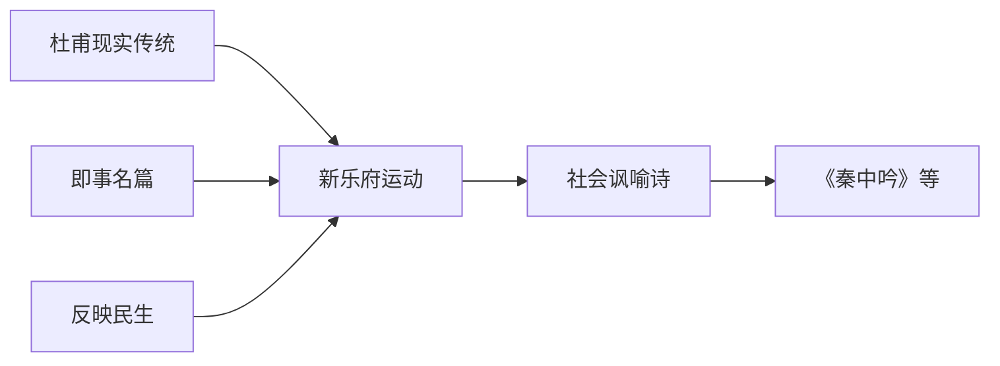

# 新乐府运动（白居易、元稹）

## 什么是新乐府运动

如果杜甫的诗是“诗史”，那么中唐诗人该如何用诗歌干预现实？白居易与元稹给出的答案便是==新乐府运动==。它并非单纯复古，而是一场由白居易、元稹倡导的诗歌革新，主张继承杜甫现实主义传统，强调诗歌应反映民生疾苦、针砭时弊。其核心创作原则是“即事名篇，无复倚傍”，即根据所写事件自拟新题，不再沿用汉魏乐府旧题。

> [!IMPORTANT]
> 新乐府运动的本质是“内容决定形式”。==即事名篇==是其区别于旧乐府的最显著标志，旨在让诗歌摆脱音乐曲调束缚，成为独立的社会讽喻工具。

## 为什么需要这场运动

安史之乱后，社会矛盾尖锐，但大历诗风趋于平庸雕琢。诗人若继续沿用《战城南》《巫山高》等旧题，往往题文分离，难以真切反映当下苦难。新乐府运动正是为了打破这种形式主义桎梏，让诗歌重新承担起“补察时政”“泄导人情”的社会功能，使文学回归现实关怀。

## 如何识别与作答

在名词解释题中，需精准覆盖以下要素：

| 答题维度 | 核心关键词 | 课件对应表述 |
| :--- | :--- | :--- |
| 倡导者 | 白居易、元稹 | 与好友元稹倡导 |
| 思想渊源 | 杜甫现实主义 | 继承杜甫现实主义传统 |
| 创作主张 | 反映民生、针砭时弊 | 主张诗歌反映民生，针砭时弊 |
| 形式特征 | 即事名篇、不复用旧题 | 往往即事名篇，不复用乐府旧题 |
| 代表作品 | 《秦中吟》《长恨歌》《琵琶行》 | 尤以……最为著名 |

> [!TIP]
> 记忆口诀：“白元倡新乐，即事不依傍；为民刺时弊，秦吟长恨彰。”答题时务必写出“即事名篇”四字，这是阅卷采分点。

## 与相近概念的区别

新乐府常与“古题乐府”混淆。二者关键区别在于题目来源与现实指向：

- **古题乐府**：沿用汉魏六朝旧题（如《陌上桑》），内容可与原题无关，重在拟古或抒情。
- **新乐府**：自创新题（如《卖炭翁》），题文一致，专为讽喻现实而作。

此外，需注意元稹的双重身份：他既是新乐府运动领袖，又是传奇小说《莺莺传》作者。后者为元代王实甫《西厢记》的故事源头，但《莺莺传》属文言小说，与新乐府诗歌体裁完全不同，切勿张冠李戴。

## 常见误区警示

> [!WARNING]
> 《长恨歌》《琵琶行》虽被列为新乐府代表作，但其叙事性与抒情性较强，讽喻意味较《秦中吟》隐晦。答题时不可将其简单等同于纯政治讽喻诗，应理解为广义的新乐府创作成果。

> [!CAUTION]
> 切勿将“新乐府运动”与宋代“诗文革新运动”混淆。前者为中唐诗歌改革，后者为北宋散文与诗歌的整体革新，时代、人物、主张均不同。

## 真题示例解析

以历年名词解释题“新乐府运动”为例，标准答案应整合为：

> 新乐府运动由白居易、元稹倡导，继承杜甫现实主义传统，主张诗歌反映民生、针砭时弊。其特点是“即事名篇，无复倚傍”，不复用乐府旧题，创作了大量浅显易懂的社会讽喻诗，代表作有《秦中吟》《长恨歌》《琵琶行》等。

此答案完整涵盖倡导者、思想渊源、主张、形式特征及代表作五要素，符合课件P300原文表述，可得满分。
