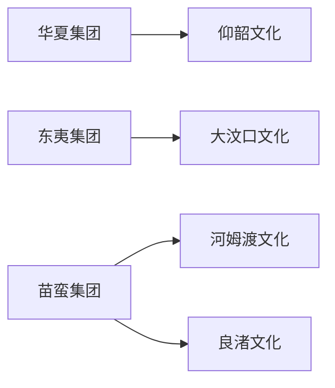

# 早期文化遗址（良渚、河姆渡、仰韶、大汶口）

## 它是什么

在《中国文化概论》第三章“历史沿革与宗法制度”里，我们要把课本 P41 提到的四个名字认清：==良渚文化、河姆渡文化、仰韶文化、大汶口文化，都是新石器时代的“早期文化遗址”==。它们不是一个朝代，也不是一个政权，而是考古学家在不同地方挖出来的古人生活遗迹，用来说明中国文明是从多个地方一起长出来的。

先问一句：如果只把黄河叫“母亲河”，那长江边挖出 7000 年前种稻子的痕迹，该怎么解释？答案就是：中国文明不是只有一个中心，而是==黄河流域、长江流域等多个文化区并存==。

## 为什么需要、分布在哪些集团

课件把上古部落分成三大集团，文化遗址就是他们的“历史表现”：

| 文化遗址 | 距今时间 | 地理位置 | 所属集团 / 流域 |
|---|---|---|---|
| 仰韶文化 | 约 7000–5000 年 | 河南渑池（黄河流域） | 华夏集团（炎黄） |
| 大汶口文化 | 约 5000 年 | 山东泰安（黄河下游） | 东夷集团 |
| 河姆渡文化 | 约 7000 年 | 浙江余姚（长江流域） | 苗蛮集团 |
| 良渚文化 | 约 4000–5000 年 | 浙江余杭（长江流域） | 苗蛮集团 |

> [!IMPORTANT]
> 答题核心句：华夏集团对应仰韶文化，东夷集团对应大汶口文化，苗蛮集团对应河姆渡与良渚文化。

## 和相近概念的区别

- 仰韶 vs 大汶口：都在黄河流域，但==仰韶在河南属华夏，大汶口在山东属东夷==，别混。
- 河姆渡 vs 良渚：都在长江下游，但==河姆渡更早（7000 年），良渚更晚（4000–5000 年且出玉器）==。
- 它们都不是“夏文化”：==二里头文化才被认定是夏文化==，这是常见坑。

## 常见坑与一个算对了的例子

> [!WARNING]
> 名词解释最易错：把“良渚=黄河流域”或“仰韶=长江流域”写反；或者把河姆渡、良渚归到华夏集团。记住：两浙的遗址归苗蛮。

真题常这样考：

> 名词解释：“良渚文化、河姆渡文化、仰韶文化、大汶口文化”

算对了的回答例子：

> 良渚文化（浙江余杭，距今四五千年）和河姆渡文化（浙江余姚，距今 7000 年）是长江流域苗蛮集团的历史表现；仰韶文化（河南，7000–5000 年）是黄河流域华夏集团的分布区；大汶口文化（山东，5000 年）是东夷集团活动区的文化表现。四者均为中国早期文化遗址，说明文明起源多中心。

> [!TIP]
> 记忆口诀：“黄仰华、山大东、浙江两蛮良与河”。
