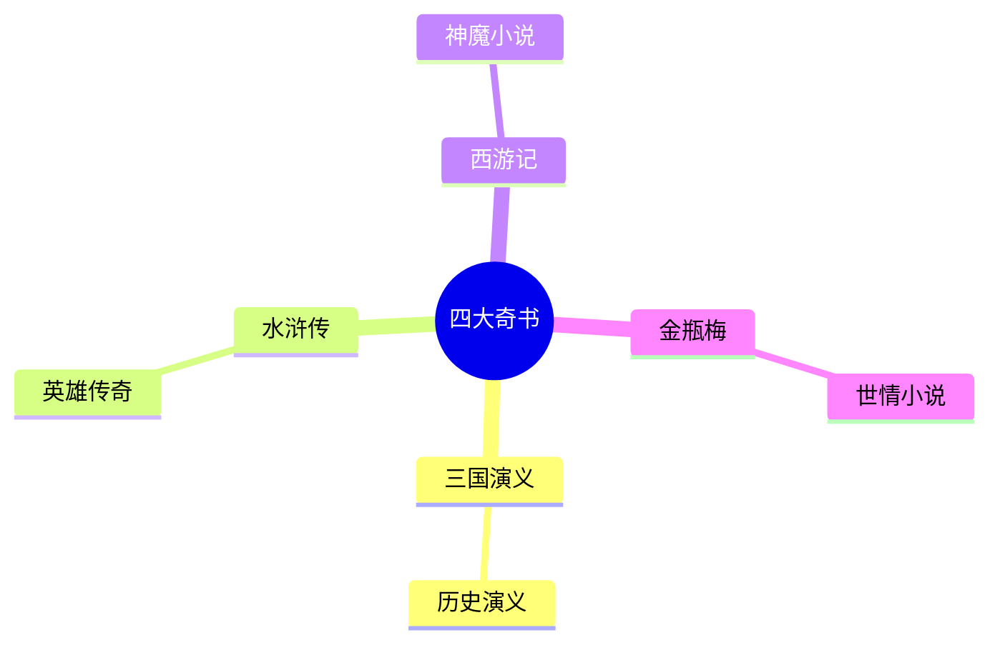

# 明代四大奇书（《三国演义》《水浒传》《西游记》《金瓶梅》）

## 是什么

明代四大奇书指 ==《三国演义》《水浒传》《西游记》《金瓶梅》==。这里的“奇书”不是“奇怪之书”，而是赞赏它们在题材、人物、结构和语言上的开创性：四部作品分别展开历史兴亡、英雄聚义、神魔取经和市井生活，共同体现明代长篇章回小说的繁荣。

## 为什么需要掌握

这一知识点的核心任务很直接：看到“明代四大奇书”，能够完整、准确地列出四部书；进一步复习时，再把书名与题材类型对应起来。四部作品不是按文学价值随意拼凑的名单，而是明代长篇小说不同创作方向的代表。

| 作品 | 常见作者署名 | 题材类型 | 核心内容 |
|---|---|---|---|
| 《三国演义》 | 罗贯中 | 历史演义 | 东汉末年至三国时期的政治、军事斗争 |
| 《水浒传》 | 施耐庵 | 英雄传奇 | 梁山好汉聚义及其兴衰 |
| 《西游记》 | 吴承恩 | 神魔小说 | 唐僧师徒西天取经 |
| 《金瓶梅》 | 兰陵笑笑生 | 世情小说 | 以西门庆家庭为中心描写市井社会 |

## 怎么做

答题时先写总称，再依次列书名，不必展开情节。若题目要求“结合作品说明”，再补充类型和代表作内容。可用 ==“三、水、西、金”== 作记忆线索，但正式答案必须写完整书名，并加书名号。

> [!TIP]
> 简答模板：明代四大奇书指《三国演义》《水浒传》《西游记》《金瓶梅》。若需扩展，可补一句“分别代表历史演义、英雄传奇、神魔小说和世情小说”。

## 和相近概念的区别

“四大奇书”与“四大名著”不是同一名单，不能混用。

| 概念 | 作品范围 | 关键差别 |
|---|---|---|
| 明代四大奇书 | 《三国演义》《水浒传》《西游记》《金瓶梅》 | 含《金瓶梅》 |
| 中国古典四大名著 | 《三国演义》《水浒传》《西游记》《红楼梦》 | 含清代《红楼梦》 |

> [!WARNING]
> 最常见的错误是把《金瓶梅》写成《红楼梦》。看到“明代”与“四大奇书”，就应锁定《金瓶梅》；《红楼梦》是清代作品，不属于这一组合。

## 常见的坑

- 只记“三西水金”，正式作答时漏写某一部。
- 把“奇书”解释成志怪小说，进而漏掉《三国演义》等作品。
- 将《金瓶梅》误归入神魔小说；它侧重现实社会与家庭、市井生活。
- 把常见作者署名当成绝对无争议的结论；本知识点首先考书名，不必主动展开作者争论。

## 一个答对了的例子

**题目：** 明代四大奇书指哪四部作品？

**答案：** 明代四大奇书指《三国演义》《水浒传》《西游记》《金瓶梅》。

这份答案与复习提纲完全一致，四部齐全、名称准确，没有混入《红楼梦》，即可满足本知识点的作答要求。
