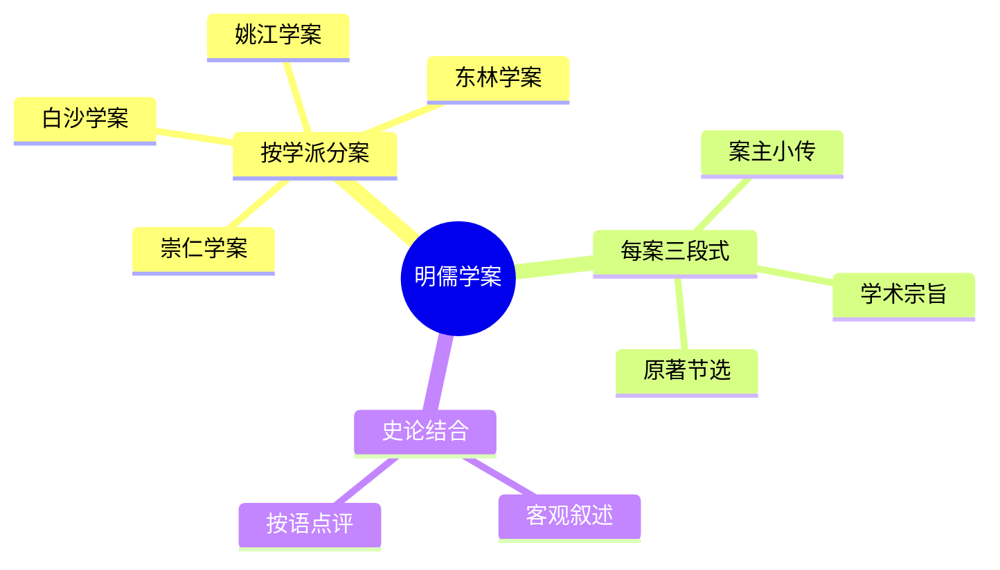

# 《明儒学案》与宋明理学总结

## 它是什么与为什么需要

提到明代思想史，你是否好奇：在没有现代数据库的古代，学者如何系统梳理两百多年间数百位哲学家的庞杂学说？答案便是黄宗羲（梨洲先生）所著的《明儒学案》。

> [!IMPORTANT]
> 《明儒学案》是==我国第一部研究中国哲学断代史的著作==，标志着中国传统学术史编纂体例的成熟。

黄宗羲虽属理学家，却精于史学且具有强烈的民主思想。他编写此书不仅是为了保存文献，更是为了总结宋明理学的发展脉络，为后世提供“辨章学术，考镜源流”的可靠依据。对于备考而言，它是连接“王阳明心学”等具体知识点与宏观学术史的关键枢纽。

## 核心内容与编纂方法

该书并非简单的语录堆砌，而是建立了严谨的“学案体”结构。我们可以通过下图理解其逻辑框架：

在具体操作上，黄宗羲坚持“一本万殊”的原则。他先撰写案主生平与师承（小传），再提炼其核心主张（宗旨），最后精选最能代表该学者思想的原文（节选）。这种“以人系学、以学明道”的方法，既保留了思想的原汁原味，又理清了学派间的传承与分歧。

## 易混概念辨析与避坑指南

复习时，许多同学容易将《明儒学案》与其他典籍混淆，需特别注意以下区别：

| 对比维度 | 《明儒学案》 | 《宋元学案》 | 《传习录》 |
| :--- | :--- | :--- | :--- |
| **性质** | ==哲学断代史== | 哲学断代史 | 个人语录/文集 |
| **作者** | 黄宗羲（独立完成） | 黄宗羲开创，全祖望补定 | 王阳明及其弟子 |
| **范围** | 仅明代儒学 | 宋元两代儒学 | 仅阳明心学 |
| **考点地位** | 第一部断代哲学史 | 续作，非“第一” | 心学原始文献 |

> [!WARNING]
> 考试中若问“第一部”，必须锁定《明儒学案》。切勿因书名相似而误选《宋元学案》，后者虽同出黄氏之手，但由后人补完，不具备“第一部”的原创性地位。

## 真题应用示例

回顾课件中关于“王阳明知行合一”的简答题，其标准答案正是基于《明儒学案·姚江学案》中对阳明思想的精准提炼：

> [!TIP]
> 答题逻辑链：良知（知）→ 良能（行）→ 不行即不知 → 万物一体。这正是《明儒学案》归纳“宗旨”的典型范式。

当题目要求简述某一学派主张时，应模仿该书的概括方式：先点明核心范畴（如“良知”），再阐释内在逻辑（“知行合一”），最后升华至境界（“达于至道”）。这种结构化表述，既符合教材术语规范，也契合阅卷老师对“学术史思维”的期待。
