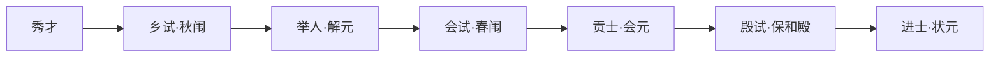

# 明清科举考试程序（乡试、会试、殿试）

## 三级考试是什么

明清科举是层层选拔的阶梯：只有先成为秀才，才有资格参加乡试；中了举人，才能进京会试；会试取中为贡士，再由皇帝殿试定名次。三次考试的第一名分别是 ==解元、会元、状元==，若一人连夺这三个第一，便是"连中三元"。

## 乡试：秋闱取举人

乡试是**一省范围**的考试，每三年一次，逢子、卯、午、酉年在**秋八月**举行，故称"秋闱"。考场设在省城贡院，外墙高且植荆棘，戒备森严。主考官由朝廷任命朝官担任，须回避原籍省份。

> [!IMPORTANT]
> 秀才乡试及格即称**举人**，第一名称**解元**（取"解送朝廷录用"之意）。中举便算正式进入统治阶级，可称"老爷"，既能继续会试，也可候任学官甚至知县。《儒林外史》"范进中举"写的正是这一幕。

## 会试与殿试：春闱定进士

会试是**全国范围**的考试，于乡试次年（丑、辰、未、戌年）**春三月**举行，由礼部主持，故又称"礼闱""春闱"；发榜时杏花正开，榜称"杏榜"。主考官为皇帝亲任的一二品大员，须进士出身。应试者必须是举人（已仕未仕均可），各省举子进京由地方政府发路费，考场在北京贡院（今中国社会科学院一带）。

会试取中者通称**贡士**，第一名称**会元**。随后的殿试在故宫保和殿举行，皇帝主考（清代常由亲王宣读考题），贡士经殿试后才是**进士**，第一名称**状元**。

## 三场考试对比

| 项目 | 乡试 | 会试 | 殿试 |
|------|------|------|------|
| 范围 | 一省 | 全国 | 全国 |
| 时间 | 秋八月 | 春三月 | 会试后 |
| 别称 | 秋闱 | 春闱/礼闱 | — |
| 应试资格 | 秀才 | 举人 | 贡士 |
| 取中身份 | 举人 | 贡士 | 进士 |
| 第一名 | 解元 | 会元 | 状元 |

> [!WARNING]
> 别把"贡士"当最终功名：会试录取只是获得殿试资格，贡士经殿试后才算进士。乡试、会试第一分别叫解元、会元，殿试第一才是状元——==连中三元==即这三元全揽。

> [!TIP]
> 记时间用"秋闱春闱"：乡试秋八月考举人，会试春三月考贡士，次年即殿试。逢子卯午酉年乡试，丑辰未戌年会试，三年一轮。
