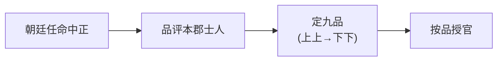
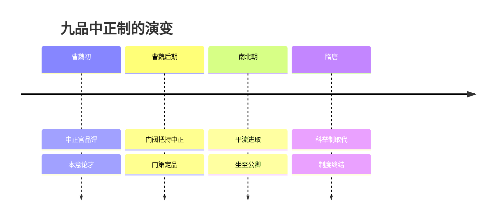

# 曹魏九品中正制

## 为什么需要九品中正制

东汉末年，察举制被豪强把持，名不副实。曹操因此颁布《求贤令》，提倡"==唯才是举=="，直接按才能选人。但曹丕称帝后，既要延续选官的客观性，又要争取世家大族的支持，于是采纳尚书陈群的建议，建立**九品中正制**（又称"九品官人法"）。

> [!NOTE]
> 曹操的"唯才是举"和九品中正制不是一回事：前者是口号式的直接征召，后者是**制度化**的品级评定。考试常把两者混为一谈。

## 它是什么、怎么做

由朝廷在各郡任命==中正官==，负责品评本郡的士人，把他们按品第分成九等：

| 品第 | 等级 |
| --- | --- |
| 一品 | 上上 |
| 二品 | 上中 |
| 三品 | 上下 |
| 四品 | 中上 |
| 五品 | 中中 |
| 六品 | 中下 |
| 七品 | 下上 |
| 八品 | 下中 |
| 九品 | 下下 |

朝廷再按品第高低授官——品第越高，起点官职越好。

> [!TIP]
> 九品是**给被选者**分级，不是给中正官分级。看到"九品"先想清楚是对谁分的。

## 特点与演变

- **曹魏初**：由中正官品评，尚有一定客观性。
- **曹魏后期**：==豪门显贵把持中正任命权==，品评标准由才、德蜕变为**门第**，形成"==上品无寒门，下品无士族=="的局面。
- **南北朝**：士族子弟仅凭门第便可"平流进取，坐至公卿"，官员普遍无能、政治腐败，九品中正制受到庶族地主冲击，难以为继。

> [!WARNING]
> 常见坑：把九品中正制的**创立**和**变质**混在一起。陈群初创时仍欲论才，是**后期**才沦为门阀工具的。考试若问"特点"，要答出这种**前后期差异**。

> [!CAUTION]
> "上品无寒门，下品无士族"描述的是**后期**现象，不能用来概括九品中正制创立时的全貌。

## 与相近概念的区别

| | 察举制 | 九品中正制 | 科举制 |
| --- | --- | --- | --- |
| 时代 | 汉 | 魏晋南北朝 | 隋唐至清 |
| 主持者 | 地方官 | 中正官 | 朝廷考试 |
| 标准 | 名望、孝廉 | 初论才，后论门第 | 考试成绩 |
| 特点 | 易被把持 | 易被门阀把持 | 相对客观 |

> [!NOTE]
> 三者都有"评"的成分，关键区别在于**谁来评、按什么评**：科举的突破是**以考试分数为唯一依据**，切断了门第与特权的直接对应。
