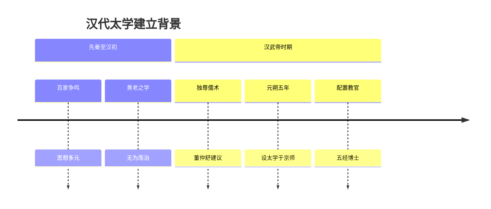

# 汉代太学与中央官学

# 汉代太学与中央官学

## 它是什么：国家最高学府的诞生

汉代太学是汉武帝时期在京师（长安）设立的**中央最高教育机构**。其核心特征在于确立了“以儒术取士”的教育导向。

> [!IMPORTANT]
> **核心定义**：元朔五年（公元前124年），武帝下令兴太学，置==五经博士==为教官，招收弟子50人。这是中国历史上第一次由中央政府正式设立的最高学府。

这里的“五经”指《诗》《书》《礼》《易》《春秋》。需注意，《乐经》在汉代已失传，故实际只立五经博士。

## 为什么需要：内法外儒的政治工具

封建社会的教育政策本质是==内法外儒==。表面上推崇儒家道德教化，实则通过教育选拔忠于皇权的官吏，巩固中央集权。

*   **统一思想**：结束百家争鸣，确立儒家思想的正统地位。
*   **培养官僚**：太学生毕业后多进入仕途，成为统治阶级的后备力量。
*   **控制学术**：将解释权收归官方指定的“博士”，防止异端思想蔓延。

> [!TIP]
> **记忆逻辑**：太学不仅是学校，更是**政治机构**。它解决了“谁来统治”和“如何统治”的人才来源问题。

## 怎么做：今文经的垄断地位

太学的教学内容具有鲜明的时代特征，即专门讲授==今文经==。

| 特征维度 | 今文经 (太学教材) | 古文经 (民间流传) |
| :--- | :--- | :--- |
| **文字载体** | 汉代流行隶书 | 先秦古文字（篆书等） |
| **传承方式** | 师徒口头传授，汉代录写 | 发掘出的先秦旧本 |
| **学术地位** | **官方正统**，立为博士 | 民间私学，非官方主流 |
| **特点** | 侧重微言大义，服务政治 | 侧重训诂考据，还原历史 |

由于战国至秦的战乱，先秦旧本大多遗失。汉代学者凭记忆口述，用当时通行的隶书记录下来，故称“今文”。太学博士仅依据这些今文经进行讲授，这使得今文经学在汉代占据了绝对的垄断地位。

## 常见误区与辨析

> [!WARNING]
> **易错点1**：认为太学教授的是“四书五经”。
> **纠正**：“四书”概念形成于宋代（朱熹），汉代只有“五经”。且《乐经》已佚，实为五经博士。

> [!WARNING]
> **易错点2**：混淆“太学”与“启蒙教育”。
> **纠正**：太学是高等教育。启蒙教材如《三字经》《百家姓》《千字文》是家庭或私塾阶段使用，与太学层级不同。

## 算对了的例子：真题复盘

**题目**：简述汉代太学的设立时间、地点及教官构成。

**解析步骤**：
1.  **定位时间**：课件明确指出为==元朔五年（公元前124年）==。
2.  **定位地点**：==京师==（即长安）。
3.  **定位教官**：==五经博士==。需补充说明因《乐经》失传，故仅立五经。
4.  **关联内容**：讲授内容为==今文经==。

**标准回答示例**：
汉武帝于元朔五年（公元前124年）在京师设立太学。太学以“五经博士”为教官，最初为博士配弟子50人。由于《乐经》失传，实际讲授的是用汉代隶书书写的“今文经”，包括《诗》《书》《礼》《易》《春秋》。这一举措标志着儒家教育官方化的开始，体现了“内法外儒”的教育政策。
