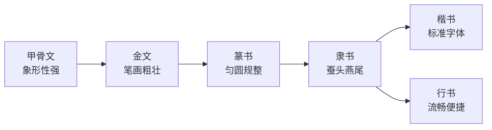

# 汉字的演变（甲骨文—金文—篆书—隶书—楷书）

## 汉字的演变：一条由繁到简的脉络

汉字不是一天造出来的，也不是一成不变的。它经历了漫长的演变过程，**从甲骨文到金文，由金文到篆书，由篆书到隶书，然后才是现在使用的行书和楷书**。这条线索是本章的核心考点。

> [!IMPORTANT]
> 汉字演变的标准顺序：**甲骨文 → 金文 → 篆书 → 隶书 → 行书、楷书**。注意行书和楷书是**并列**关系，不是先后关系，它们都产生于隶书之后。

## 各阶段特征一览

| 字体 | 时代 | 载体/用途 | 特点 |
|------|------|-----------|------|
| 甲骨文 | 商代 | 龟甲兽骨，占卜记录 | 笔画细瘦，多方折，象形性强 |
| 金文 | 西周至春秋 | 青铜器铭文 | 笔画粗壮圆润，结构渐趋规整 |
| 篆书 | 秦代 | 官方标准字体 | 笔画匀圆，结构对称，字形修长 |
| 隶书 | 汉代 | 日常书写 | 笔画出现"蚕头燕尾"，字形扁方 |
| 楷书 | 魏晋以后 | 正式书写 | 笔画平直，结构严谨，成为标准 |
| 行书 | 魏晋以后 | 日常快速书写 | 介于楷书与草书之间，流畅易写 |

## 演变的内在逻辑

汉字演变的主线是**由繁到简、由象形到符号化**。篆书以前，字形保留了较强的图画性；隶书之后，汉字的笔画系统基本定型，象形意味大大减弱，符号性显著增强。

> [!TIP]
> 记忆口诀：**"甲金篆隶楷行"**——按时间先后排列；但注意"楷行"二者是**同时并行**的，楷书偏正式，行书偏实用。

## 与书法艺术的关系

书法成为一门独立艺术，正是以汉字的**方形结构和线条变化**为基础。正因为汉字兼具"形"与"意"，才使得书写本身成为一种审美活动。例如陈代僧人**智永**，他是王羲之的七世孙，书法深得家风，其所书《千字文》极受后世推崇，成为学习楷书的经典范本。

## 常见误区

> [!WARNING]
> - **误区一**：认为行书产生于楷书之后。实际上二者都源于隶书，是**并行发展**的两种字体。
> - **误区二**：把"篆书"当作一种具体字体。篆书其实包括**大篆**（如石鼓文）和**小篆**（秦统一后的标准字体）两类，考试中说"篆书"通常泛指这一阶段的字体。
> - **误区三**：忽略隶书的关键地位。**隶书是古今文字的分水岭**，它之前的文字象形性强，之后的文字符号性强。

> [!NOTE]
> 考试中若问"汉字演变的顺序"，标准答案即：**甲骨文 → 金文 → 篆书 → 隶书 → 行书和楷书**。若问"古今文字的分界"，答案是**隶书**。
