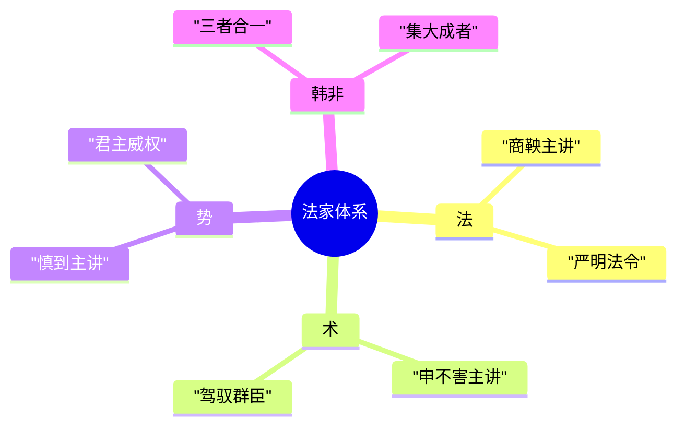

# 法家思想（商鞅、韩非：法、术、势）

战国乱世，诸侯争霸。如果仅靠儒家的“仁义”和“礼教”，君主真能管住野心勃勃的臣下、统御四方吗？法家给出的答案是否定的。

## 法家思想是什么

> [!IMPORTANT]
> 法家是战国时代后起的学派，中心思想是==“循名责实”“信赏必罚”==。其集大成者为韩非（约前280—前233年），著有《韩非子》。

在韩非之前，法家人物已各有侧重：商鞅重“法”，申不害重“术”，慎到重“势”。韩非将三者合为一体，构建了完整的君主集权理论体系。

## 法、术、势怎么做

这三者分别解决君主治国的不同问题：

- **势**：即统治者（君主）的权势地位。韩非认为君主非威势不足以“制天下而征诸侯”，必须牢牢掌握权柄不放。
- **术**：即君主驾驭群臣的心术和权术。包括知人用人、听言察实，直至对臣下使用特务手段和阴谋诡计。
- **法**：即君主的法令。主张赏罚严明，“刑过不避大臣，赏善不遗匹夫”，且应当==重刑而少赏==，因为刑法比仁义更使人少犯过错。

> [!TIP]
> 记忆口诀：“势”是底气（权位），“术”是手腕（驭臣），“法”是规矩（明令）。三者缺一不可，共同服务于君主专制。

## 与相近概念的区别

法家极度排斥其他学派的治国理念，认为礼教、仁义及人的感情都会破坏“法”的尊严。

| 对比维度 | 法家立场 | 被斥责对象 |
| :--- | :--- | :--- |
| 治国依据 | 严刑峻法，以法为教 | 儒家“以文乱法” |
| 社会秩序 | 绝对服从君主法令 | 墨家“以武犯禁” |
| 教育方式 | “无先王之语，以吏为师” | 废除书简之文 |

> [!NOTE]
> 韩非与李斯同为荀子的学生。荀子虽属儒家，但主张“性恶论”，这一思想直接启发了法家重刑罚的逻辑起点。韩非甚至提出“明主治国无书简之文，以法为教；无先王之语，以吏为师”（《难三》），这正是后来李斯劝秦始皇“焚书坑儒”的理论来历。

## 常见的坑

> [!WARNING]
> 易错点一：张冠李戴。考试中常把“法、术、势”的代表人物弄混。记住对应关系：商鞅—法，申不害—术，慎到—势。
> 
> 易错点二：误认集大成者。商鞅名气极大，但法家思想的==集大成者是韩非==，是他完成了三者的理论融合。

> [!CAUTION]
> 不要以为法家在秦亡后就消失了！课件明确指出：法家思想实际上成为==后世封建统治者维护集权统治的理论基石==。历代帝王多“外儒内法”，表面用儒家安抚人心，底层逻辑仍靠法家维持集权。

## 真题演练

**题目**：简述法家学说中“法、术、势”的含义及其代表人物，并指出法家的集大成者是谁。

**满分作答思路**：
1. **破题定位**：明确中心思想是“循名责实”“信赏必罚”。
2. **分述三者**：商鞅讲“法”（法令严明、重刑少赏）；申不害讲“术”（驾驭群臣的心术权术）；慎到讲“势”（君主的权势地位）。
3. **点明核心**：韩非将三者合为一体，是集大成者。
4. **补充影响**：斥责儒墨，主张“以法为教，以吏为师”，成为后世维护集权统治的理论基石。
