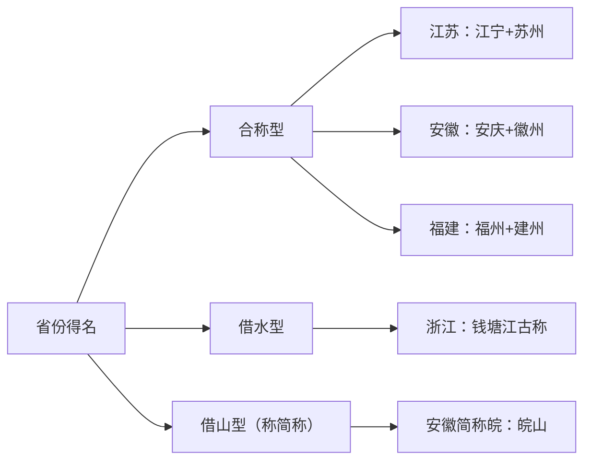
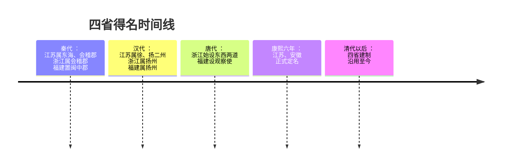

# 主要省份得名由来（江苏、浙江、安徽、福建等）

## 省名不是随便起的：从“江苏”到“福建”的命名逻辑

先问一个问题：**“江苏”这个名字里为什么既有“江”又有“苏”？“江”是长江，“苏”是苏州吗？** 如果是，那为什么不是“江南省”直接改叫“江苏”，而是康熙六年专门设了一个“江苏布政使司”？

把这个问题想通，四个省的得名逻辑就基本清楚了。

### 四种命名方式：合称、借水、借山、借州

这四个省的名字，恰好代表了古代中国省级政区得名的几条主要路径：

| 省份 | 得名来源 | 命名类型 | 关键时间点 |
|------|----------|----------|------------|
| 江苏 | 江宁府 + 苏州府 各取首字 | ==合称型== | 康熙六年（1667年） |
| 浙江 | 境内钱塘江古称“浙江” | ==借水型== | 唐代设浙江东西两道 |
| 安徽 | 安庆府 + 徽州府 各取首字 | ==合称型== | 康熙六年（1667年） |
| 福建 | 福州 + 建州 各取一字 | ==合称型== | 唐代设福建观察使 |

江苏、安徽、福建三个都是“合称型”，但合的层级不同：**江苏、安徽合的是“府”名，福建合的是“州”名**。浙江则走了另一条路——以水得名。

> [!IMPORTANT]
> ==“江苏”和“安徽”都定名于康熙六年（1667年）==，这不是巧合。清初江南省太大、太富，朝廷为便于治理而拆分，设“江苏布政使司”和“安徽布政使司”。两省同年得名，是同一场行政区划调整的产物。

### 一个最容易被忽略的坑：简称不等于省名来源

南京邮电大学这门课的考试题里，很喜欢把“省名由来”和“简称由来”混在一起考。**福建的简称“闽”来自闽江**，但“福建”这个省名本身并不来自闽江，而是来自福州和建州。同样，**安徽的简称“皖”来自皖山（天柱山）**，但“安徽”这个省名来自安庆和徽州，与皖山没有直接关系。

> [!WARNING]
> 别把“简称的由来”和“省名的由来”混为一谈：福建以福州、建州得名，简称才取闽江；安徽以安庆、徽州得名，简称才取皖山。如果题目问“福建省名的由来”，答“闽江”就错了。

### 时间线梳理：四个省名何时定型

从这条时间线可以看出一个规律：==“浙江”和“福建”的省级名称萌芽于唐代，而“江苏”和“安徽”直到清初才出现==。原因在于，唐代的“道”和宋代的“路”还是监察区或半行政区，到元代行省制度确立后，省级政区才真正成型，而清初的拆分则是对过于庞大的江南省的进一步调整。

### 算对了的例子：把“福建”带进去验证

假设考题这样问：

> 福建省的“福”和“建”分别取自哪里？

按照上面的逻辑一步步推：唐代设“福建观察使”，这是“福建”二字第一次连用；“福”取自福州（今福州市），“建”取自建州（今建瓯市）；后来宋代设福建路，元代设福建行中书省，明清沿为福建省，名称一直未变。所以答案是：**“福”取自福州，“建”取自建州（今建瓯）**。而“闽”只是因境内闽江而成为简称，与省名是两回事。

再验证“江苏”：

> 康熙六年“江苏布政使司”的“江苏”二字怎么来的？

两江总督驻江宁府（今南京），巡抚驻苏州府（今苏州），各取首字，合为“江苏”。所以“江”指的是**江宁**，不是长江——尽管江苏确实在长江下游，但那是地理事实，不是命名的直接依据。这个细节是历届考试的高频陷阱。

> [!TIP]
> 记忆口诀：**“江安福建都是合，浙水皖山是简称；江为江宁非长江，皖称皖山不称安。”** 四句话把合称型、借水型、简化型的混淆点一次说清。

### 与“郡望”的联动：省名的高频交叉考点

课件里“郡望意识”那一段提到了“彭城刘”“颍川陈”，其中**彭城就在今江苏省徐州市**。这提示我们：省名知识不仅是孤立的地名考察，还常常和“郡望”“佛教四大名山”（九华山在安徽、普陀山在浙江）等文化地理内容放在同一道题里综合考。把握住“省名—府州名—简称—郡望—名山”这张关系网，这一章的得分点就串起来了。
