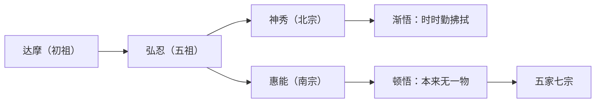

# 禅宗传法（达摩—惠能—五家七宗）

禅宗传法是中国佛教本土化最彻底的标志，其核心脉络可概括为“一祖、六祖、五家七宗”。为什么一个外来宗教能在中国生根发芽并衍生出如此庞大的体系？关键在于它完成了从“依经解义”到“直指人心”的转变，并形成了清晰的法脉传承。

## 法脉源流与南北分野

禅宗尊达摩为初祖，但真正完成中国化转型的是六祖惠能。在复习时，你是否能准确区分惠能与神秀的根本分歧？这不仅是修行方法的差异，更是禅宗分裂为南北两派的根源。

> [!IMPORTANT]
> ==南顿北渐==是禅宗传法的核心考点。惠能主张“顿悟”，神秀主张“渐悟”，二者代表了两种截然不同的成佛路径。

| 对比维度 | 南宗（惠能） | 北宗（神秀） |
| :--- | :--- | :--- |
| 核心主张 | ==顿悟==见性 | ==渐悟==修心 |
| 代表偈语 | 本来无一物，何处惹尘埃 | 时时勤拂拭，勿使惹尘埃 |
| 传法区域 | 南方（岭南等地） | 北方（荆州、长安） |
| 历史结局 | 成为禅宗主流 | 数代后衰微 |

[!TIP]
记忆口诀：“南顿北渐，惠能胜神秀；顿悟成佛，不立文字。”考试中若问及禅宗特点，务必点出“顿悟”与“南宗”的关联。

## 五家七宗的形成逻辑

惠能之后，禅宗为何会进一步分化为“五家七宗”？这并非教义冲突，而是师徒传授风格与地域文化融合的结果。临济、曹洞、沩仰、云门、法眼五家，加上临济宗分出的黄龙、杨岐二派，合称“五家七宗”。它们同出一源，皆承惠能“明心见性”之旨，区别仅在于接引学人的手段（如棒喝、默照、话头）和宗风差异。

> [!NOTE]
> “五家七宗”属于了解层级，无需背诵各宗细节，但需知道它们是==南宗禅的分支==，体现禅宗在唐末宋初的繁荣与本土化深度。

[!WARNING]
常见误区：将“顿悟”理解为“不需要修行”。实际上，惠能的“顿悟”强调心性本净、一念觉悟，并非否定日常践履，而是反对执着于形式化的坐禅与诵经。神秀的“渐悟”也非错误，只是更契合传统修行次第，但在强调“自力解脱”的中国文化语境中，南宗更具吸引力。

## 真题应用示例

若题目问：“简述禅宗南北宗的主要区别及其历史影响。”  
正确作答应包含三点：① 惠能主顿悟、神秀主渐悟；② 南宗重直觉体证、北宗重渐进修持；③ ==南宗最终成为禅宗正统==，深刻影响了宋明理学与中国艺术精神。遗漏“历史影响”或混淆二人主张，是典型失分点。

禅宗传法的本质，是一场佛教与中国心性文化的深度对话。掌握“顿渐之分”与“法脉演化”，就抓住了这一知识点的命脉。
