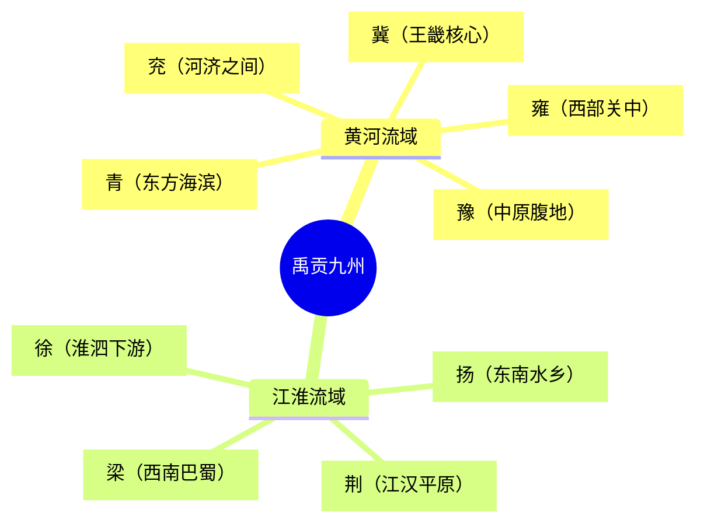

# 《尚书·禹贡》九州划分

## 九州划分的内涵与意义

当我们谈论中国古代地理认知时，为什么《尚书·禹贡》的“九州”体系总是被首先提及？它仅仅是一份上古行政区划名单吗？实际上，==九州划分是中国最早的系统性地理区划模型==，标志着先民从部落散居走向“天下一体”的空间秩序构建。它不仅是地理概念，更是政治与文化认同的基石。

> [!IMPORTANT]
> 《尚书·禹贡》九州具体指：冀、豫、青、徐、荆、扬、兖、雍、梁。这是本课程第二章“地理环境与文化发展”中必须精准记忆的核心考点。

## 九州的构成与空间逻辑

面对这九个名称，如何避免死记硬背？我们可以将其置于黄河与长江两大流域的自然格局中来理解。《禹贡》以自然山川（如岱山、荆山、衡山）和河流（如河、济、淮、汉）为界，将天下划分为九个相对独立的地理单元。

[!TIP]
> 记忆口诀：“冀豫青徐兖，雍梁荆扬”。可将“冀豫兖青徐”归为北方黄河流域五州，“雍梁荆扬”归为南方及西部四州，结合地图方位成组记忆。

## 与后世行政区的区别

复习时最容易混淆的是将《禹贡》九州等同于后世的行政州郡。二者有何本质不同？《禹贡》九州是==基于自然地理特征的宏观文化区域==，而非精确的行政管理单位；而后世“州”则是层级明确的政区建制。

| 比较维度 | 《尚书·禹贡》九州 | 汉代及以后“州” |
| :--- | :--- | :--- |
| 划分依据 | 山川形便、土壤物产 | 政治统治、人口赋税 |
| 性质 | 理想化地理文化区 | 实际行政区划单位 |
| 边界 | 模糊、自然过渡 | 明确、人为勘定 |
| 功能 | 描述天下秩序与贡赋 | 地方治理与监察 |

## 常见误区与真题示例

> [!WARNING]
> 切勿将《禹贡》九州与《周礼·职方氏》九州或《尔雅·释地》九州混为一谈。三者名称有异（如《职方》无徐、梁而有幽、并），考试若问“《尚书·禹贡》”，必须严格对应上述九名。

以课件 P21 相关考题为例，题目要求简述《尚书·禹贡》关于九州的介绍。正确作答需包含两点：一是准确列出“冀、豫、青、徐、荆、扬、兖、雍、梁”九名（顺序可不拘，但不可错漏）；二是点明其作为==中国最早系统地理区划==的文化史地位。若只答名称而未说明其“依山川划界、奠定华夏空间认知基础”的意义，则未能完整回应“地理环境与文化发展”这一章节主旨。

[!NOTE]
> 九州体系虽非夏代实录，但反映了战国时期人们对统一地理空间的构想。理解这一点，才能把握其在文化史上的真正价值——它不是行政档案，而是中华文明“大一统”空间观念的源头表达。
