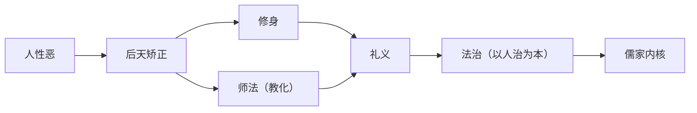

# 荀子思想（性恶论、礼法并重）

## 从“性恶”说起：荀子为什么和孟子唱反调

孟子讲“性善”，人人皆有恻隐之心。荀子却问：如果人性本善，那争夺、残贼、淫乱从何而来？顺着这个问题往下推，就得出了完全不同的起点：==“人之性恶，其善者伪也”==。注意，这个“伪”不是虚伪，而是**人为**的意思——善不是天生就有的，是人后天努力做出来的。

> [!WARNING]
> “其善者伪也”的“伪”极易误解为“假装”。荀子的意思是：善是**人为修习的结果**，不是本性的自然流露。这是理解荀子的第一道门槛。

既然人性本恶，凭什么相信人能变好？荀子的回答是：靠**后天的力量**。具体两条路：

- **修身**——个体自己下功夫，矫正本性。
- **师法**——靠圣王制定的礼义法度来教化。

于是荀子和孔孟一样提倡“礼义”，落脚点却完全不同：孔孟的礼义是善性的扩充，荀子的礼义是恶性的矫正器。

## 礼法并重：儒家外壳，法家内核？

这是荀子最需要辨析的地方。

孟子主张“民贵君轻”，荀子却主张**强化君权**。但他并非不要民，而是用了一个著名的比喻：

> “君者，舟也；庶人者，水也。水则载舟，水则覆舟。”

这比孟子的“民贵君轻”更冷静：人民不是价值上更高，而是**力量上更危险**，所以君主必须重视。

荀子主张“法治”，但和法家有本质区别：

| 维度 | 荀子 | 法家（韩非） |
|------|------|------------|
| 法的来源 | 从**礼义**出发 | 君主的**法令**本身 |
| 根本依据 | 以**人治为本** | 以**权势、权术**为核心 |
| 对儒家的态度 | 仍属儒家 | 斥责儒家“以文乱法” |
| 对教化的态度 | 重“师法”教化 | “以法为教，以吏为师” |

> [!IMPORTANT]
> ==荀子归儒不归法==：他的“法治”从礼义出发、以人治为本，内核仍是儒家。韩非才是法家集大成者，且韩非正是荀子的学生——这是常考点。

## 一个容易被忽略的贡献：天人之分

荀子还提出了==“明于天人之分”==的唯物主义观点：

> “天行有常，不为尧存，不为桀亡。”

天道有自身的规律，不因为圣君就多给点好运，也不因为暴君就降下灾祸。自然界的规律和人类社会的治乱是**两套系统**，社会治乱的根本在**人**不在天。这在先秦思想中相当清醒，直接斩断了“天命—人事”的神秘关联。

## 常见坑位

1. **把荀子的“伪”当虚伪**——错了，是“人为”。
2. **把荀子直接划入法家**——他主张法治但出发点是礼义、人治为本，仍是儒家。
3. **混淆荀子与韩非的师承方向**——韩非是荀子的学生，不是老师。
4. **“水则载舟，水则覆舟”出处**——《荀子·王制》，表述的是君民关系的重要性，不是“民贵君轻”。

> [!TIP]
> 记忆钩子：孟子“性善—贵民”，荀子“性恶—尊君—重民”。“性恶→矫性→礼法并重→尊君重民→天人有分”，一条线串到底。
