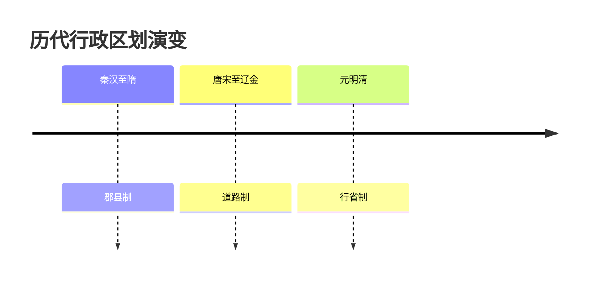
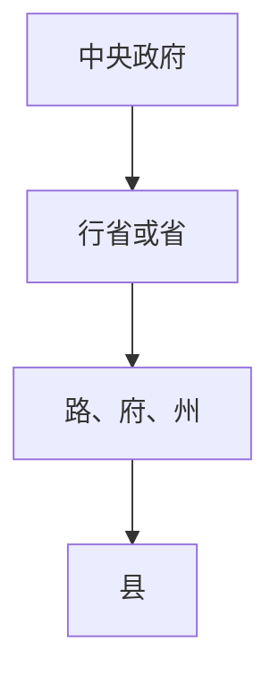

# 历代行政区划演变（郡县制—州郡县—道路制—行省制）

## 行政区划是什么

行政区划是国家为了便于行政管理、征税和治理地方而划分的等级体系。行政区划名称变化多，但核心功能始终是解决两个问题：**中央如何管理地方，地方事务归谁负责**。

历代制度可概括为：

> [!IMPORTANT]
> ==秦汉至隋：郡县制；唐宋至辽金：道路制；元明清：行省制。==

## 秦汉至隋：郡县制

秦统一六国后，在地方推行郡县制，基本形成“**中央—郡—县**”的层级。郡的长官称郡守，县的长官称县令或县长，均由中央任免，不能像古代诸侯那样世袭。

汉代大体沿袭这一制度。武帝以后州逐渐成为郡以上的监察、统辖区域，形成“州—郡—县”三级结构。隋代重新强调中央集权，州的数量被压缩，并逐步形成以州、郡、县为层级的体系。

> [!TIP]
> 记忆时不要拘泥于每一朝代是否同时存在所有层级，抓住主线即可：==这一时期以郡县制为基本地方制度==。

## 唐宋至辽金：道路制

唐代地方最高层级称为“道”，最初是监察区域，后来逐渐兼具行政职能。宋代将地方主要行政区划称为“路”，通常设置“**路—州（府）—县**”三级。辽、金也分别建立了与自身统治特点相适应的路级区域。

| 时期 | 典型层级 | 主要特点 |
|---|---|---|
| 唐 | 道—州—县 | 道由监察区转为地方高层区划 |
| 宋 | 路—州（府）—县 | 路是地方主要行政区划 |
| 辽金 | 路及州县体系 | 吸收中原制度并结合自身情况 |

> [!WARNING]
> “路”在宋代是正式的地方行政区划名称，不等同于今天日常所说的普通道路。唐称“道”、宋称“路”，但可归入课件所说的“道路制”。

## 元明清：行省制

元朝在地方设置行中书省，简称“行省”，负责一方军政事务。其下一般设路、府、州、县，形成“**行省—路府州县**”的多级体系。明清时期继续沿用省制，省成为地方最高行政区划单位，直到今天仍是我国现行行政区划的基本层级。

元朝行省幅员辽阔，也成为后世省制的重要基础。

> [!CAUTION]
> “行省制”不是只指元朝，也不是明清所有层级都完全相同。考试重点是：==元、明、清三代的地方统治以行省制或省制为基本骨架==。

## 江苏、浙江、安徽、福建的命名联系

行政区划演变与今天省名密切相关：

- **江苏**：清初设江南省，康熙六年（1667年）改设江苏布政使司，取江宁府之“江”与苏州府之“苏”合称。
- **浙江**：因钱塘江古称“浙江”而得名。
- **安徽**：清康熙六年设安徽布政使司，取安庆府之“安”与徽州府之“徽”合称。
- **福建**：唐取福州的“福”与建州的“建”组合为“福建”。

> [!TIP]
> 记忆口诀：==江苏合名取“江宁＋苏州”，安徽合名取“安庆＋徽州”，福建合名取“福州＋建州”==；浙江则直接因浙江江而得名。

## 解题例题

**题目：概括秦汉到隋代、唐宋到辽金、元明清三个时期采用的主要行政区划方式。**

**答案：**

1. 从秦汉到隋代，大体实行==郡县制==。
2. 从唐宋到辽金，主要实行==道路制==。
3. 元、明、清三代基本实行==行省制==。

判断时先锁定三个时间段，再分别对应制度即可。注意题目问的是“主要方式”，不必把每一朝代所有层级和特殊机构全部写出。
