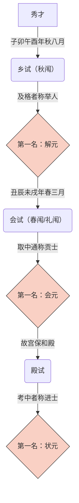

# 连中三元（解元、会元、状元）

---
requires: [中国文化概论/科举制度]
---

明清科举是一套层层筛选的选拔体系。如果一个读书人想在仕途上走到极致，他需要闯过几道关卡？每一关的第一名又叫什么？把这些问题串起来，就是“连中三元”的核心脉络。

> [!IMPORTANT]
> 核心定义：明清科举考试中，==乡试、会试、殿试的第一名分别被称为解元、会元、状元==，一个人在全部三次考试都取得第一，则被称为“连中三元”。

## 三级考试的晋升阶梯

要理解“连中三元”，必须先理清明清科举的三级进阶流程与对应头衔：

- **乡试**：一省范围内的考试，每三年一次（秋八月，故称“秋闱”）。及格者叫“举人”，第一名称为==解元==，意为“解送朝廷录用”。中举即正式进入统治阶级，可称“老爷”，《儒林外史》“范进中举”写的正是此事。
- **会试**：全国范围考试，乡试次年举行（春三月，故称“春闱”或“礼闱”）。发榜时杏花开放，又称“杏榜”。应试者必须是举人，取中后通称“贡士”，第一名叫==会元==。
- **殿试**：由皇帝亲自主考，地点在故宫保和殿。应试者必须是贡士，考中者才是“进士”，第一名为==状元==。

## 概念辨析与易错点

复习时最容易将不同级别的称谓张冠李戴，请通过下表对比记忆：

| 考试级别 | 举办时间 | 别称 | 及格者统称 | 第一名称谓 | 主考方 |
| :--- | :--- | :--- | :--- | :--- | :--- |
| 乡试 | 秋八月 | 秋闱 | 举人 | ==解元== | 朝廷任命朝官 |
| 会试 | 春三月 | 春闱、礼闱 | 贡士 | ==会元== | 礼部（一二品大员） |
| 殿试 | 会试后 | — | 进士 | ==状元== | 皇帝 |

> [!WARNING]
> 常见误区：不要把“解元”当成会试第一名，也不要以为中了“贡士”就是进士。贡士必须经过殿试才能称为进士。

> [!TIP]
> 记忆口诀：“乡解、会会、殿状”——乡试解元，会试会元，殿试状元。三元合一，即为连中三元。

> [!NOTE]
> 延伸辨析：文学史上提到的金代董解元（《西厢记诸宫调》作者），其“解元”是当时对读书人的泛称或尊称，并非指他在明清科举中真考了乡试第一，切勿与科举制度中的严格定义混淆。

## 标准答题示范

遇到名词解释题“连中三元”，可以直接套用以下结构作答：

**题目**：名词解释“连中三元”。

**参考解答**：
连中三元是指考生在明清科举考试的乡试、会试、殿试中连续获得第一名。其中，乡试第一名称为“解元”，会试第一名称为“会元”，殿试第一名称为“状元”。一人若在这三级考试中均拔得头筹，即被称为“连中三元”。
