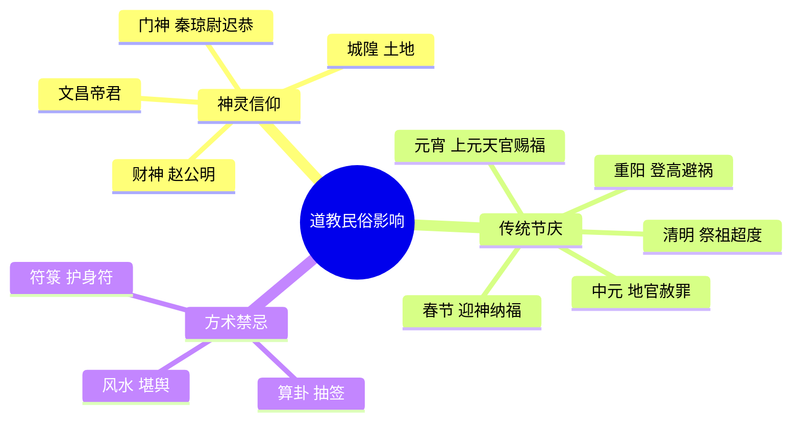

# 道教对中国文化的影响
在第六章中，你已经了解道教的起源与核心教义。你可能会有疑问：在佛教传入和儒学主导的社会里，土生土长的道教到底留下了什么？答案是，它像毛细血管一样渗透到了中国人的宇宙观、科技探索、文学审美和民俗生活的方方面面。

### 一、 思想与政治上的“黄老之术”

道教对中国政治的影响主要体现在**黄老道家**向**道教**的转化阶段。

*   **汉初治国理念**：汉初文景时期，统治者推崇“黄老之术”，主张“==清静无为==”“与民休息”。这不只是哲学，更是被道教吸收并神圣化的治国方针，直接带来了“文景之治”。
*   **宗教与政权的结合**：到了南北朝时期，道教开始从民间信仰转向官方宗教。这里需要区分一个常见的坑：

> [!WARNING]
> **常见坑**：不要以为所有道士都远离政治。北魏寇谦之改革天师道，使之成为“北天师道”，首次让道教成为“帝王师”，试图建立政教合一的政权。

### 二、 科学技术的“炼丹炉”

这可能是道教最出人意料的贡献。为了追求“长生久视”，道士们常年隐居深山进行实验。

> [!IMPORTANT]
> **核心逻辑**：道教“==贵生==”的教义催生了中国古代实验科学的萌芽，而不是单纯的迷信。

*   **化学与矿物学**：葛洪《抱朴子·内篇》记录了化学反应，比如“丹砂烧之成水银，积变又还成丹砂”（硫化汞的分解与还原）。
*   **医学与养生**：
    *   **陶弘景**是茅山宗的代表人物，他在道教史上的贡献不仅在于修炼，他还编纂了《本草经集注》，对中医药学产生巨大影响。
    *   另外，他在道教神仙谱系构建上的贡献常考填空题：他创作了 **==《真灵位业图》==** ，第一次将道教混乱的神仙分出等级、品位，构想了完整的神仙谱系。
*   **火药的发明**：炼丹术士在寻找长生药时，无意中发现了硫磺、硝石和木炭混合物的剧烈燃烧特性，这直接促成了火药的诞生。

### 三、 文学与艺术的“想象力”

道教的浪漫主义色彩与俗文化，极大地拓展了中国文学的边界。

*   **游仙诗与仙话**：李白被称为“诗仙”，他的笔下大量运用道教意象。
*   **小说体裁**：《西游记》虽崇佛，但其天庭体系、玉皇大帝、太上老君等完全取自道教神仙谱系；《封神演义》更是直接以道教阐教、截教为核心。
*   **戏曲与俗文学**：
    *   元代神仙道化剧是当时重要的戏剧题材。
    *   **全真教**的影响：金代==王重阳==创立的全真教，主张三教合一，其内丹修炼、因果报应思想大量融入民间故事。

### 四、 民俗与信仰的“万神殿”

老百姓可能分不清佛寺与道观，但道教神灵决定了中国人节庆与生活的节奏。

*   **人格化的自然**：山有山神，河有河伯，灶有灶王爷，这种“万物有灵”的底层思维正是道教赋予的。
*   **中元节（鬼节）**：七月十五中元节，源于道教三官（天、地、水）中的**地官赦罪**之说，这是典型的道教节日深刻影响民俗生活的体现。

### 案例佐证：论述题中的核心逻辑

如果考试遇到“道教对中国文化所产生的影响”这一论述题（课件P148），你不需要把它写成学术论文，而是可以建立一个“从形而上到形而下”的分析框架：

1.  **顶层设计（思想）**：黄老之学提供了治国的药方，“无为而治”成为乱世后的修复剂。
2.  **中层探索（科技）**：因为怕死所以养生，因为炼丹所以有了化学与火药。
3.  **浅层渗透（生活）**：把抽象的命运具体化为门上的门神、村口的土地庙、考前的文昌祭。

> [!TIP]
> **记忆口诀**：“**政学民俗**四字诀”：政治上的**术**（黄老术）、科学上的**炉**（炼丹炉）、文学上的**谱**（神仙谱）、民俗里的**节**（中元节）。再记具体的名词：陶弘景的谱、王重阳的教。
