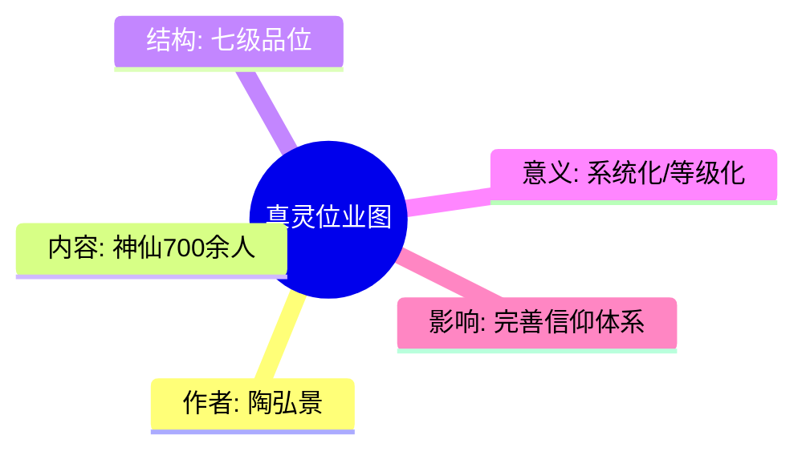

# 陶弘景与《真灵位业图》的道教贡献

# 陶弘景与《真灵位业图》的道教贡献

## 它是什么：道教神仙谱系的“行政编制表”

陶弘景（456—536年）是南朝齐梁时期的著名道士，也是陆修静的再传弟子。他在道教发展史上的核心贡献，在于撰写了==《真灵位业图》==一书。

在此之前，道教神仙体系杂乱无章，民间信仰与官方祭祀混杂。陶弘景搜罗了道教所奉的七百多位神仙，仿照人间官僚等级制度，将他们划分为七个等级（位），每个等级中又细分品位。他构想出了一个==等级森严而又宏大细密的神仙谱系==，使道教从松散的方术集合，转变为一个拥有庞大且有序信仰系统的成熟宗教。

## 为什么需要：解决信仰混乱，确立正统秩序

试想，如果一个宗教的神灵之间没有上下级关系，信徒祈祷时该先拜谁？法术效力由谁裁定？

在陶弘景之前，道教缺乏统一的神学架构。《真灵位业图》的出现解决了两个关键问题：
1.  **整合资源**：将分散的地方神、历史人物神、先天神祇纳入同一体系。
2.  **确立权威**：通过“位业”（职位与业绩）的划分，明确了主神（如元始天尊）的最高地位，为道教仪轨和修炼提供了理论依据。

> [!IMPORTANT]
> 核心结论：陶弘景首创了道教神仙的==等级与品位==，其著作《真灵位业图》标志着道教神仙谱系的正式形成。

## 怎么做：构建七阶神仙金字塔

陶弘景将神仙分为七个阶层，每一层都有主神统领。这种结构类似于朝廷的九品中正制或官僚体系。

| 层级 | 特征 | 代表神祇/类型 |
| :--- | :--- | :--- |
| 第一阶 | 最高主宰 | 元始天尊等 |
| 第二至六阶 | 中层管理 | 玉皇大帝、老君、各天帝等 |
| 第七阶 | 基层鬼神 | 鬼官、地仙、历史名人等 |

这种划分不仅厘清了神际关系，还规定了不同等级神仙的职权范围，使得道教的斋醮科仪有了明确的操作对象。

## 常见误区与辨析

> [!WARNING]
> 易错点：不要将陶弘景与葛洪或寇谦之的贡献混淆。
> *   **葛洪**：侧重炼丹术与神仙理论（《抱朴子》）。
> *   **寇谦之**：侧重改革天师道，去除粗俗仪式（北天师道）。
> *   **陶弘景**：侧重==神仙谱系建构==（《真灵位业图》）。

**常见坑：**
*   **误记书名**：常误写为《真灵位业表》或《神灵位业图》，正确书名为==《真灵位业图》==。
*   **误记人数**：课件明确指出搜罗神仙==七百余人==，非数百或上千的模糊概念。

## 算对了的例子：真题复盘

根据复习提纲 P146 第 5-9 行的考点，我们来看一道典型的填空/选择题逻辑：

**题目**：在道教发展史上，首创分出神仙等级、品位，并构想出神仙谱系的书籍是______，其作者是______。

**解析步骤**：
1.  锁定关键词：“首创”、“神仙等级”、“谱系”。
2.  对应人物：南朝道士，陆修静再传弟子 -> **陶弘景**。
3.  对应著作：系统排列神仙位阶 -> **《真灵位业图》**。

**正确答案**：
书籍：《真灵位业图》
作者：陶弘景

> [!TIP]
> 记忆口诀：**陶弘景，画图景；七百神，分位品。**
> （“画图景”谐音《真灵位业图》，暗示其构建了神仙世界的景象/谱系）
