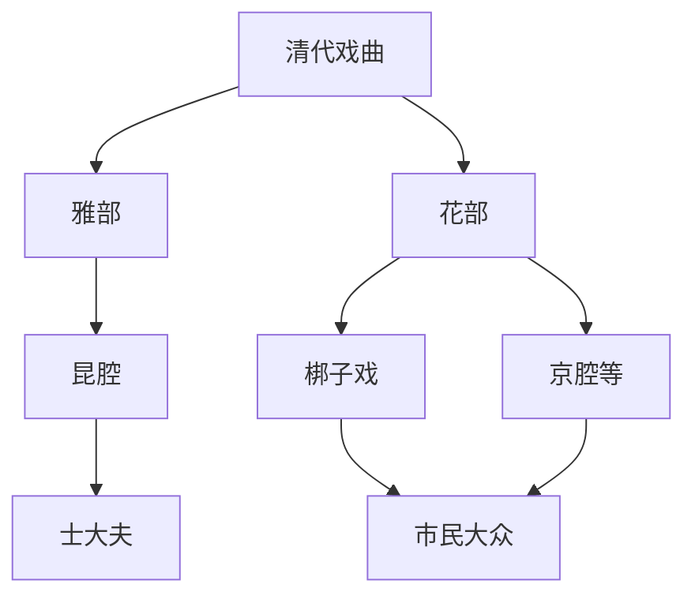

# 雅部与花部（昆腔与乱弹诸腔）

## 雅部与花部是什么

清代戏曲舞台上，剧种众多、风格各异。当时人按雅俗把它们分为两大阵营：**雅部** 指昆腔（昆曲）；**花部** 指昆腔以外的地方戏，以北方梆子戏为代表，京腔（后来的京剧）也在其中。

> [!IMPORTANT]
> **核心考点**：==雅部 = 昆腔，受士大夫青睐==；==花部 = 梆子等地方戏，受市民欢迎==。

## 为什么这样分

昆腔曲调高雅、辞章优美，演唱讲究字正腔圆，唱词多用典雅文辞，因此深受封建士大夫欣赏，被尊为"雅"。但正因曲高和寡，它的传播面被限制，主要在上层社会流行。

花部戏曲风格粗犷、语言通俗，故事贴近百姓生活，所以被士大夫==贬称为"花部"==（"花"有杂、俗之意），却在广大市民阶层中广受欢迎。

## 两者的命运走向

谁的生命力更强？请看下图：

- **雅部（昆腔）**：虽在一度衰落，但在京师地位特殊，==对京剧形成有特殊贡献==——京剧吸收了许多昆腔唱段，今天京剧唱腔中仍可听到昆腔。
- **花部**：京腔演变为京剧、各地梆子戏日益兴盛，逐渐取代昆腔成为主流。

> [!TIP]
> 记忆口诀：**"雅在士、花在民；雅易衰、花易兴"**。

## 对比一览

| 维度 | 雅部（昆腔） | 花部（梆子等） |
|---|---|---|
| 风格 | 曲调高雅、辞章优美 | 粗犷豪放 |
| 语言 | 文雅、偏书面 | 通俗口语 |
| 受众 | 封建士大夫 | 广大市民阶层 |
| 影响 | 一度高居上层、后趋衰 | 越来越兴盛 |
| 代表 | 昆曲 | 梆子戏、京腔（京剧） |

> [!WARNING]
> 易错点：**"花部"是贬称，不是自称**；京腔属于花部，但它后来吸收昆腔精华成就了京剧——别把京腔与昆腔混为一谈。

## 做对一道题

例：简答"雅部""花部"。

**参考作答**：雅部指昆曲，受众主要为士大夫；花部指梆子等地方戏，受众广泛，最终取代昆曲成为主流。昆腔曲高和寡故影响力受限，但对京剧形成有特殊贡献；花部因通俗贴近市民，生命力强，京腔与各地梆子戏日益兴盛，昆腔反倒趋向衰亡。
