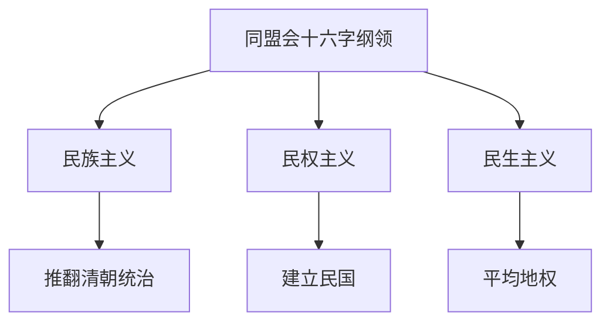

# 孙中山的三民主义学说及其历史局限性

## 三民主义是什么

1905 年，孙中山在日本东京成立**中国同盟会**，把"驱除鞑虏，恢复中华，创立民国，平均地权"十六字纲领，进一步阐发为民族、民权、民生三大主义，即**三民主义**。它是辛亥革命的指导思想，也是近代中国第一个比较完整的资产阶级民主革命纲领。

## 三大主义分别解决什么问题

先想一个问题：一场革命至少要回答哪几件事？——**革谁的命**、**革完建什么**、**成果归谁**。三民主义正好对应这三问：

| 主义 | 纲领对应 | 要解决的问题 | 实质 |
|------|----------|--------------|------|
| 民族主义 | 驱除鞑虏，恢复中华 | 革谁的命 | 以革命手段推翻清朝统治 |
| 民权主义 | 创立民国 | 建什么国 | 推翻君主专制，建立资产阶级共和国 |
| 民生主义 | 平均地权 | 成果怎么分 | 核定地价，涨价归公 |

> [!IMPORTANT]
> ==民权主义是三民主义的核心==。因为它回答的是革命的根本问题——推翻帝制之后建立什么政权，这是革命的最终目标。

## 历史进步性与局限并存

三民主义的进步性在于：它把斗争矛头指向君主专制制度，明确要建立共和国，走在了同时代其他方案的前面。

但局限同样明显，而且正是这些局限埋下了辛亥革命失败的种子：

| 局限 | 具体表现 | 导致的后果 |
|------|----------|------------|
| 民族主义不反帝 | 只反"鞑虏"（清朝），未明确反对帝国主义 | 革命得不到真正的民族独立 |
| 民权主义脱离群众 | 只讲资产阶级民主，人民权利缺乏保障 | 群众基础薄弱 |
| 民生主义不彻底 | "平均地权"未触及封建土地所有制 | 不能满足农民的土地要求 |

> [!WARNING]
> 三民主义==没有提出彻底的反帝反封建纲领==，这是它最根本的局限。辛亥革命最终失败，主观原因正在于此——革命派没有彻底的纲领、不能发动群众、没有坚强政党。

## 常见易混点辨析

> [!TIP]
> - **民族主义 ≠ 反帝**：它只反对清朝统治，没有明确反帝，这是最容易误判的考点。
> - **民生主义 ≠ 分土地给农民**："平均地权"是核定地价、涨价归公，并未把土地分给农民，与后来中共的土地革命纲领有本质区别。
> - **三民主义 ≠ 新三民主义**："联俄、联共、扶助农工"是 1924 年国民党一大确立的新政策，属于新三民主义，不要混淆。

## 典型例题

> 题干：三民主义的核心是（ ）
> A. 民族主义　B. 民权主义　C. 民生主义　D. 创立民国

**答案：B**

**解析**：民权主义（创立民国）解决的是革命的根本问题——推翻君主专制后建立资产阶级共和国，这是革命的最终目标，因此是三民主义的核心。D 选项"创立民国"是纲领原文，不是三大主义的表述，属于干扰项。
