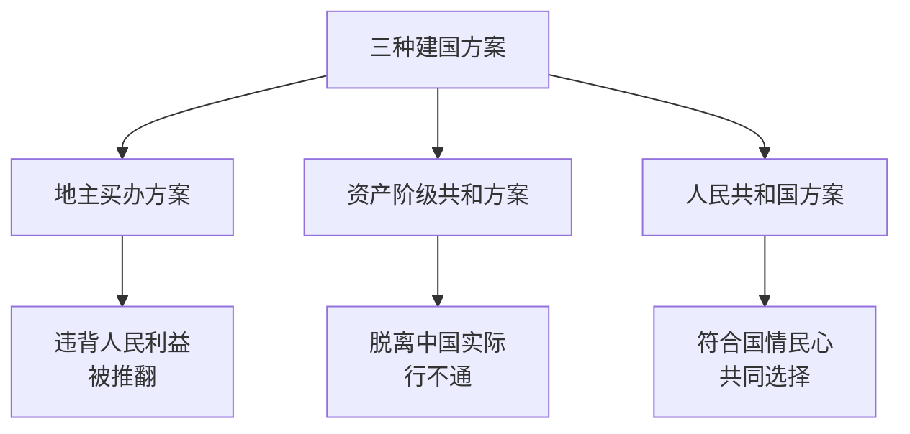

# 近代中国的三种建国方案与两个中国之命运，中共建国方案成为共同选择的原因

近代中国面临“向何处去”的历史抉择时，并非只有一条路可走。为什么最终只有中国共产党的方案成为了历史的选择？要回答这个问题，首先要厘清当时并存的政治力量及其主张，再分析它们在实践中为何成败各异。

## 三种政治力量与建国方案

1949年以前，中国社会主要存在三种政治力量，分别代表了不同的阶级利益，并提出了截然不同的建国蓝图：

| 政治力量 | 阶级基础 | 建国方案核心主张 | 命运走向 |
| :--- | :--- | :--- | :--- |
| 地主与买办大资产阶级 | 反动势力 | 维持军事独裁，延续半殖民地半封建社会 | 被人民唾弃、推翻 |
| 民族资产阶级 | 中间势力 | 建立资产阶级共和国，发展资本主义 | 脱离实际、行不通 |
| 工人、农民与小资产阶级 | 进步势力 | 建立人民民主专政，经新民主主义走向社会主义 | ==成为共同选择== |

> [!IMPORTANT]
> 虽然形式上有三种方案，但资产阶级共和国方案不具备现实性。因此，中国人民面临的实质选择只有两个：==或者是继续半殖民地半封建的旧中国，或者是创建新民主主义的新中国==。

## 资产阶级共和国方案为何行不通

既然民族资产阶级也追求国家独立与发展，为何其方案未能实现？这并非主观意愿问题，而是由客观条件决定的：

-   **帝国主义的压迫**：中国是受帝国主义深度控制的国家，列强绝不允许中国建立一个真正独立富强的资产阶级共和国，这是外部环境的不容忍。
-   **民族资产阶级的软弱性**：该阶级在经济和政治上先天不足，既没有勇气也没有能力领导彻底的反帝反封建革命，无法为建立共和国扫清障碍。

> [!WARNING]
> 答题时切勿将“资产阶级共和国方案”等同于“完全错误”。应表述为“==脱离中国实际，不具备现实性==”，且连提出者最终也承认其行不通。避免使用“反动”“邪恶”等非学术情绪化词汇评价中间势力。

## 中共方案成为共同选择的内在逻辑

中国共产党的方案之所以胜出，关键在于它精准回应了近代中国的核心矛盾，并赢得了最广泛的社会支持：

-   **彻底的革命纲领**：主张进行彻底的反帝反封建的新民主主义革命，从根本上解决了土地问题和民族独立问题。
-   **广泛的统一战线**：不仅依靠工农，还团结了城市小资产阶级乃至民族资产阶级的政治代表，形成了最大公约数。
-   **实践的检验**：通过武装斗争、根据地建设和抗日民族统一战线的成功实践，证明了自身方案的可行性与领导力。

> [!TIP]
> 记忆口诀：“==两压一软证不通，三力合一选共和==”。“两压”指帝国主义压迫与封建势力阻碍；“一软”指民族资产阶级软弱；“三力”指工人、农民、小资产阶级及民族资产阶级代表的联合拥护。

在简答题作答时，务必先分述三种方案内容，再点明“两个命运”的实质对立，最后从“外部压迫+内部软弱”双维度论证资产阶级方案失败原因，落脚于中共方案获得“最广大群众拥护”这一历史结论。
