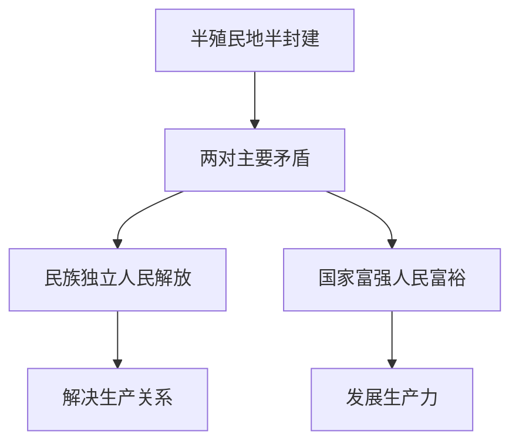

# 近代中国的两大历史任务及其相互关系

近代中国沦为半殖民地半封建社会后，摆在中国人民面前的根本问题是什么？要回答这个问题，就必须厘清近代中国的两大历史任务及其相互关系。

## 两大历史任务是什么

> [!IMPORTANT]
> 近代中国的两大历史任务是：==争取民族独立、人民解放==和==实现国家富强、人民富裕==。

这两大任务并非凭空产生，而是由近代中国的社会性质和主要矛盾决定的。鸦片战争后，独立的中国逐步变为半殖民地的中国，封建的中国逐步变成半封建的中国。帝国主义和中华民族的矛盾、封建主义和人民大众的矛盾，成为近代中国社会的主要矛盾。有压迫就有反抗，有落后就要发展，两大历史任务由此确立。

我们可以用一张图来理清“社会性质—主要矛盾—历史任务”的推导链条：

## 两大任务的相互关系

两大历史任务是==互相区别又紧密联系==的。它们不能混为一谈，也不能割裂开来。

| 比较维度 | 争取民族独立、人民解放（任务一） | 实现国家富强、人民富裕（任务二） |
| :--- | :--- | :--- |
| **核心目标** | 改变受压迫、受剥削的地位 | 改变经济、文化落后的状况 |
| **解决对象** | 解决==生产关系==的问题 | 解决==生产力==的问题 |
| **实现途径** | 必须通过==革命==才能实现 | 必须通过==现代化==才能实现 |
| **逻辑定位** | 为后者扫清障碍，创造必要前提 | 是前者的延续和追求的目标 |

> [!NOTE]
> 二者共同服务于中华民族伟大复兴的历史主题。没有民族独立，国家富强就是空中楼阁；没有国家富强，民族独立也缺乏物质保障。

## 常见易错点与辨析

> [!WARNING]
> 考试中极易将两大任务的“实现途径”张冠李戴。请记住：**任务一靠革命，任务二靠建设（现代化）**。

> [!CAUTION]
> 不要把“争取民族独立”等同于“实现国家富强”。有些同学误以为只要推翻了三座大山，国家自然就富强了。事实上，新中国成立只完成了第一个任务，第二个任务至今仍在推进中。

**相近概念辨析**：很多同学容易把“两大历史任务”和“两对主要矛盾”搞混。主要矛盾是客观存在的社会冲突（帝国主义vs中华民族，封建主义vs人民大众），而历史任务是主观能动要去完成的目标。矛盾决定任务，任务旨在解决矛盾。

## 真题实战演练

以简答题第 5 题为例：“中国近代社会的两大历史任务是什么，他们之间的关系如何？”

**标准作答思路**：

1. **先答“是什么”**：明确指出两大任务是争取民族独立、人民解放和实现国家富强、人民富裕。
2. **再答“区别”**：从目的（改变地位 vs 改变落后状况）、手段（革命 vs 现代化）、解决的问题（生产关系 vs 生产力）三个维度展开对比。
3. **最后答“联系”**：点明前者为后者扫清障碍、创造前提，后者是前者的延续和目标，二者统一于中华民族伟大复兴的主题。

> [!TIP]
> 记忆口诀：“一独一富，一革一建；前者扫障，后者续篇。”答题时踩准“生产关系/生产力”“革命/现代化”这几组关键词，阅卷老师一眼就能看到得分点。
