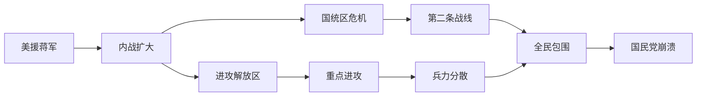

# 抗战胜利后中国面临的两种命运、两个前途的决战

## 概念与背景

抗战胜利后，中国社会面临两种前途和两种命运的决战：一种是和平民主、建设新中国；另一种是内战独裁、维持国民党反动统治。两种命运、两样前途的较量，实质上是人民民主与专制独裁之间的较量，也是决定中国革命走向的关键。

> [!IMPORTANT]
> 两种命运、两个前途的决战，贯穿于国民党发动内战、国民党政权走向崩溃以及人民解放战争胜利的进程中。

## 为什么会走向决战

日本投降后，蒋介石为攫取全国政权，撕毁《双十协定》，进攻解放区，全面内战由此爆发。国民党军在1947年由对解放区的全面进攻，转为重点进攻陕北、山东解放区，却始终无法消灭人民武装。

第二条战线也在国统区迅速形成。国民党发动内战、进行“劫收”、大肆勒索人民，引起社会普遍不满。1947年，国民党统治区物价飞涨、民生破产，工人罢工、学生运动此起彼伏，形成以学生运动为先导的人民运动高潮。

> [!TIP]
> 记忆主线：==内战扩大→财政崩溃→第二条战线→全民包围→国民党崩溃==。

## 国民党为何陷入全民包围

第一，国民党政权专制独裁、腐败无能。抗战胜利后，接收人员大肆“劫收”，私吞敌伪资产，加剧了原沦陷区人民对国民党的失望。

第二，为筹措内战经费，国民党滥发纸币、征收苛捐杂税，造成恶性通货膨胀，工厂停工、商店倒闭、农民破产。民族资产阶级和上层小资产阶级也因利益受损而转向反对国民党。

第三，国民党对民主党派和进步人士进行迫害，进一步失去社会支持。各民主党派、无党派人士逐渐接受中国共产党的领导，拥护建立人民民主的新中国。

第四，国民党在军事上虽拥有优势，但兵力不足、装备依赖美国，经济和民心却持续流失，形成了政治、经济、社会、军事上的全面危机。

## 两个重要概念的区别

| 概念 | 含义 | 表现 |
|---|---|---|
| 全面进攻 | 对各解放区 simultaneously 发动进攻 | 兵力分散，重点不突出 |
| 重点进攻 | 集中兵力进攻陕北、山东解放区 | 企图摧毁中共指挥中枢，但兵力进一步被牵制 |
| 第一条战线 | 人民解放战争，革命力量与国民党军之间的军事较量 | 决定革命战争胜负 |
| 第二条战线 | 国统区人民反对国民党统治的爱国民主运动 | 学生运动先导，各阶层广泛响应 |

> [!WARNING]
> 重点进攻不是改变战略进攻性质，而是国民党在兵力不足条件下的兵力调整；其结果是被人民解放军各个歼灭。

## 民主党派的作用

抗战时期，民主党派主张抗日、爱国和民主，反对投降与独裁，并参与国统区抗日民主运动。抗战胜利后，它们以“第三方面”身份反对国民党的内战政策，为和平民主奔走。

中国共产党同民主党派既合作又帮助其进步。随着国民党迫害加剧，1948年1月22日，民主党派和无党派人士发表《对时局的意见》，表示接受中国共产党的领导，拥护建立人民民主的新中国。1949年9月，各民主党派参加中国人民政治协商会议，标志着中国共产党领导的多党合作和政治协商制度基本形成。

> [!IMPORTANT]
> 民主党派不是共产党的附属力量，而是以各自政纲为基础、在革命实践中逐步接受并拥护中共领导的重要政治力量。

## 高频易错点

- 不要把“两种命运”理解为两个国家或两支军队；它指国家的前途和人民的命运。
- 不要认为第二条战线是独立于解放战争的另一场军事战争；它主要指国统区的爱国民主运动。
- “以学生运动为先导”不等于运动主体只有学生，工人、农民、市民等各阶层都广泛参与。
- 1949年政协会议标志的是多党合作、政治协商格局基本形成，并非新中国成立。

## 典型简答题

**问：国民党政府为什么会陷入全民包围并迅速走向崩溃？**

答：国民党因专制独裁、官员贪污和“劫收”失去民心；为筹措内战经费而滥发纸币、苛征捐税，造成恶性通货膨胀，使各阶层人民生活困苦；其坚持内战政策并迫害民主人士，促使民主党派和全国人民转向共产党；加之军事上兵力分散、重点进攻失败，最终陷入全国人民的包围之中并走向崩溃。
