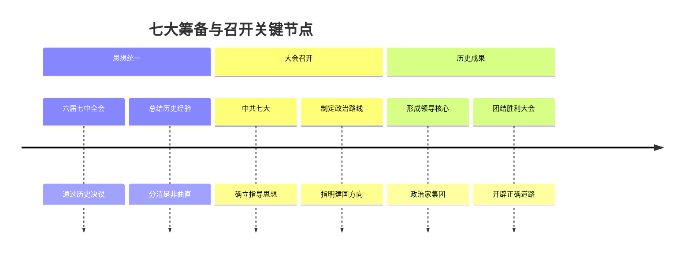

# 中共第七次全国代表大会的历史意义与毛泽东思想指导地位的确立

## 它是什么与为什么需要

中共七大是抗日战争胜利前夕召开的一次==承前启后、奠定胜局==的关键会议。在经历了长期艰苦卓绝的斗争后，党亟需解决两个核心问题：一是如何从思想上彻底清算错误路线，实现全党空前团结；二是面对抗战胜利后的复杂局势，中国向何处去？七大正是为了回答这些时代之问，为建立新民主主义新中国制定正确路线，并确立统一的指导思想。

> [!IMPORTANT]
> 七大的历史性贡献是==确立毛泽东思想为党的指导思想并写入党章==，标志着党在政治上、思想上、组织上走向成熟。

## 怎么做：从历史决议到思想确立

七大并非孤立事件，其成功召开建立在充分的思想准备之上。理解这一过程，可以把握以下逻辑链条：

1945年4月，扩大的六届七中全会原则通过《关于若干历史问题的决议》，对建党以来特别是六届四中全会至遵义会议前的历史经验教训作出结论。这份==中国共产党历史上第一个历史决议==使全党高级干部对中国革命基本问题的认识达到一致，为七大顺利召开创造了充分条件。随后召开的七大，正式将以毛泽东为主要代表的理论成果命名为“毛泽东思想”，规定为党的一切工作的指针，并形成了一支高举毛泽东旗帜的久经考验的政治家集团。

## 易混辨析与常见误区

复习时需注意区分相关概念，避免张冠李戴：

| 对比维度 | 《关于若干历史问题的决议》 | 中共七大 |
| :--- | :--- | :--- |
| 时间节点 | 1945年4月（六届七中全会） | 1945年4-6月 |
| 核心任务 | 总结历史经验，统一思想 | 确立指导思想，制定路线 |
| 历史定位 | 为七大召开创造条件 | 里程碑意义，走向成熟 |
| 理论贡献 | 分清历史是非 | ==命名并确立毛泽东思想== |

> [!WARNING]
> “新民主主义革命”科学概念最早提出于《中国革命和中国共产党》，而非《新民主主义论》或七大文件。七大是将已有理论成果==系统化、指导化==，而非首次提出该概念。

> [!TIP]
> 简答题作答要点可记为“一确立、两成熟、三制定”：确立毛泽东思想指导地位；标志政治思想组织成熟；制定正确路线方针政策、确立领导核心地位、形成政治家集团。

## 真题应用示例

以“简答5：中国共产党七大的历史意义”为例，规范答题应包含三层：第一层点明==确立毛泽东思想为指导思想并写入党章==这一历史性贡献；第二层阐述“三个成熟”的里程碑意义；第三层落脚于“团结的大会、胜利的大会”及其对后续革命的指引作用。若仅回答“确立了毛泽东思想”而忽略组织建设与路线方针，则得分不完整。记住，七大的意义是==系统性、整体性==的，答题时需兼顾思想、政治、组织三个维度。
