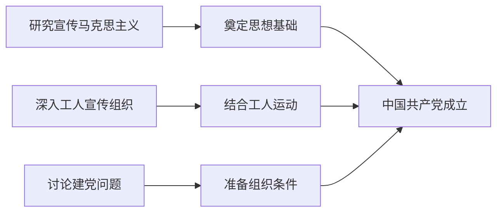

# 中国共产党早期组织的活动（宣传马克思主义、同工人运动结合等）

中国共产党早期组织的活动，是连接“马克思主义传播”与“中国共产党成立”的关键环节。答题时要抓住一条主线：==早期组织不仅宣传马克思主义，而且推动马克思主义同中国工人运动相结合，并为正式建党作了思想和组织准备。==

## 为什么需要这些活动

五四运动后，马克思主义在中国广泛传播，但仅有思想传播还不能直接建立无产阶级政党。早期共产主义者需要解决三个问题：怎样扩大马克思主义的思想阵地，怎样使先进知识分子同工人群众结合，怎样把各地分散的共产主义力量组织起来。因此，早期组织的活动围绕思想宣传、工人运动和建党准备展开。

## 主要开展了哪些活动

| 活动方面 | 主要内容 | 历史作用 |
|---|---|---|
| 研究和宣传马克思主义 | 学习马克思、恩格斯原著，开始学习列宁著作；利用《新青年》《共产党》《民国日报》等宣传马克思主义；《共产党宣言》中文全译本出版；研究中国实际问题 | 扩大马克思主义影响，为建党奠定思想基础 |
| 同反马克思主义思潮斗争 | 同主张中国走资本主义道路的知识分子、无政府主义者等进行论战 | 划清马克思主义同其他思潮的界限 |
| 到工人中去宣传和组织 | 创办工人刊物、工人学校，建立工会，发动工人开展罢工斗争 | 促进马克思主义同中国工人运动相结合 |
| 讨论和准备建党 | 讨论党的世界观、无产阶级专政和党的纪律等问题；开展实际组织工作；建立社会主义青年团 | 为统一建党准备干部和组织条件 |

其中，蔡和森在建党讨论中提出了有关党的世界观、无产阶级专政和党的纪律原则的主张。上海社会主义青年团成立后，各地团组织引导青年学习马克思主义、参加实际斗争，为党培养了一批后备力量。

## 和相近概念的区别

早期组织的活动与中共一大后的工作重心不能混为一谈。前者是为建党作准备，包括思想宣传、工人工作和组织筹备；中共一大后，党把主要精力用于==发动工人运动==。因此，“中国共产党创建初期，其主要精力是放在（　）”应选 **B. 发动工人运动**，而不是发展军事斗争或立即解决农民问题。

> [!WARNING]
> 不要把“第一个中国共产党早期组织”写成“中国共产党正式成立”。第一个早期组织于1920年在上海建立；中国共产党正式成立的标志是1921年中共一大召开。因此，“第一个中国共产党早期组织建立于哪里”应选 **A. 上海**。

> [!TIP]
> 简答题可按“三方面”作答：==研究宣传马克思主义—到工人中宣传组织—讨论建党并开展组织工作==。每一方面再补具体史实，最后点明“为中共成立作了思想上、干部上和组织上的准备”。
