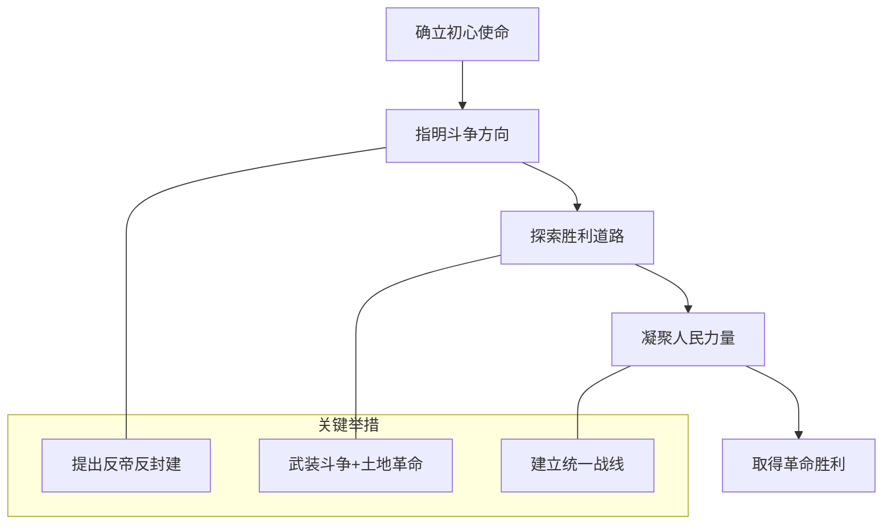

# 为什么说中国革命走上胜利之路是由于有了中国共产党的领导

# 为什么说中国革命走上胜利之路是由于有了中国共产党的领导

## 它是什么：历史选择的必然逻辑

这一知识点旨在回答“为什么是中共”而非其他政治力量（如国民党、民主党派）最终领导中国革命取得胜利。其核心论据在于中国共产党在**初心使命**、**方向指引**、**道路探索**及**力量凝聚**四个维度的独特作用。

> [!IMPORTANT]
> ==没有共产党就没有新中国==，这是中国人民依据近代中国革命的历史经验得出的科学结论。

## 为什么需要：对比其他政治力量的局限

为了理解中共领导的必要性，我们可以回顾大革命时期及解放战争时期的历史对比：

| 比较维度 | 中国共产党 | 国民党 / 其他党派 |
| :--- | :--- | :--- |
| **政治口号** | 提出反帝反军阀，目标明确 | 后期背离初心，维护独裁统治 |
| **群众基础** | 发动工农，解决土地问题 | 脱离群众，甚至迫害民主人士 |
| **武装力量** | 建立党直接指挥的军队 | 军队派系林立，战斗力涣散 |
| **统一战线** | 倡导者、领导者，又团结又斗争 | 破坏合作，实行一党专政 |

> [!NOTE]
> 民主党派在抗战和反对内战中起了积极作用，但最终发表《对时局的意见》，表示愿意接受中共领导，标志着多党合作格局的形成。

## 怎么做：中共发挥领导作用的具体路径

中国共产党并非天然拥有领导权，而是在实践中通过以下路径确立并巩固了领导地位：

1.  **指引方向**：在大革命中，中共提出了反帝国主义、反军阀的政治口号，为迷茫的中国指明了出路。
2.  **探索道路**：从大革命失败的教训中认识到，必须掌握**武装斗争**领导权，解决**农民土地问题**，并加强党的自身建设。
3.  **凝聚力量**：将原本“一盘散沙”的中国人民，通过统一战线和组织动员，凝聚成万众一心的不可战胜的力量。

## 常见的坑与易错点

> [!WARNING]
> **误区**：认为中共的领导地位是自封的或仅靠军事胜利获得的。
> **正解**：领导地位是在长期斗争中，由各民主党派和全国人民**自愿选择**的结果。例如1948年民主党派发表声明拥护中共领导，1949年参加政协会议，标志着这一格局的法律化和制度化。

> [!TIP]
> **记忆口诀**：方向明（指路），道路对（武装+土地），人心齐（统战），自身硬（党建）。

## 算对了的例子：结合简答题解析

以课件中的**简答4**为例，题目问“大革命失败的教训给中国共产党提供了怎样的认识？”

**错误答法**：只回答“要搞武装斗争”。
**正确答法逻辑**：
1.  **统一战线**：既要建立，又要保持独立性，实行“又团结又斗争”。
2.  **武装斗争**：必须组建由党直接统率的军队。
3.  **农民问题**：解决土地问题，发动农民。
4.  **党的建设**：加强民主集中制，重质量而非仅重数量。

这一答案完整体现了中共如何从失败中汲取教训，从而完善领导能力，最终走向胜利。
