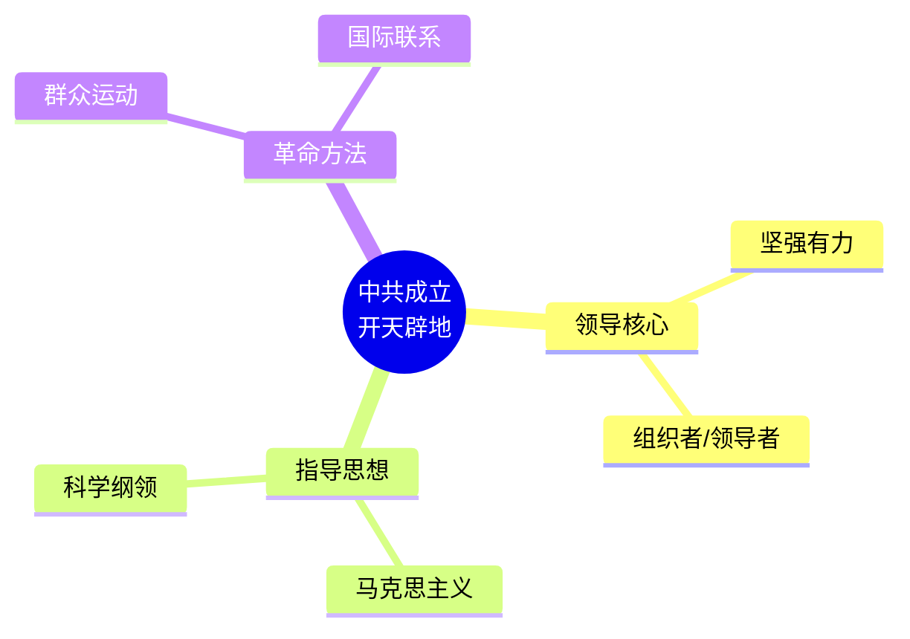

# 中国共产党的成立是“开天辟地”大事变的历史特点和历史意义

## 核心定义与历史定位

中国共产党的成立被定义为中华民族发展史上一个==“开天辟地”的大事变==。这并非简单的政权更迭或组织建立，而是中国革命从旧民主主义向新民主主义转变的根本转折点。在此之前，无论是太平天国、戊戌变法还是辛亥革命，虽各有功绩，但均因缺乏先进阶级政党的领导而失败。

> [!IMPORTANT]
> 核心结论：中共成立解决了近代中国革命屡遭挫折的最重要原因——==没有先进的坚强的政党作为凝聚力量的领导核心==。

## 为什么是“开天辟地”？（三大新面貌）

要理解其“新”，需对比此前革命的局限性。中共成立后，中国革命在以下三个维度发生了质变：

| 维度 | 旧民主主义革命（如辛亥革命） | 新民主主义革命（中共成立后） |
| :--- | :--- | :--- |
| **领导核心** | 资产阶级政党（松散、软弱） | ==坚强的无产阶级政党== |
| **指导思想** | 三民主义（未彻底反帝反封建） | ==马克思主义==（科学世界观） |
| **革命方法** | 依靠会党、新军，脱离群众 | ==发动工农群众==，建立统一战线 |

1.  **有了坚强的领导核心**：灾难深重的中国人民有了可以依赖的组织者。
2.  **有了科学的指导思想**：以马克思主义为指导，结合中国实际，制定了正确的纲领。
3.  **有了新的革命方法**：沟通了中国革命与世界无产阶级革命的联系，获得了国际援助。

## 常见误区与辨析

> [!WARNING]
> 易错点：不要混淆“中共一大”与“中共二大”的任务。
> *   **中共一大**（1921）：确定党的中心任务是==领导和组织工人运动==。
> *   **中共二大**（1922）：制定了完整的==反帝反封建的民主革命纲领==。

许多同学误以为中共一成立就提出了明确的反帝反封建纲领，实际上这是在大革命时期逐步明确并在二大正式制定的。此外，五四运动中无产阶级登上舞台是中共成立的**阶级基础**，而非中共直接领导了五四运动（当时党尚未成立）。

## 典型例题解析

**题目**：为什么说中国共产党的成立是“开天辟地”的大事变？

**解题思路**：
此题考查历史意义的三个层面。回答时需紧扣“新”字，分别从领导力量、思想武器、革命途径三个角度展开。

**标准答法要点**：
1.  **领导核心新**：中国革命有了坚强的领导核心，改变了以往一盘散沙的局面。
2.  **指导思想新**：引入了马克思主义，使革命有了科学的理论指引。
3.  **革命方法新**：采取了群众路线，并建立了与国际无产阶级革命的联系。

> [!TIP]
> 记忆口诀：**“核心强、主义真、方法新”**。
> 只要记住这三点，即可覆盖简答题的主要得分点。
