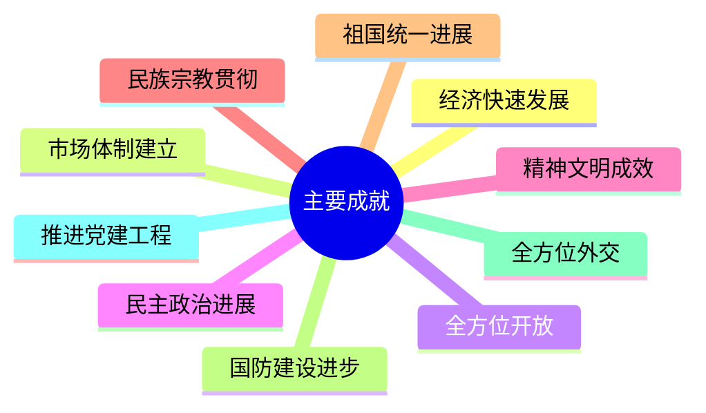

# 十一届三中全会以来中国特色社会主义事业取得的主要成就及其原因

## 考点定位

本题是第十章的**总括性简答题**，答题要扣住“十一届三中全会以来”这一时间范围，分别回答“主要成就”和“取得成就的原因”。成就部分重在全面，原因部分重在突出==中国共产党的领导和全国人民的团结奋斗==。

## 主要成就：十个方面

可用“经济—改革—开放—政治—文化—民族宗教—统一—国防—外交—党建”的顺序作答：

| 方面 | 答题要点 |
|---|---|
| 经济建设 | 国民经济持续健康快速发展，现代化建设稳步推进，综合国力和国际竞争力显著提高，人民生活总体上达到小康水平 |
| 体制改革 | 社会主义市场经济体制初步建立并不断完善，各项改革取得重大进展 |
| 对外开放 | 取得新突破，形成全方位、多层次、宽领域的对外开放格局 |
| 民主政治 | 社会主义民主政治建设取得重要进展 |
| 精神文明 | 社会主义精神文明建设成效显著 |
| 民族宗教 | 民族政策和宗教政策得到全面贯彻 |
| 祖国统一 | 祖国统一大业取得进展 |
| 国防军队 | 国防和军队建设迈出新步伐 |
| 外交工作 | 积极开展全方位外交 |
| 党的建设 | 全面推进党的建设新的伟大工程 |

> [!TIP]
> 记忆口诀：**经改开、政文民，统国外交加党建**。其中“经改开”指经济、改革、开放，“民”指民族宗教，“统国”指统一、国防。

## 取得成就的原因

第一，这些成就是全国各族人民在中国共产党的领导下，团结一致、艰苦奋斗、开拓进取取得的。

第二，中国共产党妥善处理国内外一系列重大而复杂的问题，经受各种困难和风险的考验，不断总结治党治国治军新经验，增强领导水平和执政能力。

因此，原因不能只写“实行了改革开放”。==改革开放是重要历史进程，党的领导、人民奋斗和执政能力提高才是本题要求展开的原因。==

## 相近题目与常见误区

| 相近题目 | 答题重点 |
|---|---|
| 十一届三中全会的历史转折 | 写思想、政治、组织路线的拨乱反正及改革开放新时期的开启 |
| 新中国成立以来的历史性成就 | 从经济、政治、文化、开放、国防等方面作历史性概括，并说明“只有社会主义才能救中国、发展中国” |
| 本题 | 限定于十一届三中全会以来，按“十项成就＋两点原因”作答 |

> [!WARNING]
> 不要把“伟大历史转折”的六条内容搬来充当成就，也不要把成就只写成国内生产总值增长等经济数据；政治、文化、国防、外交和党建同样属于得分点。

## 规范作答示例

**答：**十一届三中全会以来，中国特色社会主义事业取得巨大成就：国民经济持续健康快速发展，综合国力显著提高，人民生活总体达到小康；社会主义市场经济体制初步建立并不断完善；形成全方位、多层次、宽领域的开放格局；民主政治和精神文明建设取得进展；民族宗教政策全面贯彻；祖国统一、国防军队建设和全方位外交不断推进；党的建设新的伟大工程全面推进。其原因在于：全国各族人民在党的领导下团结奋斗、开拓进取；党在应对复杂问题和风险考验中不断总结治党治国治军经验，提高领导水平和执政能力。
