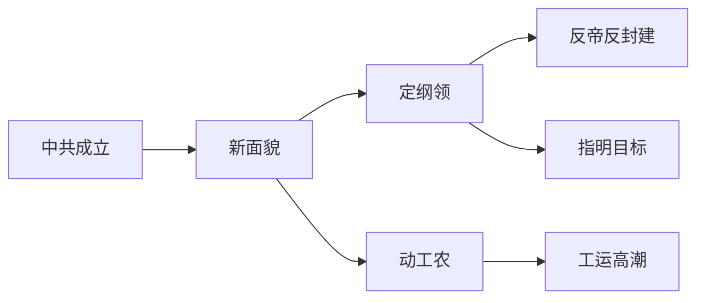
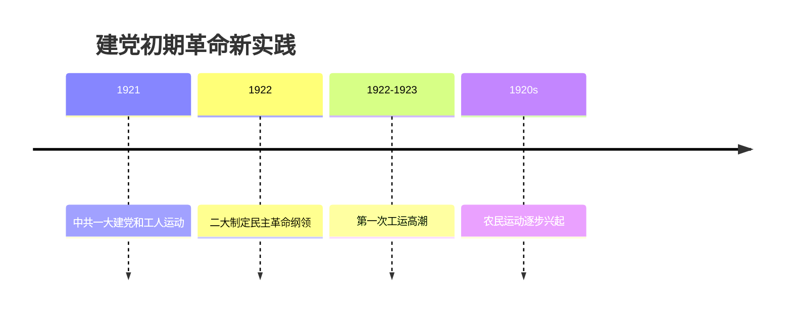

# 中国共产党成立后中国革命呈现的新面貌（制定民主革命纲领、发动工农运动）

中国共产党成立后，中国革命为什么焕然一新？最直观的变化，就是有了清晰的政治纲领，并真正把工农大众动员了起来。我们先从一个核心问题切入：在中共成立前，辛亥革命虽然推翻了皇帝，但为什么没有完成反帝反封建的任务？因为没有彻底的反帝反封建纲领，也没有广泛发动底层群众。

## 什么是中国革命的新面貌

中国共产党一经成立，中国革命就从旧式的、缺乏明确方向的斗争，转变为有科学理论指导、有彻底斗争目标、依靠工农群众的新型革命。其中，制定民主革命纲领与发动工农运动是最突出的两大表现。

> [!IMPORTANT]
> 核心结论：革命新面貌集中体现为——==第一次提出反帝反封建的民主革命纲领==，以及==发动工农群众开展革命斗争==。

## 为什么需要这么做

在1922年中共二大之前，中国各种政治力量都没能准确认清中国社会的性质。中共二大正确分析了社会性质与革命对象，指出中国是半殖民地半封建社会，当前革命不是社会主义革命，而是民主革命。这就解决了“革谁的命”这个根本问题。

## 怎么做：纲领与运动的具体内容

1922年7月，中共二大制定了党的最高纲领和最低纲领。最低纲领即民主革命纲领：消除内乱、打倒军阀；推翻国际帝国主义压迫；统一中国为真正民主共和国。同时，党把主要精力放在发动工农上，掀起第一次工人运动高潮，并开始发动农民。

| 相近概念 | 区别说明 |
|---|---|
| 一大纲领 vs 二大纲领 | 一大只提社会主义革命；二大区分民主革命与社会主义革命 |
| 旧革命 vs 新面貌 | 旧革命无彻底反帝反封建；新革命有纲领且发动工农 |

> [!WARNING]
> 常见坑：选择题常考“创建初期主要精力”。答案是发动工人运动（选B），不是解决农民问题，农民是后来逐步发动的。

## 一个算对了的例子

看这道真题：

> 与中共一大相比较，中共二大最重要的贡献是确立了（ ）
> A. 以工人运动为中心的任务
> B. 在民主革命阶段的纲领
> C. 民主集中制的原则
> D. 为共产主义奋斗的目标
> 答案：B。

解题关键：一大已经确立工人运动中心和共产主义目标，二大新增的是民主革命阶段纲领。

> [!TIP]
> 记忆口诀：二大反帝反封建，工农民众齐动员。

再看简答题“新面貌”标准答法：第一，第一次提出反帝反封建民主革命纲领；第二，发动工农斗争，掀起工运高潮和农民运动；第三，后来实行国共合作发挥主导作用。按课本这三条作答才不丢分。
