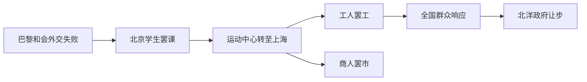

# 五四运动的历史特点及其作为中国新民主主义革命开端的原因

## 五四运动是什么

五四运动发生于1919年，是一次以先进青年知识分子为先锋、广大群众参与的反帝反封建爱国运动。导火线是巴黎和会拒绝中国收回山东权益的正当要求，并决定将德国在山东的权益转让给日本。

运动最初以北京学生罢课为主要形式，随后扩展到上海，并迅速发展为全国性的群众运动。运动提出“==外争主权，内惩国贼==”“拒绝在和约上签字”“废除二十一条”等口号。其中，“外争主权，内惩国贼”同时指向帝国主义和北洋军阀政府，最完整地体现了运动的性质。

## 五四运动有哪些历史特点

### 广泛的社会性和群众基础

五四运动不是少数学生或知识分子的孤立行动，而是学生、工人、商人等广大群众共同参与的运动。上海工人举行政治罢工，商人举行罢市，运动迅速扩展到全国各主要城市。

因此，题干问“运动很快发展成为全国性的爱国运动”说明什么时，答案是：==五四运动具有广泛的群众基础==。

### 工人阶级成为运动主力

运动中心由北京转移到上海以后出现了新的特点，其中最关键的是工人阶级大规模登上政治舞台。学生是先锋，但运动的中心力量逐渐由工人阶级承担。工人阶级开始以独立的政治力量参与反帝反封建斗争，这是五四运动最重要的历史特点之一。

### 彻底的反帝反封建态度

运动既反对日本侵略和列强欺凌，也反对北洋军阀政府，突破了以往改良或单纯反帝的局限。毛泽东指出，五四运动“具有彻底地反帝国主义和反封建主义的态度”。

### 新的社会力量和新的思想传播

运动促进了工人阶级队伍的壮大，也推动新思想、新文化和新知识的传播。工人罢工使马克思主义得到进一步传播，先进知识分子开始把改造社会的希望寄托于工人阶级，工人运动逐渐成为传播马克思主义的重要途径。

## 为什么它是新民主主义革命的开端

1919年以前，中国近代革命主要属于资产阶级民主革命范畴，如太平天国运动、戊戌变法和辛亥革命，其领导力量主要是农民阶级和资产阶级。五四运动则出现了新的阶级基础、领导力量和思想武器，因而成为中国新民主主义革命的开端。

| 方面 | 旧民主主义革命 | 五四运动 |
|---|---|---|
| 主要领导力量 | 农民阶级、资产阶级 | 工人阶级开始成为主力 |
| 群众基础 | 相对有限 | 具有广泛社会性和群众基础 |
| 思想武器 | 资产阶级民主主义 | 马克思主义逐步传播 |
| 斗争目标 | 反对君主专制和封建制度 | 同时反帝、反封建 |

> [!IMPORTANT]
> 五四运动成为新民主主义革命开端，最主要的依据是==无产阶级成为运动主力==，而不是运动由学生发动。

需要注意的是，推动这一转变的根本因素是近代以来中国民族资本主义的发展。它促使民族资产阶级和无产阶级进一步壮大，为新的革命力量和新的革命运动提供了经济与阶级基础；新文化运动、马克思主义传播和俄国十月革命则为这一转变提供了思想条件和外部影响。

## 与新文化运动的局限相区别

新文化运动高举“民主”和“科学”两面旗帜，猛烈抨击封建旧道德、旧文化，促进思想解放，为五四运动作了思想准备。但前期新文化运动的主要倡导者是资产阶级激进民主主义者，其局限在于：

- 对传统文化持简单否定态度，未能作出科学的历史评价；
- 较多关注思想文化问题，对政治问题和社会改造关注不足；
- 没有充分发动人民群众；
- 对新的革命道路和新的社会力量缺乏成熟认识。

> [!WARNING]
> 不能把“反封建”简单等同于“完全否定传统文化”。新文化运动批孔的主要对象是维护封建统治的儒家传统道德。

## 解题判断

题目问：“五四运动成为中国新民主主义革命开始的标志，最主要的依据是什么？”

正确答案是：**无产阶级成为运动主力**。

理由是：辛亥革命虽然推翻了清朝统治，但仍属于资产阶级民主革命；五四运动中，工人阶级开始以独立的政治力量登上历史舞台，并成为运动主力，由此出现了区别于旧民主主义革命的新特征。

> [!TIP]
> 记忆口诀：==学生是先锋，工人成主力；反帝又反封建，标志新民主==。
