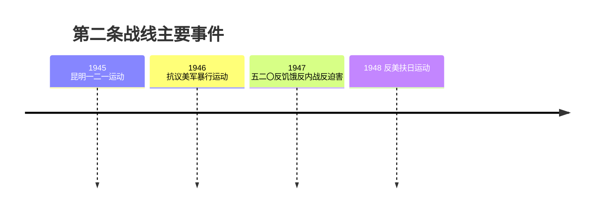
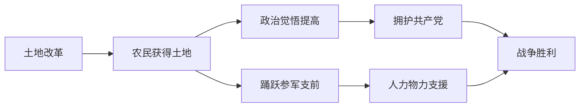

# 人民解放战争的胜利发展与第二条战线的形成
抗战胜利后，中国面临两种命运的选择。国民党坚持独裁内战，共产党力争和平民主。当全面内战爆发后，战场上的军事较量与国统区的政治斗争相互交织，共同推动着中国革命走向胜利。

### 为什么说国民党“自己把自己打垮了”

国民党在抗战后期就已严重丧失人心。抗战胜利时，原沦陷区人民曾对它抱有期待，但接收大员把“接收”变成了“劫收”，疯狂侵吞国家财产、搜刮民脂民膏。更致命的是，国民党违背人民休养生息的意愿，执意发动内战。为了筹措军费，它滥发纸币，造成恶性通货膨胀，工农业生产急剧萎缩——城市中产阶级的积蓄一夜化为乌有，农民被苛捐杂税压得喘不过气。

> [!IMPORTANT]
> ==国民党陷入全民包围的根本原因，在于其专制独裁统治与反人民的内战政策==。它将全国各阶层人民推到了饥饿与死亡的边缘，迫使人民别无选择，只能起来同它斗争。这为第二条战线的形成提供了社会土壤。

### 第二条战线：战场之外的另一种“战争”

所谓“第二条战线”，是相对于人民解放军在军事上的第一条战线而言。它在国统区以学生运动为先导，以工农斗争为基础，汇成反对国民党统治的第二条战线。

1945年底昆明学生发起“一二一”运动，揭开序幕；1946年底因美军暴行引发全国性抗暴运动；1947年5月20日，南京、上海等地学生掀起“反饥饿、反内战、反迫害”运动，迅速席卷全国。与此同时，城市工人罢工、市民抢米风潮频发，农村民变蜂起。

> [!TIP]
> 记忆口诀：**“一二一开序幕，抗暴接着来，五二〇掀高潮。”** 第二条战线以学生运动为先导，关键是它使国民党陷入“前方军事失利、后方民心尽失”的双重崩溃。

### 解放区“翻身”：土地改革怎样为战争供血

先在思想上想一个简单的问题：解放军正规军从抗战胜利时约127万发展到1948年秋的280万，新增的兵力从哪来？粮食、被服、担架队又靠谁来提供？答案在土地。

1946年5月4日，中共中央发布《关于土地问题的指示》（==五四指示==），决定将减租减息改为“耕者有其田”。1947年下半年，解放区已有2/3区域基本实现耕者有其田，但仍有1/3未进行土改，已进行的也不够彻底。为此，1947年7月至9月，中共中央在西柏坡召开全国土地会议，通过了==《中国土地法大纲》==。

> [!IMPORTANT]
> 《中国土地法大纲》明确规定：==“废除封建性及半封建性剥削的土地制度，实行耕者有其田的土地制度”==。这是一个彻底反封建的土地革命纲领。

土改初期曾出现侵犯中农利益、破坏工商业等“左”的错误，中共中央发现后立即纠正，运动重回正轨。到1948年秋，约==1亿人口==的解放区消灭了封建生产关系。

### 党的土地政策三次演变与贡献

从土地革命到解放战争，中国共产党的土地政策因时而变，但“依靠农民、解放农民”的逻辑一以贯之：

| 时期 | 政策核心 | 作用 |
|------|---------|------|
| 土地革命（1931） | 没收地主土地，按人口平分 | 调动农民生产与参军积极性 |
| 抗日战争 | 减租减息、交租交息 | 团结地主抗日，兼顾农民利益 |
| 解放战争 | 耕者有其田（五四指示→土地法大纲） | 彻底消灭封建土地制度 |

> [!NOTE]
> 抗日战争时期不没收地主土地，不是政策“倒退”，而是民族矛盾上升为主要矛盾时的策略调整——既要照顾农民，又要联合地主抗日。解放战争时期阶级矛盾重新尖锐，政策随即转向彻底废除封建剥削。

### 一个算对了的简答示例

**问：新中国成立前，共产党的土地政策发生了怎样的变化？为中国革命胜利作出了什么贡献？**

答：土地革命战争时期，没收地主阶级土地，按人口平分土地，充分调动了广大农民发展生产和参军参战的积极性。抗日战争时期，实行地主减租减息、农民交租交息的政策，既联合了地主阶级抗日，又提高了农民的抗日和生产积极性。解放战争时期，废除封建性及半封建性剥削的土地制度，实行耕者有其田的制度，将农民团结在中国共产党周围，为打败蒋介石、建立新中国奠定了深厚的群众基础。

> [!WARNING]
> 答题时不要只写“土地政策变了”，必须点明每个时期的==具体政策内容==与==对应贡献==。三个时期一一对应，缺一不可。

### 常见的坑

- **混淆五四指示与《中国土地法大纲》**：五四指示是1946年的过渡性文件，提出“耕者有其田”的方向；《中国土地法大纲》是1947年的正式纲领，明确废除封建土地制度。两者是一个演进关系，不是一回事。
- **把第二条战线理解为军事上的第二战场**：第二条战线是指==国统区的群众斗争==，不是战场上的第二方向。考试中若问“第二条战线指的是什么”，答“学生运动和人民民主运动”才是对的。
- **忽视纠错机制**：土改初期有“左”的错误，中共中央主动纠正，这一点常被用来考查学生对运动全貌的理解。
