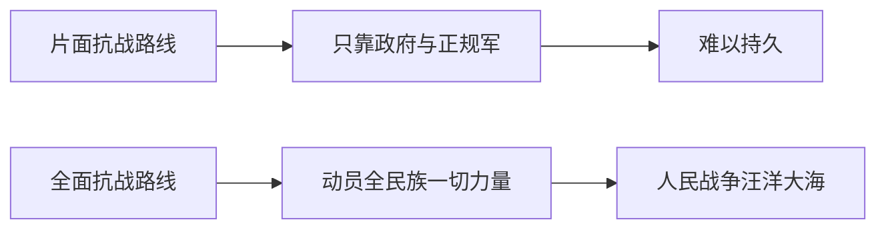
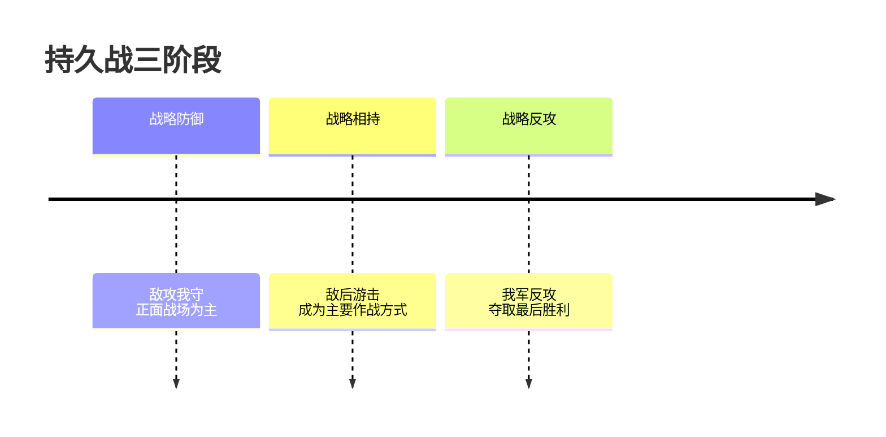

# 中国共产党的全面抗战路线与持久战的战略总方针

## 全面抗战路线与持久战的战略总方针

抗日战争全面爆发后，一个问题摆在所有人面前：中国能不能打赢？如果能，靠什么打赢？

当时流行两种错误论调：“亡国论”认为中国武器不如人，打下去必亡；“速胜论”则幻想依靠外援或国民党正规军迅速取胜。二者都指向同一个危险后果——如果战略判断错了，就会动摇抗战信心，或者把希望全部寄托于正面决战。正是在这样的背景下，中国共产党提出了自己的回答：==坚持全面抗战路线，实行持久战的战略总方针==。

### 两条抗战路线的分歧

国民党实行的是**片面抗战路线**：只依靠政府和军队，不敢放手发动群众。

共产党主张的是**全面抗战路线**：动员全民族一切力量，发动群众、组织群众、武装群众，使抗日战争成为真正的人民战争。

两者的根本区别不在于“抗不抗日”，而在于==依靠谁==来抗日。

### 持久战的战略总方针

毛泽东在 1938 年发表《论持久战》，系统回答了“为什么是持久战”和“怎样进行持久战”。

他分析中日双方有四个相互矛盾的基本特点：

| 方面 | 日本 | 中国 |
|------|------|------|
| 国力军力 | 强 | 弱 |
| 战争性质 | 退步、野蛮 | 进步、正义 |
| 国际支持 | 寡助 | 多助 |
| 国土与人力 | 小国，经不起长期消耗 | 大国，能够支持长期战争 |

第一个特点决定了中国不可能速胜，后三个特点决定了中国不会亡。因此结论是：==抗日战争是持久的，最后胜利属于中国==。

《论持久战》还科学预见了抗战发展的三个阶段：

> [!IMPORTANT]
> 战略相持阶段是整个战争的枢纽。能否熬过相持阶段，关键在于敌后战场能否坚持和发展——这正是游击战上升到战略地位的原因。

### 游击战为什么具有战略地位

一般战争中，游击战只是战术问题、辅助手段。但在中国抗日战争中，共产党把游击战==提高到战略地位==，原因是：中国是一个大国、弱国，敌人占地广而兵力不足，在敌后留下了广阔空隙。

> [!TIP]
> 记忆要点：防御阶段游击战是“辅助但关键”，相持阶段游击战是“主要作战方式”。

**战略防御阶段**：正面战场的正规战是主要的，敌后游击战是辅助的。但游击战在敌后广泛开展、开辟抗日根据地，迫使日军把进攻兵力抽调回来保守占领区，从而==减轻了正面战场压力，使战争能够转入相持阶段==。

**战略相持阶段**：日军将主要兵力用于打击敌后人民军队，仅 1939 年至 1940 年华北地区千人以上“扫荡”就达 109 次。此时敌后游击战争==成为主要的抗日作战方式==。人民军队以游击战为主、有利条件下辅以运动战——如 1940 年的百团大战即是运动战的典型。游击战的任务是削弱敌人、壮大自己，逐步改变敌强我弱的态势，为战略反攻准备条件。

> [!WARNING]
> 常见误区：认为百团大战说明相持阶段以运动战为主。实际上，百团大战只是有利条件下的局部运动战，人民军队在大部分时间里进行的仍是游击战。

### 一个易混淆点的辨析

| 问题 | 正确理解 |
|------|----------|
| 游击战是不是“小打小闹”？ | 不是。在全民族抗战中，它是被提升到战略层面的全局性作战方式 |
| 相持阶段游击战和正规战谁主谁次？ | 敌后游击战成为主要抗日作战方式 |
| “中流砥柱”体现在哪里？ | 倡导抗日民族统一战线、提出持久战方针、开辟敌后战场、共产党员先锋模范作用 |

> [!NOTE]
> “中国共产党是抗战的中流砥柱”这一论断，正是由全面抗战路线、持久战方针和敌后游击战实践共同支撑起来的。答题时要把这三条线索串起来，而不是只背结论。
