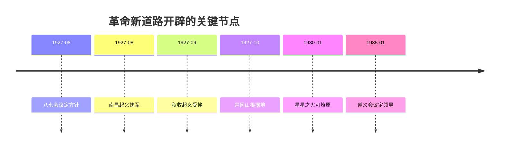

# 以毛泽东为代表的中国共产党人开辟“农村包围城市、武装夺取政权”革命新道路的理论与实践

## 为什么城市中心行不通

1927 年大革命失败后，国民党在中心城市建立了严密的白色恐怖统治。如果继续照搬苏俄“中心城市暴动”的模式，只会把革命力量消耗殆尽。那么，敌人统治最薄弱的地方在哪里？——在**农村**，尤其是在几省交界的山区。于是，以毛泽东为代表的中国共产党人被迫把武装力量拉上山，却由此开辟出了一条符合中国国情的革命新道路。

> [!IMPORTANT]
> 新道路的完整表述是==**农村包围城市、武装夺取政权**==。它是指以农村为工作重点，发动农民进行土地革命，开展武装斗争，建设革命根据地，最终夺取全国政权。

## 实践探索：从起义到根据地

1927 年 8 月，八七会议确定了**土地革命**和**武装反抗国民党**的方针。随后，党领导了南昌起义、湘赣边界秋收起义、广州起义。南昌起义打响了武装反抗国民党反动派的第一枪，标志着中国共产党独立领导革命战争、创建人民军队的开端。

秋收起义进攻长沙受挫后，毛泽东果断率部转向敌人统治薄弱的农村山区，于 1927 年 10 月创建了**井冈山革命根据地**——这是中国共产党开创的第一块农村革命根据地。

## 理论升华：三篇文章与三大法宝

毛泽东不仅在实践中首先把革命进攻方向指向农村，而且从理论上阐明了武装斗争的极端重要性和农村作为党工作中心的思想。

| 著作 | 时间 | 核心观点 |
|------|------|----------|
| 《中国的红色政权为什么能够存在？》《井冈山的斗争》 | 1928 年 | 科学阐明**土地革命、武装斗争、根据地建设**三者辩证统一关系 |
| 《星星之火，可以燎原》 | 1930 年 | 红军和红色区域是半殖民地中国农民斗争的==最高形式==，是促进全国革命高潮的最重要因素 |

这三者为何缺一不可？没有土地革命，农民不会真心支持；没有武装斗争，根据地守不住；没有根据地，武装斗争就成了流寇主义。三者结合，就形成了“工农武装割据”。

## 与相近概念的区别

- **与“城市中心论”的区别**：不是先占城市再取农村，而是==先在农村积蓄力量，最后夺取城市==。
- **与旧式农民战争的区别**：有无产阶级（共产党）领导，有马克思主义指导，有根据地建设，不是简单的流动作战。

> [!WARNING]
> 易错点：不要写成“农村革命根据地是革命的唯一形式”。准确说法是：红军游击战争实际上已经成为中国革命的==主要形式==，农村根据地成为积蓄和锻炼革命力量的主要战略阵地。

## 历史意义

农村包围城市、武装夺取政权理论，是对 1927 年革命失败后红军和根据地斗争经验的科学概括，是毛泽东为代表的中国共产党人同党内把马克思主义教条化、把共产国际和苏联经验神圣化的错误倾向坚决斗争的结果。它的提出，标志着==中国化的马克思主义——毛泽东思想的初步形成==。

> [!TIP]
> 答题模板：如果考到“如何探索和开辟新道路”，按“八七会议定方针→三大起义→转向农村建根据地→三篇著作理论升华→毛泽东思想初步形成”的逻辑链展开，即可覆盖全部得分点。
