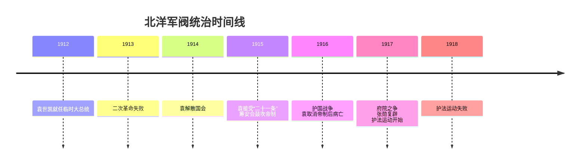
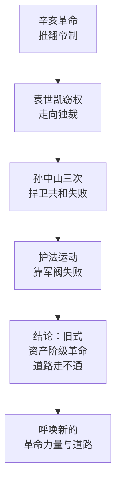

# 北洋军阀的统治与旧民主主义革命的终结

## 从“共和”到“乱局”：北洋军阀如何终结旧民主主义革命

辛亥革命赶跑了皇帝，但中国并没有因此走上坦途。孙中山把临时大总统的位置让给袁世凯，本希望换取共和的稳固，结果迎来的却是长达十余年的军阀混战。理解这一段历史，关键是抓住一条主线：==旧民主主义革命的山穷水尽，恰恰来自“有民国之名，无民国之实”==。

先问一个问题：袁世凯手握北洋军，为什么能接替孙中山？表面上是“南北议和”达成的妥协，深层原因是当时国内外的势力都认为**只有袁世凯能维持秩序**。列强需要稳定来保护在华利益，立宪派和旧官僚害怕革命继续扩大，革命党人自身力量又不足以北伐统一。于是，袁成了各方眼中的“强人”。

### “重建秩序”还是“破坏共和”？

袁世凯的统治逻辑可以用一句话概括：以武力为后盾，以秩序为旗号，一步步清除共和制度障碍。他刺杀宋教仁、镇压二次革命、解散国会、废除《临时约法》，每一步都在把共和框架掏空，最终走向帝制。

为什么帝制会失败？不是袁世凯军事不够强，而是==辛亥革命之后，民主共和观念已经开始渗入社会心理==。当袁宣布称帝，护国战争一爆发，各省纷纷响应独立，连他手下的北洋将领都开始观望。这说明复辟在政治上已经失去了正当性——人们可以忍受一个“总统”独裁，却难以重新跪下称臣。

> [!IMPORTANT]
> 袁世凯称帝与张勋复辟的速败，共同原因都是不限于军事层面：辛亥革命已经摧毁了帝制的正当性根基，谁复辟谁就站到了历史潮流的对立面。

### 府院之争：不是个人意气，是列强角力

袁世凯死后，北洋集团失去统一权威，分裂为直系、皖系、奉系。1917 年的“府院之争”，表面上是总统黎元洪与总理段祺瑞在“是否参加一战”上的冲突，实质上反映的是==美日在华控制权之争==——直系背后有英美支持，皖系背后是日本。这一斗争的激化直接引发张勋复辟，段祺瑞又借“讨逆”之名赶走张勋，掌握了北京实际权力，却在战后拒绝恢复国会和《临时约法》。

### 孙中山为什么“山穷水尽”？

孙中山的三次捍卫共和努力——二次革命、护国运动、护法运动，有一个递进的觉醒过程：

| 运动 | 时间 | 反对对象 | 主要依靠力量 | 结果与教训 |
|------|------|----------|-------------|------------|
| 二次革命 | 1913 | 袁世凯独裁 | 国民党地方实力派 | 迅速失败，力量涣散 |
| 护国运动 | 1915—1916 | 袁世凯称帝 | 蔡锷等地方实力派、西南军阀 | 推倒袁，但政权仍归北洋 |
| 护法运动 | 1917—1918 | 段祺瑞拒绝恢复约法 | 西南军阀 | 军阀之间相互勾结，失败 |

护法运动的失败最具转折意义。孙中山在广东召集“护法军政府”，实际权力却掌握在桂系、滇系军阀手中，他们不愿真正北伐。孙中山愤而指出：“南与北如一丘之貉。”这句话不是情绪发泄，而是认识到==军阀问题的本质，不在于“南方”还是“北方”，而在于他们都把军队当作私产、把战争当作生意==。

> [!WARNING]
> 常见误区：把护法运动失败归结为“孙中山没有军队”。更深层原因是孙中山把维护共和的任务寄托在军阀身上，而军阀本身恰恰是共和制度的破坏者。

### 旧民主主义革命为何“终结”

这里需要辨析一下概念：旧民主主义革命≠辛亥革命，而是**从鸦片战争到五四运动前，由中国资产阶级领导的、以建立资本主义和民主共和为目标的反帝反封建革命**。二次革命、护国运动、护法运动的连续失败，实际上宣告了这条道路的封闭：

- 民族资产阶级太弱小，既不敢动员底层群众，又无法组织独立武装；
- 帝国主义与封建军阀互相勾结，形成反动联盟；
- 革命党内部组织涣散，缺乏统一纲领和纪律。

> [!TIP]
> 遇到综合性题目，判断“孙中山领导的这次斗争属于什么性质”：二次革命、护国运动、护法运动都属于==维护辛亥革命成果、反对北洋军阀的旧民主主义革命==。它们的共同点是“都反对北洋军阀、都为维护共和、都没有成功”；区别在于失败的具体原因各不相同——二是力量涣散、护是以军阀制军阀不彻底、法是彻底认清军阀本质。

### 一个计算题式的逻辑验证

以南邮考过的选择题为例：武昌起义成功后建立的政权是哪个？如果只记“南京临时政府”这个最终结果，就会掉进选项陷阱。正确思维路径是：

**武昌起义（1911 年 10 月）→ 起义军控制武汉，需要稳定局势 → 成立地方性军政府 → 湖北军政府（黎元洪任都督）→ 起义各省代表会议召开 → 最后在南京成立中华民国临时政府**。所以做这类题的关键是注意==时间先后顺序和地方政权与中央政权的区别==，而不是凭印象套用“辛亥革命建立的政权就是南京临时政府”这个模糊记忆。

北洋军阀的这段历史看似混乱，实则有一条清晰的因果链：共和制度缺失实现土壤→军阀各自寻找列强靠山→孙中山依靠军阀反军阀屡试屡败→旧民主主义革命道路被证伪。下一站，就是新文化运动和五四运动带来的全新可能。
