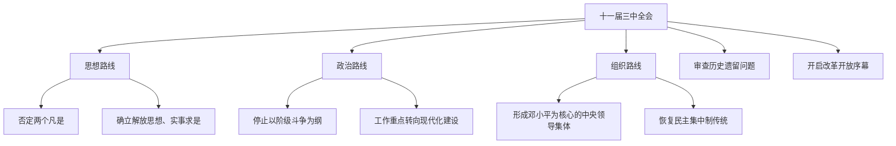

# 中共十一届三中全会是新中国成立以来伟大历史转折的原因及内容

# 中共十一届三中全会：新中国成立以来的伟大历史转折

## 为什么一次会议能被称为“伟大转折”

判断一次会议是否具有“历史转折”意义，关键看它是否**同时**改变了三条路线：思想路线、政治路线、组织路线。粉碎“四人帮”后的两年里，党和国家的工作出现了“徘徊中前进”的局面——想走出“文革”阴影，却始终被“两个凡是”束缚着。十一届三中全会的转折性，就在于它一举打破了这种徘徊。

> [!IMPORTANT]
> 十一届三中全会是新中国成立以来==伟大历史转折==，因为它实现了三条路线的拨乱反正，结束了粉碎“四人帮”后的两年徘徊局面，揭开了改革开放的序幕。

## 会议的核心内容：三重拨乱反正

会议内容可以概括为“一条主线、三重拨乱反正、一个序幕”。下面这张图展示了核心逻辑：

### 思想路线的拨乱反正

全会==彻底否定“两个凡是”的错误方针==，重新确立了解放思想、实事求是的指导思想。

### 政治路线的拨乱反正

全会==果断停止使用“以阶级斗争为纲”的口号==，作出把党和国家工作重点转移到社会主义现代化建设上来的战略决策。这是整个转折中最具决定性的一步——它决定了此后几十年中国发展的基本方向。

### 组织路线的拨乱反正

全会形成了以邓小平为核心的党中央领导集体，恢复了党的民主集中制优良传统，并提出使民主制度化、法律化的重要任务。与此同时，全会开始审查和解决历史上遗留的一批重大问题和重要领导人的功过是非，==开始了系统清理重大历史是非的拨乱反正==。

> [!TIP]
> 记忆口诀：**“思、政、组”三条线，外加“审历”与“开改”**。三条路线是骨架，审查历史是清账，改革开放是新篇。

## 近义概念辨析：不要混淆这两个问题

| 易混点 | 正确理解 |
|---|---|
| “两个凡是”的内容 | 凡是毛主席作出的决策，我们都坚决维护；凡是毛主席的指示，我们都始终不渝地遵循 |
| 十一届**三**中全会与十一届**六**中全会 | 三中全会（1978）实现转折；六中全会（1981）通过《关于建国以来党的若干历史问题的决议》，科学评价毛泽东和毛泽东思想 |
| “以阶级斗争为纲”的**停止**与“阶级斗争**不再存在**” | 全会停止使用这个口号，不等于否认阶级斗争在一定范围内长期存在 |

> [!WARNING]
> 答题时如果只写“实现了伟大转折”而不展开==具体内容（三条路线+审查历史+改革开放序幕）==，在简答题中会严重失分。转折的意义必须用扎实的内容来支撑。

## 一个算对了的例子

**问：为什么说中共十一届三中全会是新中国成立以来的伟大历史转折？**

完整答案要素展开如下：

（1）思想路线：彻底否定“两个凡是”，重新确立解放思想、实事求是的指导思想，实现了思想路线的拨乱反正。

（2）政治路线：果断停止使用“以阶级斗争为纲”的口号，作出工作重点转移的决策，实现了政治路线的拨乱反正。

（3）组织路线：形成以邓小平为核心的党中央领导集体，取得组织路线拨乱反正的最重要成果；恢复民主集中制，提出民主制度化、法律化。

（4）历史清理：审查和解决历史上遗留的一批重大问题和重要领导人的功过是非，开始系统清理重大历史是非。

（5）总体评价：==结束了粉碎“四人帮”后两年在徘徊中前进的局面==，揭开了改革开放的序幕，开辟了建设中国特色社会主义的新道路，标志着中国进入改革开放和社会主义现代化建设的历史新时期。

> [!CAUTION]
> 千万不要只堆砌“伟大转折”“深远意义”这类形容词。阅卷给分看的是**具体内容点**：两条路线（思想、政治）各写了什么、组织上形成了什么核心、历史问题怎么处理的、最终“结束徘徊+开启新时期”的总体定性。
