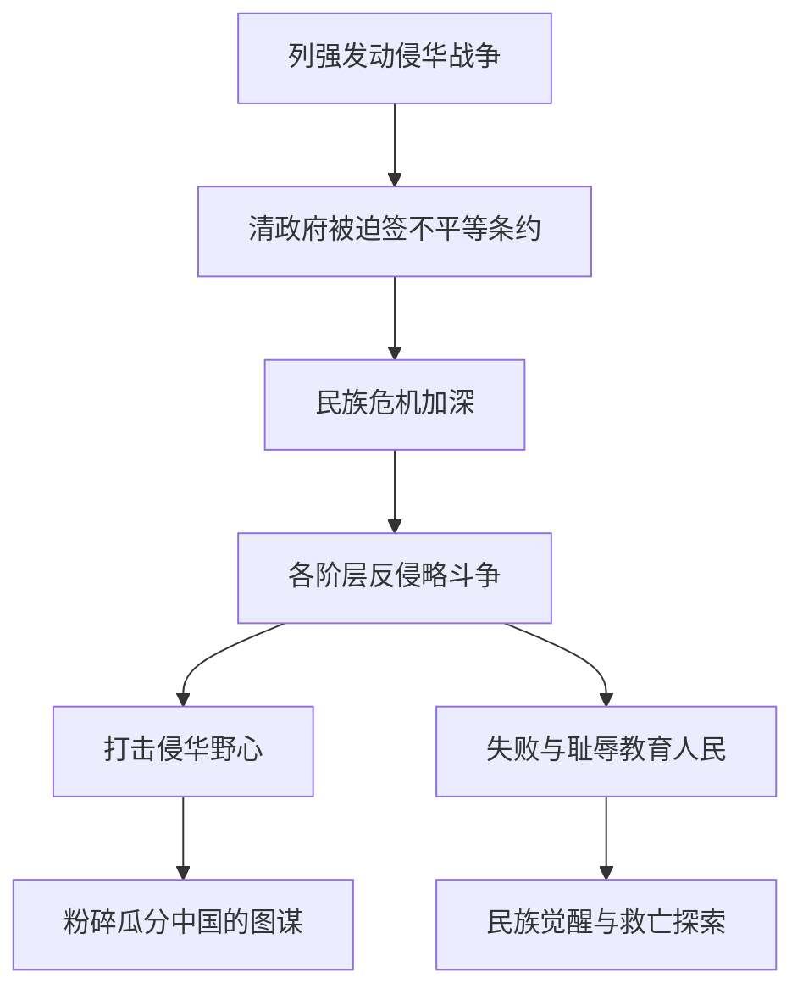
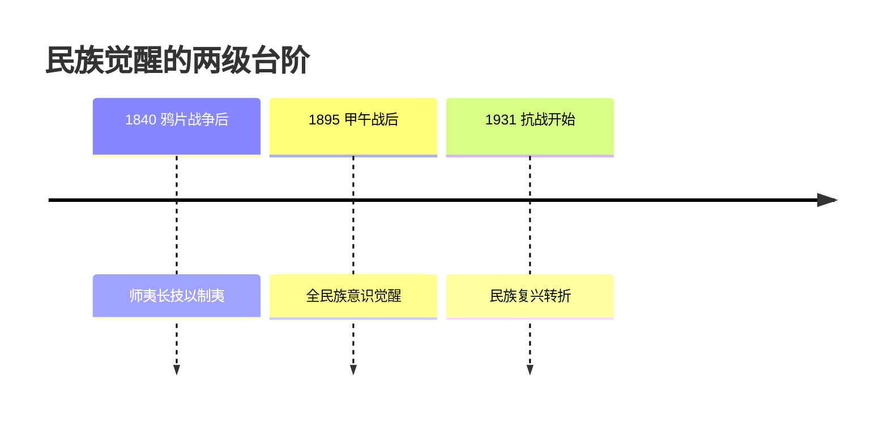

# 近代中国人民反侵略战争的历史意义

## 一、它是什么

“近代中国人民反侵略战争的历史意义”，指的是 1840 年鸦片战争以来，中国人民为抵御外国资本主义—帝国主义的军事侵略、瓜分和奴役而进行的一系列斗争（太平天国运动中对外来侵略的抵抗、三元里抗英、义和团运动、甲午战后各阶层的救亡斗争，直至 1931 年后的抗日战争）所产生的历史作用。

简答题的评分要点其实只有两句话：

- 第一：沉重打击了帝国主义侵华野心，粉碎了瓜分中国、灭亡中国的图谋；
- 第二：教育了人民，振奋了民族精神，大大提高了民族觉醒意识。

## 二、为什么需要反侵略战争：侵略与反侵略是一对孪生兄弟

先看帝国主义的侵略逻辑：列强发动侵华战争，绝不仅仅是为了通商，而是为了掠夺资源、扩大殖民地、输出资本利益。每一次战争都伴随着更大的贪婪目的，而每一次战争都必然遇到中国人民的反抗。

> [!TIP]
> 记忆链条：侵略 → 激起反抗 → 反侵略斗争打碎野心 → 列强承认“很难征服”

列强虽然能强迫清政府签订一个又一个不平等条约（《南京条约》《天津条约》《马关条约》等，一步步剥夺关税自主权、割地赔款、开设租界、攫取在华政治经济特权），但始终无法把中国变成完全的殖民地。尤其甲午战争后瓜分狂潮兴起，中国各阶层人民救亡图存的探索与奋起抗争，使侵略者看到了中国人民“不甘屈服的伟大力量”，不得不放弃瓜分中国的政策。

## 三、和“列强之间矛盾”相比：谁才是根本原因

这是最容易混淆的辨析点。

| 因素 | 作用 | 地位 |
|---|---|---|
| 列强之间的矛盾、互相制约 | 客观上使瓜分未能实现 | 重要原因，非根本原因 |
| 中国人民不屈不挠的反侵略斗争 | 使列强不敢为所欲为 | ==根本原因== |

> [!CAUTION]
> 辨析题高频陷阱：“列强矛盾是瓜分破产的根本原因”——错。列强在瓜分非洲、东南亚时同样存在利害冲突，却照样完成了瓜分；所以矛盾与妥协不是根本原因，正义的反侵略斗争才是。

义和团运动最能说明这一点：它以不畏强暴、敢与敌人战斗到底的英雄气概打击和教训了帝国主义者，粉碎了列强瓜分中国的迷梦，向世界显示了中华民族反抗外来压迫的无穷力量。

## 四、第二个意义：从反面教育人民，推动民族觉醒

“没有哪一次巨大的历史灾难不是以历史的进步作为补偿的。”侵华战争和反侵略战争的失败，从反面教育了中国人民，极大地促进了中国人民的思考、探索和奋起。

- **鸦片战争后**：先进中国人痛定思痛，了解国际形势，研究外国历史地理，总结失败教训，寻找救国御敌之道，于是有“师夷长技以制夷”思想的提出。
- **甲午战争后**：帝国主义的瓜分狂潮与民族危机刺激全民族，使普遍的民族意识开始觉醒，救亡图存思想日益高涨。

> [!IMPORTANT]
> 核心结论：反侵略战争的意义是“双重的”——对外**打碎了列强瓜分中国的图谋**，对内**催生了民族觉醒**。前者是胜利层面的意义，后者是失败层面的意义，二者缺一不可。

## 五、常见坑速查

> [!WARNING]
> 1. 不要把“反侵略战争的意义”和“太平天国运动”“义和团运动”的性质评价混为一谈。义和团是“打着反清旗号反洋人”的朴素爱国运动，它**粉碎了瓜分迷梦、显示了反抗力量**，但“阻止了中国半殖民地化进程”这一说法不准确，不能算作反侵略战争的意义。
> 2. 不要漏掉“教育了人民、振奋了民族精神、提高民族觉醒意识”这一层，只答“打击了野心”会被扣分。
> 3. 不要把“列强之间的矛盾”当作根本原因。

## 六、一道题验证理解

题：近代中国人民的反侵略战争（多选）。

A. 沉重地打击了资本—帝国主义列强的侵华野心；
B. 使我们的国家和民族历尽劫难、屡遭侵略而不亡；
C. 它表现出来的爱国主义精神，铸成了中华民族的民族魂；
D. 反侵略战争的失败，从反面教育了中国人民，极大地促进了中国人的思考、探索和奋起，反侵略战争的过程，是中华民族逐步觉醒的过程。

答案：ABCD。

对照要点：A 属第一层意义（打击野心），B、C 属民族精神层面的意义，D 属第二层意义（教育人民、唤醒觉醒）——四个选项恰好把答题要点全覆盖，因此答题时应把“双重意义”写全。

> [!TIP]
> 考场速记版：反侵略战争的意义 = **打野心**（粉碎瓜分图谋）+ **唤觉醒**（教育人民、振奋民族精神）。
