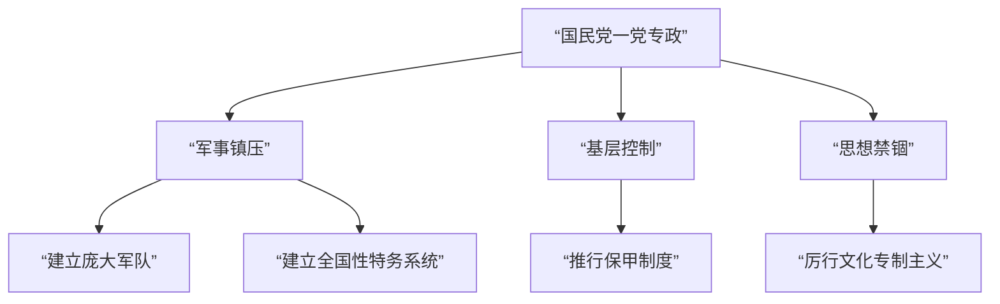

# 国民党一党专政的具体表现与南京国民政府的性质
1927年“四一二”反革命政变后，蒋介石在南京另立“国民政府”。1928年东北易帜，南京国民政府在形式上统一了全国。要理解这个政权，可以从一个最核心的问题切入：**它到底代表谁的利益？**

> [!IMPORTANT]
> 南京国民政府的性质是 ==大地主大资产阶级政权==，它所实行的是 ==代表地主阶级、买办性大资产阶级利益的一党专政和军事独裁统治==。

这里的“买办性大资产阶级”，指的是依附于外国垄断资本、充当其掠夺中国市场代理人的大资产阶级。因此，这个政权对内压迫人民，对外则长期奉行对帝国主义妥协、依赖的政策。

### 一党专政的具体表现

国民党是如何将这一专政体制落到实处呢？主要通过三大支柱和一个思想牢笼：

**一、建立庞大的军队和全国性特务系统**

这是专政的武力保障。军队用于“剿共”和消灭异己军阀；特务系统，如“中统”和“军统”，则渗透到社会各个角落，监视、绑架、暗杀反对者，制造白色恐怖。其目的就是 ==镇压人民和消灭异己力量==。

**二、推行保甲制度**

这是从基层控制人民的枷锁。规定十户为甲，十甲为保，分设甲长、保长。保甲内各户实行“连坐”，一户“犯法”，各户株连。这样一来，国民党的统治触角就直接伸到了每家每户的门口，目的是 ==控制人民，禁止革命活动==。

**三、厉行文化专制主义**

这是禁锢思想的牢笼。国民党剥夺人民的言论和出版自由，查封进步报刊，迫害进步文化工作者，大肆宣传封建思想和法西斯主义，其目的就是 ==控制舆论，剥夺人民的言论和出版自由==。

### 概念辨析与常见坑

>[!WARNING]
> **常见坑：把南京国民政府误认为“资产阶级政权”。**
> 中国的民族资产阶级力量弱小，具有两面性，从未真正掌握过政权。南京国民政府虽然口头上标榜“三民主义”，但实际上保护的是大地主和买办大资产阶级的利益，民族资产阶级在政治上始终受其排挤。因此，这道选择题的答案必须是 **D. 大地主大资产阶级政权**。

### 结合抗战胜利后崩溃的原因

这套专政机器，在抗战胜利后为何会迅速走向崩溃呢？这里的逻辑链很清晰：

>[!NOTE]
> **腐败与违背民心是致命伤。**
> 1.  **专制腐败丧失人心**：国民党的独裁本性，使得其官员在抗战后期大发国难财。胜利后的“接收”变成了“劫收”，让沦陷区人民彻底失望。
> 2.  **内战政策祸国殃民**：它违背人民休养生息的意愿，执意发动内战。为筹措军费，==滥发纸币，导致恶性通货膨胀==，使民族工商业倒闭，人民置于饥饿和死亡线上。

这样，以“一党专政”为内核的政权，最终就将自己置于全民的对立面，它的迅速崩溃也就在所难免了。
